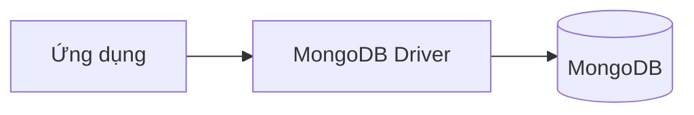

# Học MongoDB

Site tài liệu tiếng Việt về MongoDB, xây dựng bằng Next.js 16 và Fumadocs.

## Chạy local

```bash
npm install
npm run dev
```

Mở <http://localhost:3000/docs>.

## Kiểm tra

```bash
npm run lint
npm run types:check
npm run build
```

Build static được xuất vào `dist/`. Có thể preview hoặc deploy lên Cloudflare Pages:

```bash
npm run preview
npm run deploy
```

## Mermaid diagrams

Mermaid đã được cấu hình với hỗ trợ light/dark theme. Chèn diagram trực tiếp bằng fenced code block:

````mdx

````

Plugin trong `source.config.ts` sẽ tự chuyển code block thành component Mermaid.

## Nội dung

Các bài trong `content/docs/` hiện là placeholder. Hãy điền chi tiết từng bài ở lượt viết tiếp theo.
