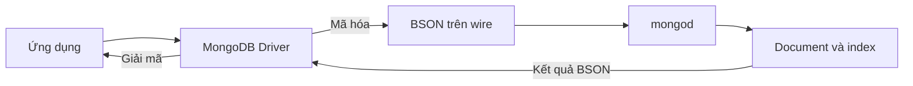

import { Step, Steps } from 'fumadocs-ui/components/steps';
import { Tab, Tabs } from 'fumadocs-ui/components/tabs';

<Callout type="info" title="Phạm vi và môi trường mẫu">
  Bài này giải thích BSON, các kiểu dữ liệu thường dùng và cách chúng đi qua
  `mongosh`, MongoDB Driver và JSON API. Ví dụ dùng cú pháp JavaScript của
  `mongosh`. Cú pháp constructor trong một driver cụ thể có thể khác, nhưng
  BSON type ở phía MongoDB vẫn là cùng một khái niệm.
</Callout>

## Mục lục

- [BSON là gì](#bson-là-gì)
  - [JSON chỉ là lớp biểu diễn](#json-chỉ-là-lớp-biểu-diễn)
  - [BSON trong đường đi của document](#bson-trong-đường-đi-của-document)
- [Bản đồ các kiểu dữ liệu BSON](#bản-đồ-các-kiểu-dữ-liệu-bson)
  - [Kiểu giá trị cơ bản](#kiểu-giá-trị-cơ-bản)
  - [Document và array](#document-và-array)
  - [Kiểu đặc biệt và kiểu legacy](#kiểu-đặc-biệt-và-kiểu-legacy)
- [Kiểu số chọn đúng độ rộng và độ chính xác](#kiểu-số-chọn-đúng-độ-rộng-và-độ-chính-xác)
  - [Double Int32 và Int64](#double-int32-và-int64)
  - [Decimal128 cho tiền và số thập phân](#decimal128-cho-tiền-và-số-thập-phân)
  - [Constructor trong mongosh](#constructor-trong-mongosh)
  - [Đừng trộn kiểu số tùy ý](#đừng-trộn-kiểu-số-tùy-ý)
- [Các kiểu dữ liệu quan trọng trong ứng dụng](#các-kiểu-dữ-liệu-quan-trọng-trong-ứng-dụng)
  - [ObjectId cho định danh](#objectid-cho-định-danh)
  - [Date cho thời điểm](#date-cho-thời-điểm)
  - [Timestamp không phải Date](#timestamp-không-phải-date)
  - [Boolean và Null](#boolean-và-null)
  - [String và UTF 8](#string-và-utf-8)
  - [Array và document lồng nhau](#array-và-document-lồng-nhau)
- [Binary UUID và dữ liệu đặc biệt](#binary-uuid-và-dữ-liệu-đặc-biệt)
  - [Binary data và subtype](#binary-data-và-subtype)
  - [UUID](#uuid)
  - [Regular expression](#regular-expression)
  - [JavaScript DBRef và các kiểu hiếm](#javascript-dbref-và-các-kiểu-hiếm)
- [Kiểu dữ liệu ở ranh giới JSON API](#kiểu-dữ-liệu-ở-ranh-giới-json-api)
  - [JSON thuần có thể làm mất thông tin kiểu](#json-thuần-có-thể-làm-mất-thông-tin-kiểu)
  - [Extended JSON relaxed và canonical](#extended-json-relaxed-và-canonical)
  - [Serialize và deserialize bằng EJSON](#serialize-và-deserialize-bằng-ejson)
- [Kiểm tra và truy vấn theo kiểu BSON](#kiểm-tra-và-truy-vấn-theo-kiểu-bson)
  - [Xem kiểu bằng aggregation](#xem-kiểu-bằng-aggregation)
  - [Lọc document theo kiểu dữ liệu](#lọc-document-theo-kiểu-dữ-liệu)
  - [Phân biệt field thiếu với null](#phân-biệt-field-thiếu-với-null)
  - [Type bracketing và thứ tự so sánh](#type-bracketing-và-thứ-tự-so-sánh)
- [Chọn kiểu dữ liệu trong schema](#chọn-kiểu-dữ-liệu-trong-schema)
  - [Bảng quy ước thực dụng](#bảng-quy-ước-thực-dụng)
  - [Schema validation với bsonType](#schema-validation-với-bsontype)
  - [Migration khi đổi kiểu](#migration-khi-đổi-kiểu)
- [Thực hành tạo và kiểm tra document](#thực-hành-tạo-và-kiểm-tra-document)
  - [Chuẩn bị collection](#chuẩn-bị-collection)
  - [Chèn document có nhiều kiểu](#chèn-document-có-nhiều-kiểu)
  - [Đọc kiểu và thử truy vấn](#đọc-kiểu-và-thử-truy-vấn)
- [Bẫy thường gặp](#bẫy-thường-gặp)
- [Tóm tắt](#tóm-tắt)
- [Đọc tiếp](#đọc-tiếp)

## BSON là gì

**BSON** là viết tắt của *Binary JSON*. Đây là định dạng tuần tự hóa
(serialization format) mà MongoDB dùng để biểu diễn document và truyền dữ liệu
giữa driver với server. “Binary” nghĩa là dữ liệu được mã hóa thành chuỗi byte,
không phải văn bản JSON mà con người đọc trực tiếp.

BSON giữ hình dạng document quen thuộc của JSON, nhưng mỗi value còn mang thông
tin kiểu. Một document BSON có thể nói rõ value là `Int32`, `Decimal128`,
`Date` hoặc `ObjectId`. JSON thuần không có đủ các kiểu này.

BSON cũng lưu thông tin độ dài của document và từng value. Nhờ đó, driver có
thể đọc một value mà không cần đoán kiểu từ nội dung chuỗi. Có thể hình dung một
đoạn BSON ở mức khái niệm như sau:

```text
[độ dài document]
  [kiểu][tên field][value]
  [kiểu][tên field][value]
[ký hiệu kết thúc]
```

Đây là mô hình minh họa, không phải định dạng byte đầy đủ để tự xây encoder.
Trong ứng dụng, hãy để MongoDB Driver đảm nhiệm việc mã hóa và giải mã BSON.

### JSON chỉ là lớp biểu diễn

JSON rất tiện để viết ví dụ, gửi HTTP request và xem dữ liệu. Tuy nhiên, cùng
một JSON có thể làm mất thông tin kiểu mà MongoDB cần để truy vấn chính xác.

<Tabs items={['JSON thuần', 'Document có kiểu BSON']}>
  <Tab value="JSON thuần">
    ```json
    {
      "_id": "65f1a0000000000000000101",
      "price": 19.9,
      "createdAt": "2026-03-20T08:00:00.000Z"
    }
    ```

    `price` chỉ được biết là một JSON number. `createdAt` chỉ được biết là một
    chuỗi. JSON không nói rõ `_id` là `ObjectId`, hay `createdAt` là BSON Date.
  </Tab>
  <Tab value="Document có kiểu BSON">
    ```javascript
    {
      _id: ObjectId("65f1a0000000000000000101"),
      price: Decimal128("19.90"),
      createdAt: ISODate("2026-03-20T08:00:00.000Z")
    }
    ```

    `ISODate()` là helper của `mongosh`; value thực tế là BSON Date. Tương tự,
    `Decimal128()` và `ObjectId()` tạo các BSON type tương ứng.
  </Tab>
</Tabs>

Vì vậy, JSON nên được xem là **lớp trao đổi hoặc hiển thị**. BSON là lớp có
thông tin kiểu mà MongoDB và driver dùng để lưu, truy vấn và trả kết quả.

### BSON trong đường đi của document

Khi ứng dụng ghi một document, driver chuyển object của ngôn ngữ ứng dụng thành
BSON trước khi gửi request. Server kiểm tra request, thực thi thao tác và trả
kết quả BSON về driver. Driver lại chuyển kết quả đó thành các object hoặc class
phù hợp với ngôn ngữ ứng dụng.



Sơ đồ này tách ba lớp thường bị trộn lẫn:

- **Object ứng dụng** phụ thuộc vào ngôn ngữ. Một `Date` của JavaScript, một
  `datetime` của Python và một `Instant` của Java có cách biểu diễn khác nhau.
- **BSON type** là hợp đồng ở phía MongoDB. Ví dụ, cả ba object trên có thể
  được driver chuyển thành BSON Date.
- **JSON API** là biên giao tiếp. Ở biên này, `ObjectId`, `Date`, `Decimal128`
  và binary cần một quy ước serialize riêng.

<Callout type="warn" title="Giới hạn kích thước document">
  Một BSON document có giới hạn kích thước **16 MiB**, bao gồm cả dữ liệu lồng
  nhau và overhead của BSON. Nếu một array có thể tăng không giới hạn, hãy tách
  dữ liệu thành collection khác, bucket hoặc hệ thống lưu file trước khi document
  tiến gần giới hạn này.
</Callout>

## Bản đồ các kiểu dữ liệu BSON

BSON có các kiểu cho giá trị đơn, cấu trúc lồng nhau và một số giá trị phục vụ
hạ tầng MongoDB. Khi dùng `$type` hoặc `bsonType` trong schema validation, bạn có
thể dùng alias dạng chuỗi như `"date"`, `"objectId"` hoặc `"decimal"`.

### Kiểu giá trị cơ bản

Bảng dưới đây tập trung vào các kiểu thường xuất hiện trong ứng dụng:

| BSON type | Alias thường dùng | Dùng cho | Ghi chú |
| --- | --- | --- | --- |
| Double | `double` | Số thực gần đúng, phép đo | Dùng biểu diễn dấu phẩy động nhị phân; không phải lựa chọn mặc định cho tiền. |
| String | `string` | Tên, mã, trạng thái, văn bản | BSON string dùng UTF-8. Mã có số 0 ở đầu vẫn nên là string. |
| Object | `object` | Document lồng nhau | Có thể chứa field, array và document con. |
| Array | `array` | Danh sách có thứ tự | Phần tử nên cùng một ý nghĩa và kiểu logic khi có thể. |
| Binary data | `binData` | Byte, UUID, payload đặc biệt | Có subtype để mô tả cách diễn giải byte. |
| ObjectId | `objectId` | `_id` hoặc reference | Dài 12 byte; thường hiển thị thành 24 ký tự hex. |
| Boolean | `bool` | Cờ đúng hoặc sai | Không dùng chuỗi `"true"` và `"false"` thay cho boolean. |
| Date | `date` | Một thời điểm | Là số nguyên 64 bit tính theo milliseconds từ Unix epoch. |
| Null | `null` | Giá trị biết là không có | Khác với field không tồn tại. |
| Regular expression | `regex` | Mẫu tìm kiếm | Thường dùng trong query; cần kiểm soát pattern do người dùng cung cấp. |
| 32-bit integer | `int` | Số lượng, counter nhỏ | Phạm vi từ `-2^31` đến `2^31 - 1`. |
| 64-bit integer | `long` | Counter lớn, ID số | Phải chú ý giới hạn số nguyên an toàn của JavaScript. |
| Decimal128 | `decimal` | Tiền và số thập phân cần chính xác | Có 34 chữ số có nghĩa theo chuẩn decimal128. |
| Timestamp | `timestamp` | Oplog và cơ chế nội bộ | Không dùng thay cho Date trong dữ liệu nghiệp vụ. |

BSON còn có `MinKey` và `MaxKey`, là các giá trị sentinel (giá trị mốc) dùng
trong so sánh nội bộ hoặc một số thao tác đặc biệt. Chúng không phải lựa chọn
thông thường cho field nghiệp vụ.

### Document và array

BSON `object` tương ứng với một document. Document có thể lồng nhau nhiều cấp:

```javascript
{
  sku: "kettle-600",
  dimensions: {
    heightMm: Int32(240),
    widthMm: Int32(145)
  },
  tags: ["pour-over", "stainless-steel"],
  warehouses: [
    { code: "HCM-01", quantity: Int32(10) },
    { code: "HN-01", quantity: Int32(8) }
  ]
}
```

Trong ví dụ này:

- `dimensions` là một document lồng nhau.
- `tags` là array các string.
- `warehouses` là array các document lồng nhau.
- `dimensions.heightMm` là đường dẫn field dùng trong dot notation.

Array có thể chứa nhiều kiểu BSON khác nhau, nhưng khả năng đó không có nghĩa là
nên trộn kiểu tùy ý. Nếu `tags` lúc là một string và lúc là một array string,
code đọc dữ liệu sẽ phải xử lý hai hình dạng. Hãy giữ kiểu logic nhất quán cho
field cốt lõi.

Một array cũng không tự quyết định rằng dữ liệu phải được embed. Nếu số phần tử
có thể tăng không giới hạn, hoặc mỗi phần tử có quyền và vòng đời độc lập, hãy
cân nhắc collection riêng. [Document, collection và database](./document-collection-database)
đi sâu hơn vào embedding, referencing và giới hạn 16 MiB.

### Kiểu đặc biệt và kiểu legacy

Một số BSON type tồn tại để tương thích hoặc phục vụ cơ chế đặc biệt:

| Kiểu | Trạng thái | Cách xử lý trong ứng dụng mới |
| --- | --- | --- |
| Binary | Đang dùng | Chọn subtype rõ ràng; không coi binary là cơ chế mã hóa chỉ vì dữ liệu không đọc được như text. |
| Timestamp | Đang dùng cho hạ tầng | Dành cho oplog và thứ tự thao tác nội bộ; dùng Date cho thời điểm nghiệp vụ. |
| JavaScript | Có hỗ trợ | Tránh lưu hoặc thực thi JavaScript phía server cho logic ứng dụng thông thường. |
| Undefined | Deprecated | Dùng field bị thiếu hoặc `null` theo một quy ước rõ ràng. |
| DBPointer | Deprecated | Dùng `ObjectId` hoặc một reference rõ nghĩa thay vì pointer kiểu cũ. |
| Symbol | Deprecated | Dùng String. |
| JavaScript with scope | Deprecated | Không dùng cho schema mới. |
| MinKey và MaxKey | Giá trị sentinel | Chỉ dùng khi hiểu rõ semantics của thao tác hoặc công cụ. |

**DBRef** thường bị nhầm với BSON `DBPointer`. DBRef là một quy ước document có
các field như `$ref`, `$id` và có thể có `$db`; nó không tạo foreign key và không
làm MongoDB tự kiểm tra document đích. Với phần lớn ứng dụng, một field như
`productId: ObjectId(...)` dễ đọc và dễ kiểm soát hơn.

## Kiểu số chọn đúng độ rộng và độ chính xác

MongoDB có bốn BSON type số chính: `Int32`, `Int64`, `Double` và `Decimal128`.
Chúng đều là số, nhưng phạm vi, cách làm tròn và cách driver ánh xạ về ngôn ngữ
ứng dụng khác nhau.

### Double Int32 và Int64

| Kiểu | Đặc điểm | Ví dụ phù hợp |
| --- | --- | --- |
| `Int32` | Số nguyên có dấu 32 bit, từ `-2,147,483,648` đến `2,147,483,647` | Số lượng hàng, thứ tự nhỏ, tuổi, retry count. |
| `Int64` | Số nguyên có dấu 64 bit, từ `-2^63` đến `2^63 - 1` | Counter lớn, sequence, số tiền tính theo đơn vị nhỏ nếu driver xử lý đúng. |
| `Double` | Số thực dấu phẩy động nhị phân 64 bit | Nhiệt độ, tỷ lệ gần đúng, dữ liệu khoa học cần tốc độ. |

`Double` có thể biểu diễn một số giá trị thập phân chỉ gần đúng. Vì vậy, phép
tính như `0.1 + 0.2` trong nhiều ngôn ngữ có thể cho kết quả hiển thị gần
`0.30000000000000004` thay vì đúng bằng `0.3`.

`Int64` cũng có một bẫy riêng với JavaScript. Kiểu `number` của JavaScript chỉ
biểu diễn chính xác số nguyên tới `Number.MAX_SAFE_INTEGER`, bằng
`9_007_199_254_740_991`. Một `Long` lớn hơn giới hạn này không nên đi qua
JavaScript `number`; hãy dùng class `Long`, `bigint` hoặc chuỗi theo cách driver
quy định.

<Callout type="warn" title="Đừng đoán kiểu từ literal trong JavaScript">
  `mongosh` và driver có thể suy ra kiểu khác nhau từ một JavaScript number. Một
  số nguyên nhỏ thường được lưu thành `Int32` trong `mongosh`, còn số thực hoặc
  số vượt phạm vi có thể thành `Double`. Nếu kiểu có ý nghĩa, hãy dùng
  constructor rõ ràng và kiểm tra lại bằng `$type`.
</Callout>

### Decimal128 cho tiền và số thập phân

`Decimal128` là số thập phân 128 bit theo IEEE 754-2008. Kiểu này hỗ trợ 34 chữ
số có nghĩa và phù hợp với tiền, thuế, tỷ lệ hoặc các phép tính cần quy tắc làm
tròn theo cơ số 10.

```javascript
{
  subtotal: Decimal128("19.90"),
  taxRate: Decimal128("0.08"),
  tax: Decimal128("1.59"),
  total: Decimal128("21.49")
}
```

Truyền giá trị vào `Decimal128()` dưới dạng string giúp tránh việc JavaScript
làm tròn số trước khi constructor nhận được value. Đừng viết
`Decimal128(19.90)` nếu mục tiêu là bảo toàn chính xác literal thập phân từ
JavaScript.

`Decimal128` không tự biến mọi phép tính của ứng dụng thành chính xác. Service
vẫn phải thống nhất quy tắc scale, làm tròn và currency. Ví dụ, `19.90 USD` và
`19.90 VND` không nên chỉ được phân biệt bằng số tiền; hãy lưu thêm `currency`
và đặt quy ước cho số chữ số thập phân.

### Constructor trong mongosh

Trong `mongosh`, dùng constructor để ép kiểu khi tạo document:

```javascript
db.type_demo.insertOne({
  quantity: Int32(12),
  sequence: Long("9007199254740993"),
  ratio: Double(0.125),
  amount: Decimal128("19.90")
})
```

Các tên thường gặp là:

| Constructor trong `mongosh` | BSON type | Ghi chú |
| --- | --- | --- |
| `Int32(12)` | `int` | Dùng khi cần xác định số nguyên 32 bit. |
| `Long("9007199254740993")` | `long` | Truyền chuỗi cho số lớn để không mất chính xác trong JavaScript. |
| `Double(0.125)` | `double` | Vẫn có đặc tính gần đúng của số dấu phẩy động. |
| `Decimal128("19.90")` | `decimal` | Truyền chuỗi thập phân có chủ đích. |
| `new Date()` hoặc `ISODate(...)` | `date` | `Date()` không có `new` trả về string trong JavaScript. |
| `ObjectId(...)` | `objectId` | Nhận chuỗi hex hợp lệ hoặc sinh ID mới. |

Các tài liệu cũ của legacy `mongo` shell có thể dùng tên như `NumberLong()` hoặc
`NumberDecimal()`. Khi viết code mới cho `mongosh`, ưu tiên constructor hiện tại
của shell và driver. Điều quan trọng không phải tên helper, mà là BSON type
được gửi tới server.

Trong Node.js Driver, class BSON được import từ package `mongodb`:

<Tabs items={['mongosh', 'Node.js Driver']}>
  <Tab value="mongosh">
    ```javascript
    const value = {
      count: Int32(12),
      sequence: Long("9007199254740993"),
      amount: Decimal128("19.90")
    }
    ```
  </Tab>
  <Tab value="Node.js Driver">
    ```javascript
    import {
      Decimal128,
      Int32,
      Long
    } from "mongodb";

    const value = {
      count: new Int32(12),
      sequence: Long.fromString("9007199254740993"),
      amount: Decimal128.fromString("19.90")
    };
    ```
  </Tab>
</Tabs>

Đây là khác biệt ở API của client. Khi document được lưu, server vẫn nhận các
BSON type tương ứng.

### Đừng trộn kiểu số tùy ý

Hai document dưới đây cùng có field `price`, nhưng schema thực tế lại khác:

```javascript
{ sku: "a", price: Decimal128("19.90") }
{ sku: "b", price: "19.90" }
{ sku: "c", price: 19.90 }
```

Hậu quả có thể xuất hiện ở nhiều lớp:

- `$sum`, `$multiply` và các phép so sánh phải xử lý nhiều type.
- Một filter dùng literal `Double` có thể không tìm đúng các value
  `Decimal128` như bạn mong đợi.
- Index không sửa được vấn đề dữ liệu không có cùng semantics.
- Code API phải đoán xem value là string, number hay Decimal128.

Nếu field đã chọn `Decimal128`, hãy gửi operand cùng kiểu trong các lệnh
`mongosh` và driver:

```javascript
db.products.find({
  price: Decimal128("19.90")
})
```

Dùng `$type` để kiểm kê dữ liệu cũ trước khi ép schema:

```javascript
db.products.aggregate([
  {
    $group: {
      _id: { $type: "$price" },
      count: { $sum: 1 }
    }
  }
])
```

Nói ngắn gọn: chọn một type cho mỗi field logic, ghi rõ lựa chọn đó trong schema
và dùng migration có kiểm soát khi cần thay đổi.

## Các kiểu dữ liệu quan trọng trong ứng dụng

### ObjectId cho định danh

`ObjectId` có kích thước 12 byte. Cấu trúc của nó gồm timestamp 4 byte tính theo
giây, một phần random 5 byte và counter 3 byte. Cấu trúc này giúp client tạo ID
nhanh mà không cần hỏi server trước.

```javascript
const id = ObjectId("65f1a0000000000000000101")
id.getTimestamp()
```

Timestamp bên trong giúp ObjectId **xấp xỉ** tăng theo thời gian tạo. Nó không
phải đồng hồ chính xác và không bảo đảm thứ tự tuyệt đối, vì độ phân giải chỉ là
một giây và ID được tạo ở nhiều process hoặc máy khác nhau. Không dùng ObjectId
làm sequence nghiệp vụ, timestamp audit chính xác hoặc secret token.

Mỗi document trong collection phải có `_id` duy nhất. Nếu insert bỏ qua `_id`,
driver thường tự tạo ObjectId. Bạn cũng có thể dùng UUID hoặc một business ID
khác nếu đó là lựa chọn phù hợp, nhưng phải thống nhất type trong toàn bộ
reference.

Một string chứa 24 ký tự hex không tự động là ObjectId:

```javascript
// Có thể khớp document dùng ObjectId.
db.orders.findOne({ _id: ObjectId("65f1a0000000000000000101") })

// Đây là một string khác kiểu, không tương đương với ObjectId ở trên.
db.orders.findOne({ _id: "65f1a0000000000000000101" })
```

Ở biên API, ObjectId thường được serialize thành string. Khi nhận lại string,
service phải kiểm tra format và chuyển thành ObjectId trước khi query. Không nên
để mọi tầng tự chuyển đổi theo cách riêng.

### Date cho thời điểm

BSON Date là số nguyên có dấu 64 bit biểu diễn số milliseconds từ Unix epoch
(`1970-01-01T00:00:00Z`). Nó biểu diễn một **thời điểm**, không lưu tên múi giờ
hiển thị.

Trong `mongosh`, dùng `new Date()` hoặc `ISODate()`:

```javascript
{
  createdAt: new Date(),
  paidAt: ISODate("2026-03-20T08:30:00.000Z")
}
```

`Date()` không có `new` trả về chuỗi JavaScript. Đây là một lỗi dễ tạo ra field
string thay vì BSON Date. Hãy dùng `new Date()` hoặc `ISODate()` khi viết trong
`mongosh`.

Nên lưu thời điểm theo UTC và chuyển sang múi giờ hiển thị ở tầng ứng dụng. Nếu
nghiệp vụ cần một **ngày trên lịch** thay vì một thời điểm, chẳng hạn ngày nghỉ
`2026-04-30` tại Việt Nam, hãy cân nhắc lưu thêm giá trị ngày theo quy ước như
`"2026-04-30"` và timezone liên quan. Chỉ lưu một Date lúc nửa đêm UTC có thể
làm ngày hiển thị đổi khi người dùng ở múi giờ khác.

Query theo khoảng thời gian nên dùng khoảng nửa mở `[from, to)` để tránh chồng
lấn giữa hai trang hoặc hai ngày:

```javascript
db.orders.find({
  createdAt: {
    $gte: ISODate("2026-03-01T00:00:00.000Z"),
    $lt: ISODate("2026-04-01T00:00:00.000Z")
  }
})
```

### Timestamp không phải Date

BSON `Timestamp` là một giá trị 64 bit gồm phần thời gian tính theo giây và một
increment dùng để sắp thứ tự nhiều thao tác trong cùng giây. MongoDB dùng type
này cho oplog và các cơ chế nội bộ.

```javascript
{
  ts: Timestamp({ t: 1773995400, i: 1 })
}
```

`Timestamp` không phải lựa chọn thay thế cho `Date` trong `createdAt`,
`publishedAt` hoặc `expiresAt`. Nếu cần thời điểm nghiệp vụ, dùng BSON Date.
Nếu cần thứ tự thao tác trong một log nội bộ và đã hiểu semantics của nó,
Timestamp mới là type phù hợp.

<Callout type="warn" title="Đừng đặt tên field gây nhầm">
  Một field tên `timestamp` vẫn có thể chứa Date hoặc Timestamp. Tên field không
  quyết định BSON type. Hãy kiểm tra bằng `$type` và dùng tên như `createdAt` cho
  Date nghiệp vụ để giảm nhầm lẫn.
</Callout>

### Boolean và Null

Boolean chỉ có hai giá trị `true` và `false`. Dùng boolean cho cờ đơn giản:

```javascript
{
  isActive: true,
  emailVerified: false
}
```

Nếu trạng thái có nhiều hơn hai giá trị, dùng string enum như
`"pending"`, `"paid"` và `"failed"` thay vì tạo nhiều boolean có thể mâu thuẫn.

`null` biểu diễn một value đã biết là không có. Nó khác với field bị thiếu:

```javascript
{ phone: null } // Có field phone, giá trị là null
{ }            // Không có field phone
```

MongoDB có một số quy tắc query khiến filter `{ phone: null }` có thể khớp cả
hai document. Nếu cần phân biệt, dùng `$type: "null"` cho value null và
`$exists: false` cho field bị thiếu. Phần kiểm tra bên dưới có ví dụ đầy đủ.

### String và UTF 8

BSON string được lưu bằng UTF-8 nên phù hợp với tiếng Việt và phần lớn văn bản
quốc tế. Hãy dùng string cho:

- mã SKU, số điện thoại và mã bưu chính, kể cả khi chúng chỉ chứa chữ số;
- trạng thái hoặc enum như `"pending"` và `"shipped"`;
- ngày lịch có định dạng cố định khi nghiệp vụ thực sự cần ngày, không phải thời
  điểm;
- nội dung tìm kiếm hoặc nhãn hiển thị.

Không dùng number cho `"00123"`, vì chuyển thành số sẽ làm mất số 0 ở đầu.
Ngược lại, không dùng string để thay cho một Date hoặc Decimal128 nếu field đó
cần sắp xếp, range query hoặc tính toán.

So sánh string mặc định dùng thứ tự binary. Nếu cần quy tắc theo ngôn ngữ, chữ
hoa/chữ thường hoặc dấu, hãy xem xét **collation**. Collation là cấu hình so sánh
và sắp xếp theo locale; nó không biến string thành một kiểu dữ liệu mới.

### Array và document lồng nhau

Array phù hợp với dữ liệu có thứ tự hoặc danh sách được đọc cùng document:

```javascript
{
  orderNumber: "ORD-2026-0001",
  items: [
    {
      sku: "coffee-v60",
      quantity: Int32(2),
      unitPrice: Decimal128("18.90")
    }
  ]
}
```

Một array có thể chứa document và mỗi document con có thể chứa array khác. Khi
truy vấn, dot notation đi qua document lồng nhau. Khi một điều kiện phải khớp
trên cùng một phần tử của array document, dùng `$elemMatch` để tránh ghép điều
kiện từ hai phần tử khác nhau.

Array nên có giới hạn tăng trưởng thực tế. Comment, event hoặc lịch sử trạng
thái có thể tăng mãi; nhúng toàn bộ chúng vào parent sẽ làm document lớn dần,
update nặng hơn và cuối cùng chạm giới hạn 16 MiB. Trường hợp đó thường cần
collection riêng, phân trang hoặc mô hình bucket.

## Binary UUID và dữ liệu đặc biệt

### Binary data và subtype

BSON `binData` là một mảng byte. Mỗi binary value có **subtype**, tức một mã cho
biết cách driver hoặc công cụ nên hiểu payload. Một số subtype đáng biết:

| Subtype | Ý nghĩa thường gặp |
| ---: | --- |
| `0` | Generic binary data. |
| `3` | UUID dạng legacy; chỉ dùng khi tương thích dữ liệu cũ và đã thống nhất representation. |
| `4` | UUID chuẩn hiện đại. |
| `8` | Dữ liệu nhạy cảm; MongoDB tránh ghi literal value của subtype này vào log. Nó không tự mã hóa dữ liệu. |
| `9` | Vector data đóng gói dày, dành cho các workload vector phù hợp. |
| `128` | Custom data do ứng dụng định nghĩa. |

Subtype chỉ mô tả byte. Subtype `8` không phải encryption, và subtype `4` không
tự xác thực một chuỗi có phải UUID nghiệp vụ hợp lệ hay không.

Đừng dùng một document MongoDB để chứa file lớn chỉ vì BSON hỗ trợ binary. Hãy
cân nhắc object storage hoặc GridFS cho payload lớn, rồi lưu metadata, checksum
và đường dẫn trong MongoDB. Giới hạn 16 MiB vẫn áp dụng cho document chứa binary.

### UUID

UUID là lựa chọn tốt cho định danh khi hệ thống cần format 128 bit chuẩn, muốn
tránh phụ thuộc vào cấu trúc thời gian của ObjectId hoặc cần tương thích với
nhiều hệ thống khác.

```javascript
db.sessions.insertOne({
  _id: UUID("3b241101-e2bb-4255-8caf-4136c566a962"),
  userId: ObjectId("65f1a0000000000000000101"),
  createdAt: new Date()
})
```

UUID chuẩn được lưu dưới dạng binary subtype `4`. Driver có thể cung cấp nhiều
chế độ representation cho dữ liệu UUID cũ, đặc biệt khi hệ thống từng dùng
subtype `3`. Hãy chọn một representation, cấu hình giống nhau ở mọi service và
kiểm thử khi migrate. Không nên trộn UUID legacy và UUID standard trong cùng một
field nếu query hoặc unique index dựa trên field đó.

Ở JSON API, UUID thường đi qua dưới dạng chuỗi chuẩn có dấu gạch ngang. Service
phải chuyển đổi chuỗi về kiểu UUID của driver trước khi query nếu field trong
MongoDB là binary UUID.

### Regular expression

BSON regular expression lưu pattern và options. Trong `mongosh`, query có thể
viết bằng regex literal:

```javascript
db.users.find({
  email: /^admin@/i
})
```

Regex phù hợp với filter có pattern cố định. Nếu pattern đến từ người dùng, hãy
kiểm tra độ dài, escape ký tự và giới hạn thời gian hoặc workload. Regex phức tạp
có thể làm query quét nhiều document. Một pattern có tiền tố cố định thường dễ
tận dụng index hơn regex bắt đầu bằng wildcard, nhưng vẫn cần kiểm tra bằng
`explain()`.

Nếu ứng dụng chỉ cần lưu một cấu hình tìm kiếm để xử lý ở service, lưu pattern
và flags dưới dạng string có schema rõ ràng đôi khi dễ portable hơn việc lưu
BSON regex trực tiếp.

### JavaScript DBRef và các kiểu hiếm

BSON có type JavaScript code, JavaScript with scope và DBPointer để tương thích
với các tính năng cũ. Không nên dùng chúng làm nền tảng cho logic ứng dụng mới:

- `$where` và server-side JavaScript khó tối ưu hơn các query operator thông
  thường và có rủi ro vận hành cao hơn.
- DBPointer đã deprecated. Reference bằng ObjectId hoặc UUID rõ ràng hơn.
- `undefined`, Symbol và JavaScript with scope đều là lựa chọn legacy. Dùng
  field bị thiếu, `null`, string hoặc document thông thường theo semantics cần
  thiết.
- `MinKey` và `MaxKey` hữu ích trong một số cơ chế so sánh, nhưng không nên xuất
  hiện trong model nghiệp vụ nếu không có lý do cụ thể.

Một tính năng tồn tại trong danh sách BSON không có nghĩa là nó phù hợp cho
schema mới. Hãy ưu tiên các type mà driver, validation và công cụ quan sát hỗ trợ
nhất quán.

## Kiểu dữ liệu ở ranh giới JSON API

### JSON thuần có thể làm mất thông tin kiểu

JSON có sáu nhóm giá trị cơ bản: object, array, string, number, boolean và null.
JSON không phân biệt `Int32` với `Int64`, `Double` với `Decimal128`, hay string
ngày với Date.

Nếu service đọc BSON rồi gọi `JSON.stringify()` mà không có contract rõ ràng,
client có thể nhận dữ liệu không đủ để khôi phục type ban đầu. Một số vấn đề
thường gặp:

| BSON trong database | Cách JSON thuần thường thể hiện | Rủi ro |
| --- | --- | --- |
| `ObjectId` | Chuỗi hex | Client gửi lại string nhưng query lại cần ObjectId. |
| `Date` | Chuỗi ISO 8601 | Client không biết đây là instant hay ngày lịch nếu contract không nói rõ. |
| `Decimal128` | Number hoặc string | Number có thể làm mất độ chính xác; string cần quy ước parse. |
| `Int64` | Number | JavaScript có thể mất chữ số với giá trị lớn. |
| Binary hoặc UUID | Base64 hoặc string | Mất subtype nếu không có quy ước. |
| Regex | Pattern string | Có thể mất flags hoặc semantics của engine. |

Đây là lý do API nên định nghĩa representation cho từng field. Một contract
thực dụng thường dùng string cho tiền và số nguyên rất lớn, chuỗi RFC 3339 cho
Date, chuỗi hex cho ObjectId và chuỗi UUID chuẩn cho UUID.

### Extended JSON relaxed và canonical

**MongoDB Extended JSON v2** là JSON có thêm wrapper để giữ thông tin BSON type.
Nó có hai cách biểu diễn chính:

- **Relaxed mode** ưu tiên khả năng đọc và tương thích với hệ thống JSON. Một số
  số nguyên có thể xuất hiện như JSON number, nên type cụ thể có thể không còn
  đầy đủ.
- **Canonical mode** ưu tiên bảo toàn type. Các value được bọc bằng khóa như
  `$numberInt`, `$numberLong`, `$numberDecimal` hoặc `$date`.

Ví dụ một document ở canonical mode:

```json
{
  "_id": { "$oid": "65f1a0000000000000000101" },
  "quantity": { "$numberInt": "2" },
  "sequence": { "$numberLong": "9007199254740993" },
  "price": { "$numberDecimal": "19.90" },
  "createdAt": { "$date": { "$numberLong": "1773993600000" } }
}
```

Một phần ở relaxed mode có thể trông dễ đọc hơn:

```json
{
  "_id": { "$oid": "65f1a0000000000000000101" },
  "quantity": 2,
  "sequence": 9007199254740993,
  "price": { "$numberDecimal": "19.90" },
  "createdAt": { "$date": "2026-03-20T08:00:00.000Z" }
}
```

Relaxed mode vẫn giữ wrapper cho một số type như ObjectId và Decimal128, nhưng
number lớn trong ví dụ trên không an toàn nếu client JavaScript xử lý như
`number`. Dùng canonical mode cho export, backup trung gian hoặc giao tiếp cần
khôi phục type chính xác. Dùng representation riêng của API khi mục tiêu là
hợp đồng dễ dùng cho frontend.

### Serialize và deserialize bằng EJSON

`mongosh` cung cấp `EJSON` để chuyển giữa object BSON và Extended JSON:

```javascript
const document = db.bson_types_demo.findOne()

// Chuỗi Extended JSON để truyền hoặc lưu tạm.
const serialized = EJSON.stringify(document, null, 2)

// Khôi phục các wrapper BSON từ chuỗi Extended JSON.
const restored = EJSON.parse(serialized)
restored._id
```

Khi cần bảo toàn type trong driver, chọn tùy chọn canonical hoặc `relaxed: false`
theo API của driver. Đừng nhầm Extended JSON với schema nghiệp vụ. Wrapper như
`$oid` và `$numberDecimal` là format trao đổi; trong document MongoDB, field
vẫn là `_id` kiểu ObjectId và `price` kiểu Decimal128.

Nếu API của bạn không công bố Extended JSON, hãy trả representation ổn định:

| Field BSON | Representation API gợi ý |
| --- | --- |
| ObjectId | String 24 ký tự hex, hoặc một ID công khai riêng. |
| Date | RFC 3339/ISO 8601 string ở UTC. |
| Decimal128 | String, kèm currency và quy tắc scale nếu cần. |
| Int64 | String hoặc JSON number chỉ khi client bảo đảm an toàn. |
| Binary | Base64 kèm metadata subtype nếu client cần khôi phục. |
| UUID | Chuỗi UUID chuẩn. |

## Kiểm tra và truy vấn theo kiểu BSON

### Xem kiểu bằng aggregation

Toán tử aggregation `$type` trả về alias của BSON type. Cách này hữu ích để audit
một collection sau khi nhiều phiên bản service đã ghi dữ liệu:

```javascript
db.bson_types_demo.aggregate([
  {
    $project: {
      _id: 0,
      product: 1,
      quantityType: { $type: "$quantity" },
      sequenceType: { $type: "$sequence" },
      priceType: { $type: "$price" },
      createdAtType: { $type: "$createdAt" }
    }
  }
])
```

Kết quả có thể chứa các alias như `int`, `long`, `decimal` và `date`. `typeof`
trong JavaScript không đủ chi tiết: nó thường chỉ trả `number` hoặc `object`.
`instanceof` cũng không phải cách đáng tin cậy để suy luận BSON type của mọi
value nhận từ server. Khi cần biết type trong database, hỏi server bằng `$type`.

Bạn cũng có thể kiểm tra một value có phải một trong các kiểu số hay không bằng
`$isNumber` trong aggregation:

```javascript
db.products.aggregate([
  {
    $match: {
      $expr: { $isNumber: "$price" }
    }
  }
])
```

### Lọc document theo kiểu dữ liệu

Query operator `$type` nhận alias string hoặc mã số BSON. Alias dễ đọc hơn và
ít phụ thuộc vào việc người đọc nhớ mã số:

```javascript
// Tìm giá đang là Decimal128.
db.products.find({
  price: { $type: "decimal" }
})

// Tìm mọi kiểu số: int, long, double và decimal.
db.products.find({
  price: { $type: "number" }
})
```

`number` là alias đặc biệt, không phải một BSON type mới. Nó khớp bốn kiểu số
chính. Nếu cần migrate dữ liệu, hãy lọc từng type cụ thể để biết chính xác
document nào cần xử lý.

### Phân biệt field thiếu với null

Dùng `$exists` và `$type` khi hai trạng thái có nghĩa khác nhau:

```javascript
// Khớp field phone có giá trị BSON null.
db.users.find({
  phone: { $type: "null" }
})

// Khớp document không có field phone.
db.users.find({
  phone: { $exists: false }
})

// Khớp phone tồn tại và không phải null.
db.users.find({
  phone: {
    $exists: true,
    $ne: null
  }
})
```

Filter `{ phone: null }` có thể khớp cả field null và field bị thiếu. Đây là hành
vi hữu ích cho một số query “chưa có giá trị”, nhưng nguy hiểm nếu bạn cần phân
biệt hai trạng thái. Hãy viết điều kiện tường minh trong API và test cả hai
trường hợp.

### Type bracketing và thứ tự so sánh

MongoDB có thứ tự so sánh BSON type khi sort hoặc so sánh value khác type. Từ
thấp tới cao, thứ tự khái quát là:

```text
MinKey < Null < Numbers < String < Object < Array < Binary
        < ObjectId < Boolean < Date < Timestamp < Regex
        < JavaScript code < MaxKey
```

Các kiểu số được nhóm để so sánh theo giá trị số trong nhiều ngữ cảnh. Tuy
nhiên, `$type` vẫn phân biệt `int`, `long`, `double` và `decimal`. Ngoài ra,
comparison query predicate có quy tắc **type bracketing**: MongoDB không tùy ý
coi mọi kiểu BSON là cùng một kiểu khi áp dụng điều kiện.

Ví dụ, một field `price` được chuẩn hóa thành Decimal128 nên được query bằng
operand Decimal128 ở client tương ứng:

```javascript
db.products.find({
  price: Decimal128("19.90")
})
```

Không nên dựa vào thứ tự BSON type để mô tả thứ tự nghiệp vụ như mức độ ưu tiên
hoặc trạng thái. Hãy lưu `priority` hoặc `status` bằng field riêng, có type và
quy ước rõ ràng. Với dữ liệu có nhiều type lịch sử, hãy kiểm tra bằng `$type`,
chạy `explain()` trên query thật và chuẩn hóa trước khi tối ưu index.

## Chọn kiểu dữ liệu trong schema

### Bảng quy ước thực dụng

Bảng dưới đây là điểm bắt đầu cho một schema thương mại điện tử. Workload cụ thể
có thể dẫn tới lựa chọn khác, nhưng thay đổi cần có lý do và được ghi lại:

| Field logic | BSON type nên cân nhắc | Vì sao | Tránh |
| --- | --- | --- | --- |
| `_id` | ObjectId, UUID hoặc business string | Chọn theo cách sinh ID, tích hợp và public API. | Trộn nhiều type trong cùng collection. |
| `customerId`, `productId` | Cùng type với `_id` của collection đích | Reference dễ query và tạo index. | Một nơi là ObjectId, nơi khác là string hex. |
| `createdAt`, `updatedAt` | Date | Range query và sort theo thời điểm. | Chuỗi ngày nhiều format hoặc Timestamp nội bộ. |
| `price`, `tax`, `total` | Decimal128 | Giữ precision và quy tắc thập phân. | Double cho số tiền cần chính xác. |
| `quantity`, `retryCount` | Int32 hoặc Int64 | Chọn theo giới hạn tăng trưởng. | Double hoặc string cho counter. |
| `sequence` rất lớn | Int64 hoặc string | Tránh mất chính xác ở JavaScript. | JSON number vượt safe integer mà không có contract. |
| `ratio`, `temperature` | Double hoặc Decimal128 | Double cho gần đúng; Decimal128 cho thập phân cần chính xác. | Chọn kiểu mà không nói rõ sai số chấp nhận được. |
| `status`, `sku`, `currency` | String | Dễ đọc và có thể validation bằng enum hoặc pattern. | Dùng số cho mã có leading zero. |
| `isActive`, `verified` | Boolean | Biểu diễn cờ hai trạng thái. | Chuỗi `"true"` hoặc nhiều cờ mâu thuẫn. |
| `tags`, `items` | Array, phần tử có schema ổn định | Biểu diễn danh sách và aggregate nhỏ. | Array tăng không giới hạn. |
| File hoặc payload lớn | Metadata trong document, bytes ở object storage hoặc GridFS | Giữ document nhỏ và dễ phục vụ. | Nhúng file lớn vào BSON document. |

Điểm quan trọng nhất là **cùng một field logic phải có cùng semantics**. Ví dụ,
`createdAt` không nên là Date ở document mới nhưng là string ở document cũ mà
không có kế hoạch chuyển tiếp.

### Schema validation với bsonType

Schema validation có thể đặt ranh giới ở phía server. Validator dưới đây yêu cầu
ID order là ObjectId, số tiền là Decimal128 không âm, thời điểm là Date và
`items` là array các object:

```javascript
db.createCollection("payments", {
  validator: {
    $jsonSchema: {
      bsonType: "object",
      required: ["orderId", "amount", "createdAt", "status"],
      properties: {
        orderId: {
          bsonType: "objectId",
          description: "orderId phải là ObjectId"
        },
        amount: {
          bsonType: "decimal",
          minimum: 0,
          description: "amount phải là Decimal128 không âm"
        },
        createdAt: {
          bsonType: "date"
        },
        status: {
          bsonType: "string",
          enum: ["pending", "paid", "refunded"]
        },
        items: {
          bsonType: "array",
          items: {
            bsonType: "object",
            required: ["sku", "quantity"],
            properties: {
              sku: { bsonType: "string" },
              quantity: { bsonType: "int", minimum: 1 }
            }
          }
        }
      }
    }
  },
  validationLevel: "strict",
  validationAction: "error"
})
```

Validator này kiểm tra type và hình dạng. Nó không tự bảo đảm `orderId` tồn tại
ở collection `orders`, và cũng không tạo uniqueness cho `sku`. Dùng unique
index cho uniqueness và dùng transaction hoặc quy trình ứng dụng cho invariant
trải trên nhiều collection.

Không đặt `additionalProperties: false` theo thói quen nếu collection vẫn cần
mở rộng field. Schema linh hoạt có kiểm soát thường giữ validator cho phần cốt
lõi và cho phép field mở rộng ở những vùng có chủ đích. [Schema validation](../thiet-ke-du-lieu/schema-validation)
sẽ đi sâu hơn vào validator, validation level và migration.

### Migration khi đổi kiểu

Khi phát hiện một field có nhiều type, đừng bật validation nghiêm ngặt ngay lập
tức. Một quy trình an toàn thường có các bước:

<Steps>
  <Step>
    **Kiểm kê dữ liệu hiện có.** Dùng `$type` để đếm từng type và lấy danh sách
    document không hợp lệ. Tách dữ liệu lỗi khỏi dữ liệu có thể chuyển đổi tự
    động.
  </Step>
  <Step>
    **Chọn quy tắc chuyển đổi.** Ví dụ, chuyển string tiền có format hợp lệ thành
    Decimal128, nhưng đưa string sai format vào hàng đợi cần xử lý thủ công.
  </Step>
  <Step>
    **Chạy backfill ở môi trường kiểm thử.** Với string số hợp lệ, aggregation
    update pipeline có thể dùng `$toDecimal`. Toán tử này sẽ báo lỗi nếu value
    không chuyển đổi được, vì vậy phải thử trên snapshot hoặc staging trước.
  </Step>
  <Step>
    **Bật validation sau khi dữ liệu sạch.** Có thể bắt đầu với `validationAction:
    "warn"` để quan sát writer cũ, sau đó chuyển sang `"error"` khi mọi client đã
    gửi đúng type.
  </Step>
</Steps>

Ví dụ backfill tối giản cho dữ liệu đã được kiểm tra:

```javascript
db.payments.updateMany(
  { amount: { $type: "string" } },
  [
    {
      $set: {
        amount: { $toDecimal: "$amount" }
      }
    }
  ]
)
```

Không chạy đoạn này trên production nếu chưa biết mọi string đều hợp lệ. Hãy
chụp backup, thử trên dữ liệu đại diện, kiểm tra số document thay đổi và chuẩn
bị rollback hoặc quy trình khôi phục. Migration kiểu dữ liệu là thay đổi dữ liệu,
không chỉ là đổi một dòng schema.

## Thực hành tạo và kiểm tra document

Phần này tạo một collection riêng để bạn quan sát trực tiếp các type. Dùng môi
trường học tập, không chạy lệnh drop trên database có dữ liệu thật.

### Chuẩn bị collection

<Steps>
  <Step>
    **Chọn database thử nghiệm và xóa collection thử nghiệm nếu cần.** Lệnh này
    chỉ nhằm làm lab có thể chạy lại từ đầu.

    ```javascript
    use bson_lab
    db.bson_types_demo.drop()
    ```
  </Step>
  <Step>
    **Chèn một document với nhiều BSON type.** Các constructor làm cho mục đích
    của từng field rõ ràng trong `mongosh`.

    ```javascript
    db.bson_types_demo.insertOne({
      _id: ObjectId("65f1a0000000000000000301"),
      product: "Bình giữ nhiệt",
      quantity: Int32(12),
      sequence: Long("9007199254740993"),
      rating: Double(4.75),
      price: Decimal128("349000.00"),
      active: true,
      note: null,
      createdAt: ISODate("2026-03-20T08:00:00.000Z"),
      tags: ["travel", "steel"],
      dimensions: {
        heightMm: Int32(250),
        weightG: Int32(620)
      },
      requestId: UUID("3b241101-e2bb-4255-8caf-4136c566a962")
    })
    ```
  </Step>
</Steps>

### Chèn document có nhiều kiểu

Lệnh `findOne()` cho bạn thấy cách `mongosh` hiển thị value. Cách hiển thị không
phải lúc nào cũng là JSON thuần:

```javascript
db.bson_types_demo.findOne()
```

Bạn có thể serialize document sang Extended JSON để quan sát rõ wrapper type:

```javascript
const sample = db.bson_types_demo.findOne()
EJSON.stringify(sample, null, 2)
```

Trong output, hãy tìm các dấu hiệu như `ObjectId(...)`, `Long(...)`,
`Decimal128(...)`, `ISODate(...)` hoặc wrapper `$oid`, `$numberLong` tùy cách
shell serialize.

### Đọc kiểu và thử truy vấn

Kiểm tra type của các field đã chèn:

```javascript
db.bson_types_demo.aggregate([
  {
    $project: {
      _id: 0,
      quantity: { $type: "$quantity" },
      sequence: { $type: "$sequence" },
      rating: { $type: "$rating" },
      price: { $type: "$price" },
      createdAt: { $type: "$createdAt" },
      requestId: { $type: "$requestId" }
    }
  }
])
```

Thử query bằng đúng BSON type:

```javascript
// Query Decimal128 bằng Decimal128.
db.bson_types_demo.find({
  price: Decimal128("349000.00")
})

// Lọc các document có sequence là Int64.
db.bson_types_demo.find({
  sequence: { $type: "long" }
})

// Lọc các document có field rating là một kiểu số bất kỳ.
db.bson_types_demo.find({
  rating: { $type: "number" }
})
```

Sau lab này, hãy thử thêm một document cố ý sai schema, chẳng hạn `price` là
string. Chạy `$type` để thấy outlier, rồi quyết định xem nên sửa dữ liệu hay
thêm schema validation. Việc nhìn thấy lỗi trong query nhỏ giúp tránh phát hiện
cùng lỗi đó sau khi collection đã có hàng triệu document.

## Bẫy thường gặp

| Bẫy | Vì sao xảy ra | Cách tránh |
| --- | --- | --- |
| Lưu Date thành string | JSON dễ viết hơn và `Date()` không có `new` trả về string. | Dùng `new Date()` hoặc `ISODate()`; kiểm tra bằng `$type: "date"`. |
| Query ObjectId bằng string | API thường nhận ID dưới dạng text. | Validate string rồi chuyển về ObjectId ở service boundary. |
| Dùng Double cho tiền | Double gần đúng theo cơ số 2. | Dùng Decimal128, thống nhất currency và quy tắc làm tròn. |
| Đưa Int64 qua JavaScript number | `number` vượt safe integer sẽ mất chữ số. | Dùng Long, bigint hoặc string theo driver và API contract. |
| Dùng Timestamp cho `createdAt` | Cùng có chữ “timestamp” nhưng semantics khác nhau. | Dùng Date cho thời điểm nghiệp vụ; dành Timestamp cho nội bộ MongoDB. |
| Đồng nhất null với missing | `{ field: null }` có thể khớp cả hai. | Dùng `$type: "null"` và `$exists` khi cần phân biệt. |
| Trộn string, number và Decimal128 | Nhiều client ghi cùng collection với quy ước khác nhau. | Dùng schema validation, shared model và migration có kiểm soát. |
| Dùng subtype 8 như encryption | Subtype chỉ ảnh hưởng cách binary được nhận diện và log. | Mã hóa ở lớp phù hợp; không xem subtype là cơ chế bảo mật. |
| Dùng ObjectId như ID tuần tự tuyệt đối | ObjectId chỉ xấp xỉ tăng theo giây và được tạo ở client. | Dùng sequence hoặc field thời gian riêng nếu nghiệp vụ cần thứ tự chắc chắn. |
| Nhúng file hoặc array tăng mãi | Document ban đầu nhỏ nhưng phình theo thời gian. | Đặt giới hạn, tách collection, bucket hoặc object storage. |

Khi debug một query “không tìm thấy dữ liệu”, hãy kiểm tra ba thứ theo thứ tự:
field có tồn tại không, BSON type là gì, và operand của query có cùng semantics
không. Nhiều lỗi không nằm ở operator mà nằm ở dữ liệu đã được ghi sai type từ
trước.

## Tóm tắt

- BSON là định dạng có thông tin kiểu mà MongoDB dùng để lưu và truyền document;
  JSON chỉ là một lớp biểu diễn dễ trao đổi.
- `Int32`, `Int64`, `Double` và `Decimal128` có phạm vi và độ chính xác khác
  nhau. Dùng Decimal128 cho tiền và tránh đưa Int64 lớn qua JavaScript number.
- ObjectId phù hợp cho nhiều `_id`, nhưng chỉ xấp xỉ có thứ tự theo thời gian và
  không phải secret hoặc business sequence.
- Dùng Date cho thời điểm nghiệp vụ, Timestamp cho cơ chế nội bộ, và phân biệt
  field null với field bị thiếu.
- Binary có subtype. UUID chuẩn thường dùng subtype 4; subtype 8 không phải
  encryption.
- JSON API cần contract rõ cho ObjectId, Date, Decimal128, Int64, UUID và binary.
  Extended JSON canonical hữu ích khi cần bảo toàn type.
- Dùng `$type`, `$isNumber`, schema validation và migration để giữ field có
  semantics nhất quán. Schema linh hoạt không có nghĩa là bỏ qua data contract.
- Luôn tính tới giới hạn 16 MiB và tốc độ tăng của array khi thiết kế document.

## Đọc tiếp

<Cards>
  <Card
    title="Document, collection và database"
    href="/docs/nen-tang/document-collection-database"
    description="Hiểu cách BSON document được nhóm vào collection và database, cùng embedding và referencing cơ bản."
  />
  <Card
    title="CRUD đầu tiên"
    href="/docs/bat-dau/crud-dau-tien"
    description="Thực hiện create, read, update và delete với document trong mongosh."
  />
  <Card
    title="Schema validation"
    href="/docs/thiet-ke-du-lieu/schema-validation"
    description="Đặt ranh giới cho field bắt buộc, BSON type và giá trị hợp lệ ở phía server."
  />
  <Card
    title="Node.js Driver"
    href="/docs/ung-dung-va-cong-cu/nodejs-driver"
    description="Xem cách MongoDB Driver ánh xạ BSON type vào object và class của Node.js."
  />
</Cards>
