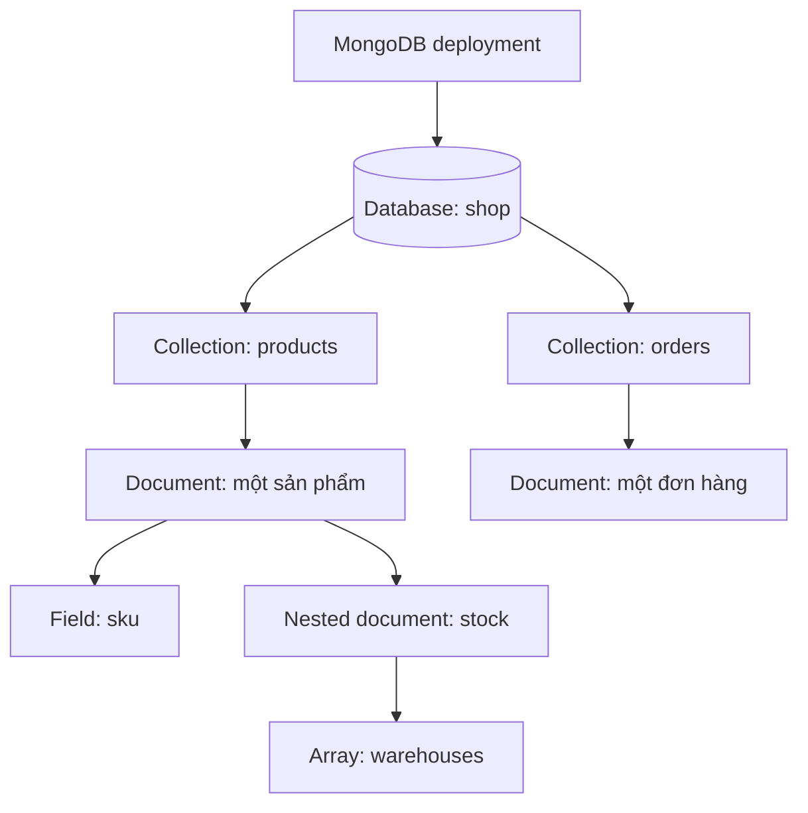

import { Step, Steps } from 'fumadocs-ui/components/steps';
import { Tab, Tabs } from 'fumadocs-ui/components/tabs';

<Callout type="info" title="Phạm vi và dữ liệu mẫu">
  Trang này dùng MongoDB Shell (`mongosh`) và database mẫu `shop`. Bạn có thể chạy các lệnh theo thứ tự trên một môi trường học tập riêng. Các ví dụ dùng cú pháp JavaScript của `mongosh`, không phải JSON thuần.
</Callout>

## Mục lục

- [MongoDB tổ chức dữ liệu theo tầng](#mongodb-tổ-chức-dữ-liệu-theo-tầng)
- [Document là gì](#document-là-gì)
  - [Cấu trúc một document](#cấu-trúc-một-document)
  - [Các quy tắc quan trọng của document](#các-quy-tắc-quan-trọng-của-document)
- [Collection là gì](#collection-là-gì)
  - [Collection thường và collection đặc biệt](#collection-thường-và-collection-đặc-biệt)
  - [Tạo và khám phá collection](#tạo-và-khám-phá-collection)
- [Database là gì](#database-là-gì)
  - [Chuyển database và tạo database](#chuyển-database-và-tạo-database)
  - [Quản lý database và tránh thao tác phá hủy](#quản-lý-database-và-tránh-thao-tác-phá-hủy)
- [Thực hành với mongosh](#thực-hành-với-mongosh)
  - [Chuẩn bị dữ liệu mẫu](#chuẩn-bị-dữ-liệu-mẫu)
  - [Đọc document và chọn field](#đọc-document-và-chọn-field)
  - [Cập nhật document](#cập-nhật-document)
  - [Xóa và kiểm tra kết quả](#xóa-và-kiểm-tra-kết-quả)
- [Schema linh hoạt không có nghĩa là tùy ý](#schema-linh-hoạt-không-có-nghĩa-là-tùy-ý)
  - [Khi nào khác nhau về schema hữu ích](#khi-nào-khác-nhau-về-schema-hữu-ích)
  - [Khi nào khác nhau về schema trở thành nợ kỹ thuật](#khi-nào-khác-nhau-về-schema-trở-thành-nợ-kỹ-thuật)
  - [Đặt ranh giới bằng schema validation](#đặt-ranh-giới-bằng-schema-validation)
- [Mô hình hóa cơ bản](#mô-hình-hóa-cơ-bản)
  - [Bắt đầu từ access pattern](#bắt-đầu-từ-access-pattern)
  - [Embedding dữ liệu liên quan](#embedding-dữ-liệu-liên-quan)
  - [Referencing dữ liệu dùng chung hoặc tăng không giới hạn](#referencing-dữ-liệu-dùng-chung-hoặc-tăng-không-giới-hạn)
  - [Trade-off và câu hỏi quyết định](#trade-off-và-câu-hỏi-quyết-định)
- [Quy trình thiết kế thực dụng](#quy-trình-thiết-kế-thực-dụng)
- [Tóm tắt](#tóm-tắt)
- [Bài tiếp theo](#bài-tiếp-theo)

## MongoDB tổ chức dữ liệu theo tầng

MongoDB là một **document database**: hệ quản trị cơ sở dữ liệu lưu bản ghi dưới dạng các document thay vì hàng và cột cố định. Một **database** chứa các **collection**, còn mỗi collection chứa nhiều **document**. Document được tạo từ các cặp **field** (trường) và giá trị.

Một deployment (một máy MongoDB đơn lẻ, replica set hoặc sharded cluster) có thể chứa nhiều database. Sơ đồ dưới đây cho thấy một document có thể chứa field đơn, mảng và document lồng nhau:



| Khái niệm MongoDB | Vai trò | Tương tự trong SQL, chỉ để dễ hình dung | Ví dụ |
| --- | --- | --- | --- |
| Database | Ranh giới logic chứa collection và quyền truy cập | Database hoặc schema | `shop` |
| Collection | Nhóm các document cùng phục vụ một miền dữ liệu | Table | `products` |
| Document | Một đơn vị dữ liệu có thể đọc hoặc ghi nguyên tử | Row | Một sản phẩm |
| Field | Một thuộc tính trong document | Column, nhưng linh hoạt hơn | `price` hoặc `stock.quantity` |

Phép so sánh với SQL chỉ là ẩn dụ. Collection không bắt buộc mọi document có cùng danh sách field, và document có thể chứa cấu trúc lồng nhau. Vì vậy, cách thiết kế MongoDB nên bắt đầu từ cách ứng dụng đọc và cập nhật dữ liệu, không chỉ từ việc chuyển từng table SQL sang một collection.

## Document là gì

**Document** là đơn vị dữ liệu cơ bản trong MongoDB. Về mặt biểu diễn, document trông giống một object JSON. Khi lưu trữ, MongoDB dùng **BSON** (Binary JSON), một định dạng nhị phân có thêm các kiểu như `ObjectId`, ngày giờ và `Decimal128`. Xem [BSON và kiểu dữ liệu](./bson-va-kieu-du-lieu) để tìm hiểu sâu hơn về các kiểu này.

Ví dụ, một document trong collection `products` có thể là:

```javascript
{
  _id: ObjectId("64c13ab08edf48a008793cac"),
  sku: "coffee-v60",
  name: "Bộ pha cà phê V60",
  price: NumberDecimal("18.90"),
  stock: {
    quantity: 42,
    warehouses: [
      { code: "HCM-01", quantity: 30 },
      { code: "HN-01", quantity: 12 }
    ]
  },
  tags: ["pour-over", "beginner"],
  createdAt: ISODate("2026-03-01T08:00:00Z")
}
```

### Cấu trúc một document

Trong ví dụ trên:

- `_id` là định danh của document. `ObjectId` là một kiểu BSON thường được driver dùng để sinh định danh mới.
- `sku`, `name` và `price` là field ở cấp cao nhất. Tên field là chuỗi, còn giá trị có thể là chuỗi, số, boolean, ngày giờ, `null`, object hoặc mảng.
- `stock` là **nested document** (document lồng nhau). `stock.quantity` là đường dẫn đi qua field `stock` để tới field `quantity` bên trong.
- `warehouses` là một mảng các nested document. Mỗi phần tử mô tả tồn kho ở một kho.
- `tags` là mảng chuỗi. MongoDB có thể truy vấn phần tử mảng mà không cần tách mỗi tag thành một document riêng.
- `NumberDecimal("18.90")` biểu diễn số thập phân Decimal128. Với tiền, kiểu thập phân giúp tránh một số sai số làm tròn của số dấu phẩy động.
- `ISODate(...)` tạo giá trị ngày giờ BSON. Nên lưu thời điểm theo UTC và đổi sang múi giờ hiển thị ở tầng ứng dụng.

Một document không cần chỉ có field đơn. Nhúng dữ liệu liên quan giúp một lần đọc lấy được toàn bộ thông tin cần thiết:

```javascript
{
  orderNumber: "ORD-2026-0001",
  shippingAddress: {
    recipient: "Nguyễn An",
    street: "12 Nguyễn Huệ",
    city: "Hồ Chí Minh"
  },
  items: [
    { sku: "coffee-v60", quantity: 2 },
    { sku: "kettle-600", quantity: 1 }
  ]
}
```

Địa chỉ giao hàng trong ví dụ là một **snapshot** (bản chụp tại thời điểm đặt hàng). Nếu khách hàng đổi địa chỉ hồ sơ sau đó, địa chỉ của đơn cũ vẫn phải giữ nguyên. Đây là một ví dụ về việc dữ liệu trùng lặp có chủ đích, không nhất thiết là lỗi thiết kế.

### Các quy tắc quan trọng của document

#### `_id` phải duy nhất trong collection

Mỗi document phải có field `_id`. Khi bạn bỏ qua field này trong thao tác insert bằng `mongosh` hoặc driver, client thường tự thêm một `ObjectId` trước khi gửi document tới server. Giá trị `_id` phải duy nhất trong collection đó và không thể thay đổi sau khi document được tạo.

```javascript
// Tự đặt _id giúp tham chiếu tới sản phẩm trong ví dụ khác.
db.products.insertOne({
  _id: ObjectId("64c13ab08edf48a008793cb0"),
  sku: "manual-id-demo",
  name: "Sản phẩm minh họa _id tự đặt",
  category: "demo",
  price: NumberDecimal("1.00"),
  stock: { quantity: 1 }
})
```

`_id` chỉ được đảm bảo duy nhất trong một collection. Hai collection khác nhau có thể có document dùng cùng một giá trị `_id`. Nếu `sku` cũng phải duy nhất trong toàn bộ `products`, bạn cần thêm unique index; chỉ đặt tên field là `sku` không tạo ra ràng buộc đó.

#### Kích thước và tên field

MongoDB giới hạn kích thước một BSON document ở **16 MiB**. Giới hạn này áp dụng cho cả dữ liệu lồng nhau và phần overhead của BSON. Một mảng tăng không giới hạn có thể làm document phình to dù mỗi phần tử rất nhỏ.

Tên field không được chứa ký tự null (`\0`). MongoDB hiện đã nới lỏng một số hạn chế với field bắt đầu bằng `$` hoặc chứa dấu chấm trong các phiên bản mới, nhưng driver, công cụ và một số thao tác vẫn có thể xử lý chúng không đồng nhất. Thực hành an toàn là dùng tên như `stock.quantity`, `createdAt` và `lineItems`, đồng thời tránh tên bắt đầu bằng `$` hoặc chứa `.`.

<Callout type="warn" title="Dấu chấm trong truy vấn không phải dấu chấm trong tên field">
  Trong truy vấn `{ "stock.quantity": { $gt: 0 } }`, dấu chấm là **đường dẫn** tới field lồng nhau `quantity` bên trong `stock`. Đây không phải khuyến nghị tạo một field có tên nguyên văn là `stock.quantity`.
</Callout>

#### Giữ kiểu dữ liệu nhất quán

Schema linh hoạt cho phép hai document có field khác nhau, nhưng cùng một field mang nhiều kiểu không phải lúc nào cũng linh hoạt hữu ích. Ví dụ, truy vấn giá sẽ khó dự đoán nếu một document lưu `price` là Decimal128 còn document khác lưu chuỗi `"18.90"`.

| Field logic | Nên thống nhất | Rủi ro khi trộn kiểu |
| --- | --- | --- |
| `price` | Decimal128 | So sánh số và tính tổng cho kết quả không nhất quán |
| `createdAt` | BSON Date | Sắp xếp ngày như chuỗi có thể sai thứ tự |
| `stock.quantity` | Một kiểu số nguyên | Update bằng `$inc` hoặc kiểm tra giới hạn khó đoán |
| `tags` | Mảng chuỗi | Code ứng dụng phải xử lý cả chuỗi lẫn mảng |

`null` và field bị thiếu cũng có ý nghĩa khác nhau. Field bị thiếu thường có nghĩa “chưa cung cấp hoặc không áp dụng”, còn `null` thường có nghĩa “đã biết là không có giá trị”. Chọn một quy ước cho từng miền dữ liệu và dùng nhất quán trong code.

## Collection là gì

**Collection** là nhóm document trong một database. Collection được nhận diện trong namespace như `shop.products`: phần trước là database, phần sau là tên collection.

Collection không áp một schema cứng mặc định. Hai document trong `products` có thể có các field `attributes` khác nhau, miễn là các thao tác đọc và code ứng dụng hiểu được những biến thể đó. Collection vẫn là nơi đặt các ràng buộc vận hành như validator, index, hoặc các tùy chọn lưu trữ.

### Collection thường và collection đặc biệt

Collection thông thường là lựa chọn mặc định cho dữ liệu nghiệp vụ như sản phẩm, người dùng và đơn hàng. MongoDB cũng có một số dạng đặc biệt:

- **Capped collection** có kích thước cố định và thường dùng cho dữ liệu dạng log hoặc stream cần giữ phần mới nhất. Khi đầy, dữ liệu cũ bị ghi đè theo cơ chế của collection.
- **Time series collection** tối ưu cho các measurement theo thời gian, chẳng hạn nhiệt độ cảm biến. Nó yêu cầu field thời gian và có thể có field metadata.
- **View** là kết quả đọc được định nghĩa từ một aggregation pipeline. View không lưu một bản sao document độc lập và thường chỉ đọc.

Không nên chọn capped collection chỉ vì muốn giới hạn số document. Nếu dữ liệu cần xóa theo điều kiện nghiệp vụ hoặc cần cập nhật tùy ý, collection thường với TTL index hoặc job dọn dẹp có thể phù hợp hơn. Các lựa chọn chuyên sâu này nên được đánh giá theo access pattern và vòng đời dữ liệu.

### Tạo và khám phá collection

Collection có thể được tạo ngầm định khi insert document đầu tiên hoặc tạo tường minh bằng `createCollection`. Chọn một trong hai cách dưới đây trong database `shop`:

<Tabs items={['Ngầm định', 'Tường minh']}>
  <Tab value="Ngầm định">
    Collection được tạo khi thao tác ghi đầu tiên chạy thành công:

    ```javascript
    use shop

    db.products.insertOne({
      sku: "first-product",
      name: "Sản phẩm đầu tiên"
    })
    ```

    Cách này phù hợp với collection thường không cần tùy chọn đặc biệt. Validator và index có thể được thêm ở bước cấu hình sau.
  </Tab>
  <Tab value="Tường minh">
    Tạo collection trước khi ghi dữ liệu:

    ```javascript
    use shop

    db.createCollection("products")
    ```

    Cách này cần thiết khi muốn khai báo validator, capped collection, time series hoặc các tùy chọn khác ngay lúc tạo. Nếu collection đã tồn tại, lệnh sẽ báo lỗi namespace đã tồn tại.
  </Tab>
</Tabs>

Sau khi collection tồn tại, dùng các lệnh sau để kiểm tra metadata và tên collection:

```javascript
show collections

// API JavaScript tương đương, hữu ích trong script.
db.getCollectionNames()
db.getCollectionInfos({ name: "products" })
```

`show collections` là helper của `mongosh`. `getCollectionInfos()` trả về thông tin như validator và loại collection. Việc gọi `db.products` không tự tạo collection; đọc collection chưa tồn tại thường chỉ trả về cursor rỗng.

## Database là gì

**Database** là namespace logic chứa các collection. Database giúp tách tên collection, dữ liệu và một phần quyền truy cập giữa các miền ứng dụng. Ví dụ, `shop.products` và `analytics.products` là hai collection khác nhau dù cùng có tên `products`.

Một database có thể chứa nhiều collection liên quan:

```text
shop/
├── products
├── orders
├── customers
└── productReviews
```

Cây trên chỉ là cách hình dung logic. MongoDB không yêu cầu mọi collection trong cùng database phải có quan hệ với nhau. Việc gom collection vào một database nên dựa trên ranh giới nghiệp vụ, quyền truy cập và vận hành.

### Chuyển database và tạo database

Trong `mongosh`, `use` chuyển ngữ cảnh hiện tại. Nó **không** tạo database bền vững ngay lập tức:

```javascript
use shop
db.getName()
// shop
```

Database thường xuất hiện trong `show dbs` sau khi có dữ liệu được ghi hoặc collection được tạo. MongoDB không có một lệnh `CREATE DATABASE` riêng như SQL. Quy trình tối thiểu là chọn tên rồi ghi dữ liệu:

```javascript
use shop
db.createCollection("products")
show dbs
```

Nếu chỉ chạy `use shop` rồi thoát, database rỗng có thể không xuất hiện trong danh sách. Đây là lý do người mới thường tưởng rằng lệnh `use` đã tạo database nhưng không tìm thấy nó bằng `show dbs`.

### Quản lý database và tránh thao tác phá hủy

Một số lệnh quản trị thường dùng:

```javascript
// Database hiện tại.
db.getName()

// Thống kê kích thước và số lượng collection ở mức khái quát.
db.stats()

// Xóa collection hiện tại sau khi xác nhận đúng tên.
db.products.drop()

// Xóa toàn bộ database hiện tại và mọi collection bên trong.
db.dropDatabase()
```

<Callout type="error" title="Cẩn thận với thao tác xóa">
  `dropDatabase()` không phải thao tác dọn dữ liệu thử nghiệm theo từng phần; nó xóa toàn bộ database hiện tại. Luôn kiểm tra `db.getName()`, sao lưu dữ liệu cần giữ và dùng môi trường riêng trước khi chạy lệnh phá hủy. Với dữ liệu production, quy trình xóa phải đi qua quyền hạn và phê duyệt phù hợp.
</Callout>

## Thực hành với mongosh

Phần này xây dựng một collection `products` nhỏ để minh họa các thao tác cơ bản. `mongosh` là shell tương tác cho phép gửi lệnh JavaScript tới MongoDB. Khi chạy một khối lệnh nhiều lần, các `_id` cố định có thể gây lỗi trùng khóa; hãy xóa database thử nghiệm hoặc đổi `_id` trước khi seed lại.

### Chuẩn bị dữ liệu mẫu

Thực hiện các bước sau trên một database thử nghiệm. Bước tạo collection có điều kiện để có thể chạy lại mà không báo lỗi nếu collection đã tồn tại.

<Steps>
  <Step>
    **Chọn database làm việc.**

    ```javascript
    use shop
    db.getName()
    ```
  </Step>
  <Step>
    **Tạo collection nếu collection chưa tồn tại.**

    ```javascript
    if (!db.getCollectionNames().includes("products")) {
      db.createCollection("products")
    }
    ```
  </Step>
  <Step>
    **Thêm hai document có cấu trúc lồng nhau.**

    ```javascript
    db.products.insertMany([
      {
        _id: ObjectId("64c13ab08edf48a008793cac"),
        sku: "coffee-v60",
        name: "Bộ pha cà phê V60",
        category: "coffee",
        price: NumberDecimal("18.90"),
        stock: {
          quantity: 42,
          warehouses: [
            { code: "HCM-01", quantity: 30 },
            { code: "HN-01", quantity: 12 }
          ]
        },
        tags: ["pour-over", "beginner"],
        attributes: {
          material: "ceramic",
          capacityMl: 350
        },
        createdAt: ISODate("2026-03-01T08:00:00Z")
      },
      {
        _id: ObjectId("64c13ab08edf48a008793cad"),
        sku: "kettle-600",
        name: "Ấm rót cổ ngỗng 600 ml",
        category: "equipment",
        price: NumberDecimal("29.50"),
        stock: {
          quantity: 18,
          warehouses: [
            { code: "HCM-01", quantity: 10 },
            { code: "HN-01", quantity: 8 }
          ]
        },
        tags: ["pour-over", "stainless-steel"],
        attributes: {
          material: "stainless-steel",
          capacityMl: 600
        },
        createdAt: ISODate("2026-03-02T08:00:00Z")
      }
    ])
    ```
  </Step>
</Steps>

`insertMany()` trả về số document ghi thành công và danh sách `_id`. Các document ở đây có cùng những field cốt lõi, nhưng MongoDB không bắt buộc mọi document được thêm sau đó phải giống hệt như vậy.

### Đọc document và chọn field

`find()` nhận một **filter** (điều kiện lọc) và tùy chọn một **projection** (tập field muốn trả về). Kết quả của `find()` là cursor, tức một trình lặp kết quả có thể tiếp tục sắp xếp, giới hạn hoặc duyệt dần.

```javascript
// Tìm sản phẩm còn hàng, chỉ trả về các field cần cho màn hình danh sách.
db.products.find(
  {
    category: "coffee",
    "stock.quantity": { $gt: 0 }
  },
  {
    _id: 0,
    sku: 1,
    name: 1,
    price: 1,
    "stock.quantity": 1
  }
).sort({ price: 1 })
```

Trong filter, `$gt` là toán tử “lớn hơn”. Cú pháp `stock.quantity` đi qua nested document. Trong projection, `_id: 0` loại bỏ `_id`; nếu không chỉ rõ, `_id` thường vẫn được trả về.

Một số thao tác đọc thường gặp:

```javascript
// Lấy một document theo khóa nghiệp vụ.
db.products.findOne({ sku: "coffee-v60" })

// Đếm document khớp điều kiện, không dùng estimatedDocumentCount cho filter.
db.products.countDocuments({ category: "coffee" })

// Lấy các giá trị category không trùng nhau.
db.products.distinct("category")
```

Chỉ chọn field cần thiết giúp giảm dữ liệu truyền về ứng dụng. Tuy nhiên, projection không thay thế index và không tự đảm bảo truy vấn nhanh; việc chọn index và đọc query plan được trình bày ở các bài về [index cơ bản](../indexes-va-hieu-nang/index-co-ban) và [explain query plan](../indexes-va-hieu-nang/explain-query-plan).

### Cập nhật document

`updateOne()` cập nhật một document khớp filter bằng các **update operator** (toán tử cập nhật). Dùng `$set` để gán giá trị, `$inc` để tăng số và `$currentDate` để ghi thời điểm cập nhật:

```javascript
db.products.updateOne(
  { sku: "coffee-v60" },
  {
    $set: {
      "stock.quantity": 40,
      "attributes.color": "white"
    },
    $inc: {
      soldCount: 2
    },
    $currentDate: {
      updatedAt: true
    }
  }
)
```

Lệnh trên không thay thế toàn bộ document. Nó chỉ đổi `stock.quantity`, thêm hoặc tăng `soldCount`, thêm `attributes.color` và cập nhật `updatedAt`. `$inc` sẽ tạo `soldCount` với giá trị ban đầu phù hợp nếu field này chưa có.

Khi muốn bỏ hẳn một field, dùng `$unset` thay vì đặt field thành `null`:

```javascript
db.products.updateOne(
  { sku: "coffee-v60" },
  { $unset: { "attributes.color": "" } }
)
```

`replaceOne()` có ngữ nghĩa khác: document mới thay thế toàn bộ document cũ. Nếu replacement có `_id`, giá trị đó phải trùng với document đang được thay thế; không thể dùng `replaceOne()` để đổi `_id`. Nếu bạn bỏ sót `tags`, `stock` hoặc field khác trong document thay thế, các field đó sẽ biến mất. Vì vậy, dùng update operator cho thay đổi một phần và chỉ dùng `replaceOne()` khi bạn thực sự có bản đầy đủ của document.

### Xóa và kiểm tra kết quả

Xóa cần bắt đầu bằng việc xem đúng filter. Ví dụ dưới đây chỉ xóa document có SKU dùng cho dữ liệu tạm:

```javascript
const filter = { sku: "sample-to-delete" }

db.products.find(filter)
db.products.deleteOne(filter)
```

`deleteOne()` xóa tối đa một document. `deleteMany()` xóa mọi document khớp filter, nên phải đặc biệt thận trọng:

```javascript
// Chỉ dùng sau khi đã xem trước số document khớp.
db.products.countDocuments({ status: "archived" })
db.products.deleteMany({ status: "archived" })
```

Nếu filter rỗng, `deleteMany({})` sẽ xóa toàn bộ document trong collection. Đây là một trong những lỗi nguy hiểm nhất khi viết script dọn dữ liệu.

## Schema linh hoạt không có nghĩa là tùy ý

**Schema** là quy ước về cấu trúc, kiểu dữ liệu và ràng buộc của dữ liệu. MongoDB cho phép schema linh hoạt ở mức collection: server không tự buộc mọi document phải có cùng field như một table SQL có cột cố định. Đặc tính này hữu ích khi dữ liệu thay đổi theo loại hoặc theo phiên bản.

Tuy nhiên, “schema-less” không có nghĩa là không cần schema. Schema vẫn tồn tại trong query, code ứng dụng, tài liệu API và các invariant (điều kiện phải luôn đúng) của nghiệp vụ. Nếu không viết rõ quy ước, schema chỉ chuyển từ database sang nhiều nơi khó kiểm soát hơn.

### Khi nào khác nhau về schema hữu ích

Các sản phẩm có thể chia sẻ field cốt lõi nhưng có thuộc tính riêng theo loại:

```javascript
// Máy xay có bộ thuộc tính riêng.
{
  sku: "grinder-pro",
  name: "Máy xay cà phê Pro",
  category: "equipment",
  price: NumberDecimal("79.00"),
  stock: { quantity: 7 },
  attributes: {
    burrMaterial: "steel",
    grindSettings: 24
  }
}

// Giấy lọc có bộ thuộc tính khác, nhưng vẫn ở products.
{
  sku: "coffee-filter-02",
  name: "Giấy lọc cỡ 02",
  category: "filter",
  price: NumberDecimal("6.50"),
  stock: { quantity: 100 },
  attributes: {
    size: "02",
    paperType: "unbleached"
  },
  compatibility: ["coffee-v60"]
}
```

Hai document có thể ở cùng `products` vì chúng cùng được bán, có SKU, giá và tồn kho. Field `attributes` thay đổi theo `category`, còn `compatibility` chỉ có ở một số sản phẩm. Cách này tránh việc tạo một collection mới cho mỗi loại sản phẩm khi các access pattern chính vẫn giống nhau.

### Khi nào khác nhau về schema trở thành nợ kỹ thuật

Schema linh hoạt bắt đầu gây vấn đề khi cùng một ý nghĩa được lưu bằng nhiều tên hoặc nhiều kiểu:

```javascript
// Cùng biểu diễn giá nhưng khác kiểu dữ liệu.
{ sku: "a", price: NumberDecimal("18.90") }
{ sku: "b", price: "18.90" }

// Cùng biểu diễn tồn kho nhưng khác đường dẫn.
{ sku: "c", stock: { quantity: 4 } }
{ sku: "d", inventory: 4 }
```

Hậu quả thường gặp:

- Filter số có thể bỏ qua document lưu giá dưới dạng chuỗi.
- Code phải chứa nhiều nhánh để đọc `stock.quantity` hoặc `inventory`.
- Aggregation và index phải xử lý nhiều hình dạng, làm tăng chi phí bảo trì.
- Dữ liệu cũ và dữ liệu mới có thể cho kết quả khác nhau sau khi triển khai một tính năng.

Nên đặt tên field và kiểu dữ liệu ổn định cho phần cốt lõi. Khi thay đổi schema, hãy có kế hoạch migrate document cũ hoặc để code hỗ trợ có chủ đích một giai đoạn chuyển tiếp. Nói ngắn gọn: linh hoạt ở phần biến thiên, nghiêm ngặt ở phần ứng dụng luôn dựa vào.

### Đặt ranh giới bằng schema validation

MongoDB hỗ trợ **schema validation** để server kiểm tra document khi insert hoặc update. Validator dưới đây bắt buộc `sku`, `name`, `price` và `stock.quantity`, nhưng vẫn cho phép thêm field như `attributes` hoặc `compatibility` vì không đặt `additionalProperties: false`:

```javascript
db.runCommand({
  collMod: "products",
  validator: {
    $jsonSchema: {
      bsonType: "object",
      required: ["sku", "name", "price", "stock"],
      properties: {
        sku: {
          bsonType: "string",
          description: "SKU phải là chuỗi"
        },
        name: {
          bsonType: "string"
        },
        price: {
          bsonType: "decimal",
          minimum: 0
        },
        stock: {
          bsonType: "object",
          required: ["quantity"],
          properties: {
            quantity: {
              bsonType: "int",
              minimum: 0
            }
          }
        },
        tags: {
          bsonType: "array",
          items: { bsonType: "string" }
        }
      }
    }
  },
  validationLevel: "strict",
  validationAction: "error"
})
```

Sau khi bật validator, document có `price` là chuỗi sẽ bị từ chối:

```javascript
db.products.insertOne({
  sku: "invalid-price",
  name: "Document không hợp lệ",
  price: "18.90",
  stock: { quantity: 1 }
})
// MongoServerError: Document failed validation
```

Validator kiểm tra kiểu và hình dạng. Nó không tự bảo đảm `sku` duy nhất hoặc bảo đảm một document được tham chiếu luôn tồn tại. Với tính duy nhất, dùng unique index; với quan hệ tham chiếu, ứng dụng hoặc transaction phải bảo đảm invariant tương ứng.

```javascript
db.products.createIndex({ sku: 1 }, { unique: true })
```

Nếu collection đã có dữ liệu không phù hợp, hãy kiểm kê và migrate trước khi chuyển sang validation nghiêm ngặt. Không nên bật `additionalProperties: false` chỉ để làm schema “trông sạch” nếu miền dữ liệu còn cần mở rộng; điều đó có thể chặn các field hợp lệ trong lần phát hành sau.

## Mô hình hóa cơ bản

MongoDB gọi việc quyết định document chứa gì, tách collection ở đâu và đặt quan hệ như thế nào là **data modeling** (mô hình hóa dữ liệu). Mục tiêu không phải làm document giống một object bất kỳ, mà là làm cho các thao tác quan trọng đọc ít lần, ghi đúng ranh giới và giữ kích thước có thể kiểm soát.

### Bắt đầu từ access pattern

**Access pattern** là danh sách cách ứng dụng thực sự đọc, lọc, sắp xếp và cập nhật dữ liệu. Ví dụ với cửa hàng:

| Access pattern | Dữ liệu cần đọc hoặc ghi |
| --- | --- |
| Hiển thị trang sản phẩm | `products` theo `sku` |
| Danh sách sản phẩm theo loại còn hàng | `category` và `stock.quantity` |
| Xem chi tiết đơn hàng | Một order cùng `items` và địa chỉ giao hàng |
| Cập nhật tồn kho | Một hoặc nhiều sản phẩm theo SKU |
| Xem lịch sử đánh giá | Nhiều review theo `productId`, có thể tăng liên tục |

**Cardinality** là số lượng phần tử trong một quan hệ. “Một đơn hàng có vài item” là cardinality nhỏ và có giới hạn thực tế. “Một sản phẩm có review tăng mãi” là cardinality không bị giới hạn rõ ràng. Hai trường hợp này thường dẫn đến hai quyết định khác nhau: nhúng item vào order, nhưng tách review thành collection riêng.

Trước khi thiết kế, hãy trả lời bốn câu hỏi:

1. Những field nào luôn được đọc cùng nhau?
2. Mảng hoặc quan hệ con có giới hạn kích thước thực tế không?
3. Dữ liệu con có vòng đời và quyền cập nhật độc lập không?
4. Những field nào phải được cập nhật nguyên tử cùng một lần ghi?

### Embedding dữ liệu liên quan

**Embedding** là nhúng document con hoặc giá trị liên quan trực tiếp vào document cha. Dùng embedding khi dữ liệu thường được đọc cùng nhau, số phần tử có giới hạn và document cha sở hữu vòng đời của phần tử con.

Một order thường là aggregate (cụm dữ liệu được xử lý như một đơn vị) phù hợp để embed line item và địa chỉ giao hàng:

```javascript
db.orders.insertOne({
  _id: ObjectId("64c13ab08edf48a008793caf"),
  orderNumber: "ORD-2026-0001",
  customerId: ObjectId("64c13ab08edf48a008793cae"),
  status: "pending",
  items: [
    {
      productId: ObjectId("64c13ab08edf48a008793cac"),
      sku: "coffee-v60",
      name: "Bộ pha cà phê V60",
      unitPrice: NumberDecimal("18.90"),
      quantity: 2,
      lineTotal: NumberDecimal("37.80")
    },
    {
      productId: ObjectId("64c13ab08edf48a008793cad"),
      sku: "kettle-600",
      name: "Ấm rót cổ ngỗng 600 ml",
      unitPrice: NumberDecimal("29.50"),
      quantity: 1,
      lineTotal: NumberDecimal("29.50")
    }
  ],
  shippingAddress: {
    recipient: "Nguyễn An",
    street: "12 Nguyễn Huệ",
    city: "Hồ Chí Minh"
  },
  total: NumberDecimal("67.30"),
  createdAt: ISODate("2026-03-10T09:30:00Z")
})
```

Cấu trúc này có ba lợi ích:

- Trang chi tiết order đọc một document thay vì ghép order với nhiều collection.
- Cập nhật `status`, `shippingAddress` và `items` trong cùng document có tính nguyên tử ở cấp document.
- `name` và `unitPrice` trong item là snapshot. Khi sản phẩm đổi tên hoặc giá, lịch sử đơn hàng không bị thay đổi.

Đổi lại, snapshot tạo ra dữ liệu trùng lặp. Nếu cần sửa tên hiển thị của mọi order cũ, bạn phải quyết định có migrate các snapshot hay giữ nguyên lịch sử. Đó là trade-off nghiệp vụ, không chỉ là vấn đề kỹ thuật.

### Referencing dữ liệu dùng chung hoặc tăng không giới hạn

**Referencing** là lưu định danh của document liên quan thay vì nhúng toàn bộ document đó. Dùng reference khi dữ liệu được dùng bởi nhiều parent, có vòng đời độc lập, được đọc riêng thường xuyên hoặc có thể tăng không giới hạn.

Review là ví dụ thường nên tách khỏi `products`:

```javascript
db.productReviews.insertOne({
  productId: ObjectId("64c13ab08edf48a008793cac"),
  authorId: ObjectId("64c13ab08edf48a008793cae"),
  rating: 5,
  body: "Rót ổn định, phù hợp cho người mới.",
  createdAt: ISODate("2026-03-11T10:00:00Z")
})
```

`products` chỉ giữ thông tin sản phẩm. `productReviews` giữ `productId` để truy vấn review theo sản phẩm. Mảng review không bị nhúng vào sản phẩm nên một sản phẩm phổ biến không tiến gần giới hạn 16 MiB chỉ vì có nhiều review.

Reference không phải foreign key (khóa ngoại) tự động. MongoDB không tự từ chối `productId` trỏ tới sản phẩm không tồn tại. Ứng dụng cần kiểm tra, dùng transaction khi invariant yêu cầu nhiều ghi phải thành công cùng nhau, hoặc chấp nhận tham chiếu mồ côi và có job dọn dẹp.

Nếu cần đọc dữ liệu từ nhiều collection, có thể dùng `$lookup` trong aggregation. Nhưng `$lookup` không phải lý do mặc định để tách mọi nested document. Hãy đo access pattern thực tế và cân nhắc chi phí của nhiều lần đọc, join và đồng bộ dữ liệu.

### Trade-off và câu hỏi quyết định

| Tiêu chí | Embedding | Referencing |
| --- | --- | --- |
| Đọc parent và child cùng nhau | Một lần đọc, thường đơn giản | Cần nhiều lần đọc hoặc `$lookup` |
| Cập nhật cùng một document | Thuận lợi và nguyên tử ở cấp document | Có thể cần nhiều ghi hoặc transaction |
| Dữ liệu con tăng không giới hạn | Rủi ro document quá lớn, mảng phình to | Dễ phân trang và dọn dẹp hơn |
| Dữ liệu dùng chung | Dễ tạo bản sao phải đồng bộ | Một nguồn chính, ít trùng lặp hơn |
| Lịch sử cần giữ snapshot | Nhúng bản chụp rất phù hợp | Cần collection snapshot riêng nếu không nhúng |

Không có quy tắc “luôn embed” hoặc “luôn reference”. Một mô hình lai thường thực tế hơn: order reference tới product để biết nguồn gốc, đồng thời embed `sku`, `name` và `unitPrice` tại thời điểm mua. Hãy chọn ranh giới document theo thao tác cần tính nguyên tử và theo kích thước tăng trưởng, không theo thói quen chuyển đổi máy móc từ SQL.

<Callout type="idea" title="Quy tắc chọn nhanh">
  Nếu child được đọc cùng parent, số lượng có giới hạn và không sống độc lập, hãy bắt đầu bằng embedding. Nếu child dùng chung, có quyền truy cập riêng hoặc tăng không giới hạn, hãy bắt đầu bằng referencing. Sau đó kiểm tra lại bằng kích thước document và số lần đọc thực tế.
</Callout>

## Quy trình thiết kế thực dụng

Dùng quy trình sau cho một collection mới hoặc khi refactor schema hiện có:

<Steps>
  <Step>
    **Liệt kê các thao tác quan trọng.** Ghi rõ filter, field cần trả về, tần suất đọc và kiểu cập nhật. Đừng bắt đầu bằng việc vẽ collection trước khi biết ứng dụng cần làm gì.
  </Step>
  <Step>
    **Xác định aggregate và ranh giới nguyên tử.** Gom những field phải thay đổi cùng nhau vào một document khi kích thước cho phép. Nếu một quy trình bắt buộc cập nhật nhiều document, ghi nhận nhu cầu transaction hoặc cơ chế bù trừ.
  </Step>
  <Step>
    **Ước tính kích thước và tốc độ tăng trưởng.** Đặc biệt kiểm tra các mảng. Một mảng “thường chỉ vài phần tử” cần có giới hạn hoặc kế hoạch tách collection khi nghiệp vụ thay đổi.
  </Step>
  <Step>
    **Chọn embedding, referencing hoặc mô hình lai.** Nếu cố ý duplicate dữ liệu, ghi rõ field nào là nguồn chính và field nào là snapshot. Điều này giúp tránh đồng bộ nhầm trong các lần cập nhật sau.
  </Step>
  <Step>
    **Đặt ràng buộc và kiểm thử với dữ liệu thật.** Dùng schema validation cho field cốt lõi, unique index cho tính duy nhất, rồi thử các query, update, dữ liệu thiếu và dữ liệu lớn trước khi phát hành.
  </Step>
</Steps>

## Tóm tắt

- Database chứa collection; collection chứa document; document chứa field, nested document và array.
- Document có `_id` duy nhất trong collection và bị giới hạn kích thước 16 MiB.
- Collection và database có thể được tạo ngầm định, nhưng tạo tường minh hữu ích khi cần validator hoặc tùy chọn lưu trữ.
- Schema linh hoạt cho phép phần biến thiên thay đổi, nhưng field cốt lõi và kiểu dữ liệu vẫn nên ổn định.
- Chọn embedding khi dữ liệu được đọc cùng nhau, có cardinality giới hạn và cùng vòng đời. Chọn referencing khi dữ liệu dùng chung, sống độc lập hoặc tăng không giới hạn.
- Validator, unique index và quy ước ứng dụng bổ sung cho nhau; không một cơ chế đơn lẻ nào diễn tả toàn bộ invariant nghiệp vụ.

## Bài tiếp theo

Các trang sau mở rộng những phần được dùng trong bài này:

<Cards>
  <Card
    title="BSON và kiểu dữ liệu"
    href="/docs/nen-tang/bson-va-kieu-du-lieu"
    description="Tìm hiểu ObjectId, Date, Decimal128, array và các kiểu BSON quan trọng."
  />
  <Card
    title="CRUD đầu tiên"
    href="/docs/bat-dau/crud-dau-tien"
    description="Thực hiện chuỗi create, read, update và delete đầu tiên trong MongoDB."
  />
  <Card
    title="Nguyên tắc thiết kế schema"
    href="/docs/thiet-ke-du-lieu/schema-design-principles"
    description="Thiết kế schema từ access pattern, kích thước dữ liệu và vòng đời document."
  />
  <Card
    title="Embedding và referencing"
    href="/docs/thiet-ke-du-lieu/embedding-vs-referencing"
    description="So sánh sâu hơn hai cách biểu diễn quan hệ trong MongoDB."
  />
</Cards>
