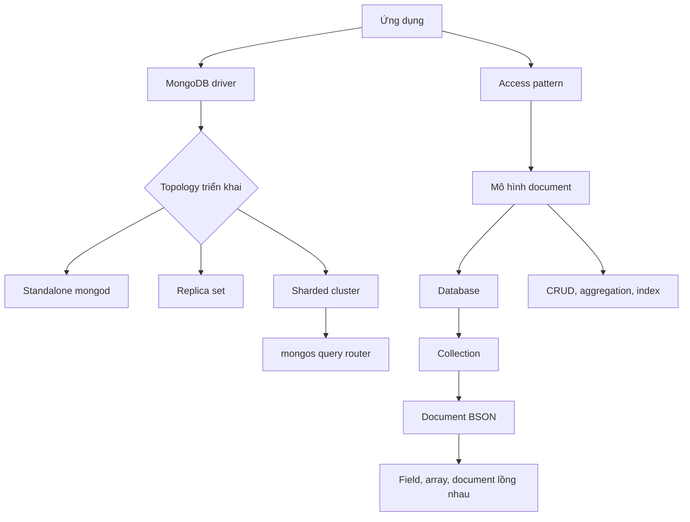

import { Step, Steps } from 'fumadocs-ui/components/steps';
import { Tab, Tabs } from 'fumadocs-ui/components/tabs';

<Callout type="info" title="Mục tiêu của phần này">
  Phần **Nền tảng MongoDB** xây dựng mô hình tư duy cần có trước khi viết truy vấn hoặc vận hành production (môi trường thật). Bạn sẽ đi từ cách MongoDB tổ chức một document đến cách một request (yêu cầu từ ứng dụng) đi qua kiến trúc triển khai. Không cần biết SQL trước; nếu đã quen với SQL, hãy dùng các điểm đối chiếu trong bài để chuyển đổi mô hình suy nghĩ.
</Callout>

## Mục lục

- [Mục tiêu học tập](#mục-tiêu-học-tập)
- [Cách đọc phần Nền tảng](#cách-đọc-phần-nền-tảng)
  - [Chọn lối vào phù hợp](#chọn-lối-vào-phù-hợp)
  - [Học theo vòng lặp nhỏ](#học-theo-vòng-lặp-nhỏ)
- [Bản đồ khái niệm](#bản-đồ-khái-niệm)
- [Các khái niệm nền tảng](#các-khái-niệm-nền-tảng)
  - [MongoDB là gì?](#mongodb-là-gì)
  - [Document, collection và database](#document-collection-và-database)
  - [BSON và kiểu dữ liệu](#bson-và-kiểu-dữ-liệu)
  - [Kiến trúc MongoDB](#kiến-trúc-mongodb)
  - [MongoDB và cơ sở dữ liệu SQL](#mongodb-và-cơ-sở-dữ-liệu-sql)
- [Lộ trình đọc đề xuất](#lộ-trình-đọc-đề-xuất)
- [Bẫy thường gặp và nguyên tắc thực hành](#bẫy-thường-gặp-và-nguyên-tắc-thực-hành)
- [Toàn bộ bài trong phần](#toàn-bộ-bài-trong-phần)
- [Bước tiếp theo trong lộ trình](#bước-tiếp-theo-trong-lộ-trình)

## Mục tiêu học tập

Sau khi hoàn thành phần này, bạn nên có thể:

| Năng lực | Dấu hiệu đã nắm được |
| --- | --- |
| Mô tả MongoDB | Giải thích được vì sao MongoDB là **document database** — cơ sở dữ liệu tổ chức dữ liệu thành document thay vì bắt buộc mọi dữ liệu nằm trong các hàng và cột cố định. |
| Đọc mô hình dữ liệu | Phân biệt được `database`, `collection`, `document`, `field`, mảng và document lồng nhau. |
| Chọn kiểu dữ liệu | Biết khi nào dùng `Date`, `ObjectId`, `Decimal128`, số nguyên, chuỗi hoặc mảng; không coi mọi giá trị là chuỗi JSON. |
| Đọc đường đi của request | Nhận diện vai trò của driver, `mongod`, replica set, `mongos` và sharded cluster trong một triển khai MongoDB. |
| So sánh có căn cứ | Chọn MongoDB hoặc cơ sở dữ liệu SQL dựa trên access pattern (mẫu đọc/ghi thực tế), quan hệ dữ liệu, yêu cầu nhất quán và cách mở rộng; không chọn chỉ vì một khẩu hiệu. |
| Sẵn sàng học phần kế tiếp | Có thể chuyển sang CRUD, thiết kế dữ liệu và index (cấu trúc phụ giúp tìm document nhanh hơn) mà không còn nhầm document với row hoặc replica set với backup. |

<Callout type="idea" title="Tiêu chí hoàn thành">
  Đừng chỉ ghi nhớ định nghĩa. Hãy tự giải thích một document cụ thể, vẽ đường đi của một lượt đọc và nêu một trade-off của lựa chọn đó. Nếu làm được ba việc này, bạn đã có nền móng đủ tốt để học các phần thao tác và tối ưu.
</Callout>

## Cách đọc phần Nền tảng

### Chọn lối vào phù hợp

Không phải người học nào cũng bắt đầu từ cùng một điểm. Chọn lối đọc gần với kinh nghiệm hiện tại, nhưng hãy quay lại đọc đủ năm bài trước khi thiết kế schema (quy tắc cấu trúc và field của dữ liệu) cho một hệ thống thật.

<Tabs items={['Mới với MongoDB', 'Biết SQL', 'Đã dùng CRUD']} label="Lộ trình gợi ý">
  <Tab value="Mới với MongoDB">
    Đọc tuần tự [MongoDB là gì?](./mongodb-la-gi) → [Document, collection và database](./document-collection-database) → [BSON và kiểu dữ liệu](./bson-va-kieu-du-lieu) → [Kiến trúc MongoDB](./kien-truc-mongodb) → [MongoDB và cơ sở dữ liệu SQL](./mongodb-vs-sql). Đây là đường đi dễ theo dõi nhất nếu các thuật ngữ MongoDB còn mới.
  </Tab>
  <Tab value="Biết SQL">
    Bắt đầu bằng [MongoDB và cơ sở dữ liệu SQL](./mongodb-vs-sql) để dựng bản đồ tương ứng, sau đó đọc [MongoDB là gì?](./mongodb-la-gi), [Document, collection và database](./document-collection-database), [BSON và kiểu dữ liệu](./bson-va-kieu-du-lieu) và [Kiến trúc MongoDB](./kien-truc-mongodb). Đừng dừng ở bảng so sánh: điểm khác biệt quan trọng nằm ở cách thiết kế theo access pattern.
  </Tab>
  <Tab value="Đã dùng CRUD">
    Nếu đã chạy được các lệnh CRUD (create, read, update, delete — tạo, đọc, cập nhật và xóa), hãy đọc [Document, collection và database](./document-collection-database) rồi [BSON và kiểu dữ liệu](./bson-va-kieu-du-lieu). Tiếp theo, dùng [Kiến trúc MongoDB](./kien-truc-mongodb) để hiểu môi trường bạn đang kết nối và đọc [MongoDB là gì?](./mongodb-la-gi), [MongoDB và cơ sở dữ liệu SQL](./mongodb-vs-sql) để lấp các khoảng trống khái niệm.
  </Tab>
</Tabs>

### Học theo vòng lặp nhỏ

Mỗi bài nên tạo ra một kết quả có thể kiểm tra. Cách này hiệu quả hơn việc đọc hết lý thuyết rồi mới thử lệnh.

<Steps>
  <Step>
    **Đọc câu hỏi trọng tâm.** Trước khi mở bài, hãy đoán câu trả lời: dữ liệu này được nhóm như thế nào, kiểu nào biểu diễn nó, và request sẽ đi đâu?
  </Step>
  <Step>
    **Chạy một ví dụ nhỏ.** Dùng `mongosh` hoặc MongoDB Compass để tạo một document, đọc lại nó và quan sát kiểu dữ liệu thực tế. Ví dụ nhỏ giúp phân biệt một khái niệm với cú pháp ngẫu nhiên.
  </Step>
  <Step>
    **Nói rõ trade-off (đánh đổi).** Với mỗi lựa chọn, ghi lại điều bạn được và chi phí phải trả. Ví dụ, nhúng dữ liệu giúp đọc một đơn hàng trong một lần nhưng làm document lớn hơn khi mảng tăng không giới hạn.
  </Step>
  <Step>
    **Nối sang bài tiếp theo.** Khi gặp một thuật ngữ như index, transaction (giao dịch gồm nhiều thao tác có tính toàn bộ hoặc không gì cả) hoặc shard key (khóa quyết định cách dữ liệu được phân phối), ghi chú nó thay vì cố học sâu ngay trong phần Nền tảng. Các phần sau sẽ dùng lại mô hình này.
  </Step>
</Steps>

## Bản đồ khái niệm

Sơ đồ dưới đây tách hai lớp thường bị trộn lẫn: **mô hình logic** của dữ liệu và **topology** (cách các tiến trình MongoDB được bố trí để phục vụ workload). Workload là tải đọc/ghi mà ứng dụng tạo ra; access pattern — mẫu truy vấn và cập nhật mà ứng dụng thực sự chạy — nối hai lớp đó lại vì nó ảnh hưởng cả schema lẫn index.



Cách đọc sơ đồ:

- **Ứng dụng → driver → topology** là đường đi của request. Driver là thư viện ngôn ngữ giúp ứng dụng mở kết nối, mã hóa lệnh và đọc kết quả từ MongoDB.
- **Database → collection → document** là cấu trúc logic. Nó mô tả dữ liệu được nhóm ra sao, không nói rằng mỗi collection phải giống một bảng SQL.
- **Document BSON** là đơn vị dữ liệu mà MongoDB đọc và ghi một cách nguyên tử ở cấp document. BSON là cách biểu diễn nhị phân có thêm các kiểu như `Date`, `ObjectId` và `Decimal128`.
- **Access pattern → mô hình document** là hướng suy nghĩ quan trọng nhất. Ta thiết kế document từ cách ứng dụng đọc và ghi, thay vì chuyển nguyên xi sơ đồ bảng sang collection.
- **Topology** quyết định tính sẵn sàng và khả năng mở rộng. Một `mongod` đơn lẻ đơn giản hơn; replica set thêm bản sao và failover; sharded cluster phân phối dữ liệu nhưng đòi hỏi vận hành và shard key cẩn thận.

## Các khái niệm nền tảng

Năm bài trong phần này liên kết với nhau. Các mục dưới đây là bản xem trước để bạn biết mỗi bài trả lời câu hỏi nào và vì sao nó xuất hiện trong lộ trình.

### MongoDB là gì?

[MongoDB là gì?](./mongodb-la-gi) trả lời câu hỏi nền tảng: MongoDB phù hợp với loại workload nào và document database khác gì so với mô hình quan hệ. **Document database** lưu một thực thể cùng các thuộc tính liên quan trong một document có cấu trúc giống object (đối tượng gồm các cặp key–value). Cách này thường thuận tiện khi ứng dụng đọc một thực thể cùng dữ liệu con của nó.

Ví dụ, một đơn hàng có thể giữ các mặt hàng và địa chỉ giao hàng trong cùng document:

```javascript
use shop

db.orders.insertOne({
  customerId: ObjectId("65a000000000000000000010"),
  status: "paid",
  items: [
    {
      sku: "MUG-001",
      name: "MongoDB mug",
      quantity: 2,
      unitPrice: Decimal128("12.50")
    }
  ],
  shippingAddress: {
    city: "Da Nang",
    country: "VN"
  },
  createdAt: ISODate("2025-01-15T10:30:00Z")
})
```

Trong ví dụ này, `orders` là collection và object truyền vào `insertOne()` là document. `items` là mảng các document lồng nhau. `shippingAddress` là một document lồng nhau khác. Vì không tự cung cấp `_id`, MongoDB sẽ tạo một `_id` duy nhất cho document đơn hàng.

Lệnh sau đọc các đơn đã thanh toán tại Việt Nam và chỉ trả về những field cần dùng:

```javascript
db.orders.find(
  { status: "paid", "shippingAddress.country": "VN" },
  { _id: 0, status: 1, items: 1 }
)
```

Dấu chấm trong `shippingAddress.country` là **dot notation**, cú pháp truy cập field lồng nhau. Đối số thứ hai là projection, tức danh sách field cần trả về. Ví dụ cho thấy document model không chỉ là cách lưu dữ liệu; nó ảnh hưởng trực tiếp đến cách ứng dụng đọc dữ liệu.

### Document, collection và database

[Document, collection và database](./document-collection-database) giải thích ba cấp tổ chức dữ liệu. Có thể hình dung chúng như sau:

```text
database: shop
└── collection: orders
    ├── document: một đơn hàng
    │   ├── field: status
    │   ├── field: createdAt
    │   ├── array: items[]
    │   └── embedded document: shippingAddress
    └── document: một đơn hàng khác
```

- **Database** là không gian logic chứa các collection.
- **Collection** là nhóm các document có liên quan. MongoDB cho phép các document trong cùng collection có field khác nhau nếu bạn không đặt validation.
- **Document** là bản ghi dạng key-value, có thể chứa scalar value (giá trị đơn như chuỗi hoặc số), mảng và document lồng nhau.
- **Field** là một cặp tên–giá trị trong document. `_id` là field định danh; mỗi document trong một collection phải có `_id` duy nhất.

Schema linh hoạt không có nghĩa là mọi document đều nên tùy ý. Ứng dụng vẫn cần quy ước field bắt buộc, kiểu dữ liệu và trạng thái hợp lệ. Khi collection có nhiều writer hoặc dữ liệu quan trọng, có thể bổ sung schema validation (cơ chế kiểm tra cấu trúc document) ở database để bắt lỗi sớm.

Trade-off chính là **locality** (đặt dữ liệu được đọc cùng nhau ở gần nhau) so với khả năng cập nhật độc lập. Nhúng `items` giúp đọc một đơn hàng nhanh và tự nhiên. Nếu một mảng tăng không giới hạn hoặc phần tử được nhiều đơn hàng dùng chung, tham chiếu sang collection khác có thể an toàn hơn. Hãy để access pattern quyết định, không áp dụng máy móc quy tắc “luôn nhúng” hoặc “luôn tham chiếu”.

### BSON và kiểu dữ liệu

[BSON và kiểu dữ liệu](./bson-va-kieu-du-lieu) giải thích representation (cách biểu diễn) mà MongoDB dùng khi lưu và truyền document. BSON là viết tắt của Binary JSON: nó giữ cấu trúc giống JSON nhưng hỗ trợ thêm kiểu dữ liệu và thông tin kích thước để driver xử lý chính xác hơn.

Ví dụ, catalog sản phẩm có thể lưu giá tiền dưới dạng `Decimal128` thay vì số thực thông thường:

```javascript
db.products.insertOne({
  sku: "MUG-001",
  price: Decimal128("12.50"),
  available: true,
  tags: ["drinkware", "gift"],
  releasedAt: ISODate("2025-01-15T00:00:00Z")
})
```

Một số lựa chọn quan trọng:

| Kiểu BSON | Dùng cho | Điểm cần chú ý |
| --- | --- | --- |
| `String` | Mã, tên, trạng thái có số lượng giá trị hữu hạn | Không dùng chuỗi để thay cho ngày hoặc tiền nếu cần so sánh và tính toán chính xác. |
| `Int32`, `Int64`, `Double` | Bộ đếm, số lượng hoặc phép đo | Chọn miền giá trị và độ chính xác phù hợp; driver của ngôn ngữ có thể ánh xạ các kiểu này khác nhau. |
| `Decimal128` | Giá tiền, thuế và số thập phân cần độ chính xác | Phải giữ nhất quán kiểu ở các phép tính và khi trao đổi với ứng dụng. |
| `Date` | Mốc thời gian | BSON lưu mốc thời gian; ứng dụng nên thống nhất quy ước UTC và không lưu ngày dưới nhiều dạng chuỗi khác nhau. |
| `ObjectId` | Định danh document hoặc tham chiếu | Đây là BSON type, không phải chuỗi tùy ý; khi đi qua JSON API cần quy ước serialize (chuyển kiểu thành dữ liệu truyền đi) rõ ràng. |
| `Array` và embedded document | Dữ liệu lặp hoặc có cấu trúc con | Cần giới hạn kích thước và số phần tử nếu document có thể tăng lâu dài. |

Mongosh hiển thị các hàm tiện ích (helper) như `ObjectId()`, `Decimal128()` và `ISODate()`. Đây là cú pháp JavaScript của shell để tạo giá trị BSON; document trên không phải JSON thuần túy. Ranh giới này quan trọng khi dữ liệu đi qua API trả JSON, nơi JSON không có biểu diễn chuẩn cho `ObjectId` hoặc `Decimal128`.

Một gotcha phổ biến là phân biệt **field có giá trị `null`** với **field không tồn tại**. Điều kiện `{ field: null }` có thể khớp cả hai trường hợp. Nếu hai trạng thái có ý nghĩa khác nhau trong nghiệp vụ, hãy dùng thêm `$exists` và đặt quy ước rõ ràng.

### Kiến trúc MongoDB

[Kiến trúc MongoDB](./kien-truc-mongodb) nối mô hình logic với cách triển khai thật. `mongod` là tiến trình máy chủ MongoDB. Ứng dụng thường kết nối đến một `mongod` đơn lẻ trong môi trường học, hoặc đến một replica set/sharded cluster trong môi trường production.

- **Standalone** là một `mongod` độc lập. Nó dễ cài và phù hợp để học, nhưng không tự có failover (chuyển sang tiến trình dự phòng) nếu máy chủ hỏng.
- **Replica set** là một nhóm các `mongod` duy trì nhiều bản sao dữ liệu. Primary nhận ghi, secondary sao chép dữ liệu và một cuộc election (bầu chọn primary) có thể chọn primary mới khi cần. Bản sao giúp tăng tính sẵn sàng, nhưng không thay thế backup.
- **Sharded cluster** phân phối dữ liệu trên nhiều shard để mở rộng dung lượng hoặc throughput (số thao tác xử lý trong một đơn vị thời gian). Mỗi shard thường là một replica set. `mongos` là query router (bộ định tuyến truy vấn) nhận request và định tuyến tới shard phù hợp; config server giữ metadata (siêu dữ liệu) của cluster.

Đường đi tối giản của một lượt đọc có thể là:

```text
Ứng dụng
   │
   ▼
Driver ──────► mongod (standalone hoặc replica set)
   │
   └─────────► mongos ──────► các shard trong sharded cluster
```

Trade-off nằm ở độ phức tạp vận hành. Standalone ít thành phần nhưng có điểm lỗi đơn. Replica set cần theo dõi election, replication lag (độ trễ sao chép) và cách driver phản ứng khi topology thay đổi. Sharded cluster có thêm shard key, metadata và khả năng request phải đi tới nhiều shard. Đừng chọn sharding chỉ vì dữ liệu “có thể lớn”; trước hết hãy đo workload và kiểm tra giới hạn của một replica set.

<Callout type="warn" title="Replica set không phải backup">
  Nếu một document bị xóa nhầm, thao tác xóa có thể được sao chép tới mọi thành viên replica set. Backup và quy trình restore mới giúp quay về trạng thái trước sự cố. Hãy học phần [Backup và restore](../bao-mat-va-production/backup-restore) trước khi xem bản sao là chiến lược phục hồi.
</Callout>

### MongoDB và cơ sở dữ liệu SQL

[MongoDB và cơ sở dữ liệu SQL](./mongodb-vs-sql) không nhằm tìm một bên “tốt hơn”. Mục tiêu là nhận ra giả định của từng mô hình để chọn đúng cho workload.

| Khía cạnh | MongoDB | Cơ sở dữ liệu SQL |
| --- | --- | --- |
| Đơn vị dữ liệu | Document trong collection; một document có thể chứa mảng và dữ liệu lồng nhau. | Row trong table; cấu trúc thường được mô tả bởi các column và constraint. |
| Schema | Linh hoạt theo document, nhưng vẫn nên có quy ước hoặc validation. | Schema bảng và kiểu column thường được khai báo rõ trước. |
| Quan hệ | Có thể embedding, referencing hoặc dùng `$lookup`; quyết định dựa trên access pattern. | Foreign key và join (kết hợp dữ liệu giữa các bảng) là cơ chế quen thuộc để biểu diễn quan hệ. |
| Atomicity | Một document được cập nhật nguyên tử; MongoDB cũng hỗ trợ transaction nhiều document khi cần. | Transaction nhiều row/table là primitive (cơ chế nền tảng) phổ biến. |
| Mở rộng | Replica set cho tính sẵn sàng; sharding cho phân phối dữ liệu khi workload phù hợp. | Có thể dùng replica, partitioning (phân vùng) hoặc các cơ chế phân tán tùy hệ quản trị. |

Ví dụ đơn hàng ở trên thường phù hợp với MongoDB nếu màn hình chi tiết luôn đọc đơn hàng cùng các `items`. Ngược lại, nếu nhiều quy trình độc lập cập nhật cùng một danh mục sản phẩm, cần constraint (ràng buộc) quan hệ chặt và nhiều báo cáo join ad-hoc (truy vấn phát sinh linh hoạt, không có mẫu cố định), mô hình SQL có thể tự nhiên hơn. MongoDB vẫn có transaction và join-like operation (thao tác kết hợp dữ liệu giữa các collection), nhưng dùng chúng không miễn phí: chúng có chi phí về độ phức tạp, latency (độ trễ) hoặc cách thiết kế.

<Callout type="idea" title="Câu hỏi thay cho khẩu hiệu">
  Trước khi chọn database, hãy hỏi: ứng dụng đọc gì cùng nhau, dữ liệu nào tăng không giới hạn, invariant (bất biến nghiệp vụ) nào phải giữ nguyên tử, và workload sẽ mở rộng theo chiều nào? Câu trả lời cho bốn câu hỏi này có giá trị hơn việc so sánh tính năng trên một checklist.
</Callout>

## Lộ trình đọc đề xuất

Thứ tự dưới đây đi từ khái niệm tổng quát đến quyết định triển khai. Cột cuối là bằng chứng bạn nên có trước khi chuyển bài.

| Thứ tự | Bài | Câu hỏi trọng tâm | Có thể chuyển tiếp khi |
| ---: | --- | --- | --- |
| 1 | [MongoDB là gì?](./mongodb-la-gi) | Document database giải quyết bài toán nào? | Bạn giải thích được điểm mạnh và giới hạn của MongoDB mà không nói “schema-less nên không cần thiết kế”. |
| 2 | [Document, collection và database](./document-collection-database) | Dữ liệu được xếp từ database đến document ra sao? | Bạn có thể đọc document `orders` và xác định field, array, embedded document. |
| 3 | [BSON và kiểu dữ liệu](./bson-va-kieu-du-lieu) | Giá trị trong document được biểu diễn thế nào? | Bạn biết vì sao giá tiền nên dùng `Decimal128`, thời điểm nên dùng `Date`, và API cần serialize `ObjectId` ra sao. |
| 4 | [Kiến trúc MongoDB](./kien-truc-mongodb) | Request đi qua `mongod`, replica set hoặc `mongos` như thế nào? | Bạn phân biệt được standalone, replica set, sharded cluster và backup. |
| 5 | [MongoDB và cơ sở dữ liệu SQL](./mongodb-vs-sql) | Khi nào mô hình document hoặc quan hệ tự nhiên hơn? | Bạn có thể đưa ra lựa chọn dựa trên access pattern, consistency và chi phí vận hành. |

<Callout type="info" title="Đừng bỏ qua bài nào vì đã biết CRUD">
  CRUD chỉ cho biết cách gửi thao tác. Nền tảng giải thích vì sao thao tác đó có hình dạng như vậy, dữ liệu đi tới đâu và lựa chọn schema sẽ ảnh hưởng tới index, transaction hoặc sharding như thế nào.
</Callout>

## Bẫy thường gặp và nguyên tắc thực hành

| Hiểu lầm | Vì sao nguy hiểm | Nguyên tắc thay thế |
| --- | --- | --- |
| “Schema linh hoạt” nghĩa là không cần schema. | Document không nhất quán làm truy vấn, index và code xử lý nhiều nhánh hơn. | Xác định invariant, quy ước field và dùng validation khi ranh giới dữ liệu cần được bảo vệ. |
| Collection là bảng SQL, document là row; chỉ cần dịch từng bảng. | Cách dịch máy móc bỏ qua việc ứng dụng thường đọc một nhóm dữ liệu nghiệp vụ cùng dữ liệu con. | Bắt đầu từ access pattern, rồi cân nhắc embedding và referencing. Xem thêm [Embedding và referencing](../thiet-ke-du-lieu/embedding-vs-referencing). |
| BSON chỉ là JSON viết bằng tên khác. | Bạn có thể làm mất kiểu `Date`, độ chính xác tiền hoặc định danh khi serialize qua API. | Chọn BSON type có chủ đích và định nghĩa quy ước chuyển đổi ở biên ứng dụng. |
| Có replica set là đã có disaster recovery (khôi phục sau sự cố lớn). | Lỗi logic hoặc thao tác xóa có thể được nhân bản; replica không cung cấp lịch sử độc lập. | Có backup, retention (thời gian lưu giữ) và bài kiểm thử restore định kỳ. |
| MongoDB không có transaction. | Bạn có thể tự viết quy trình hai pha khó kiểm soát, hoặc ngược lại lạm dụng transaction cho mọi thao tác. | Ưu tiên atomic update một document; dùng [multi-document transaction](../transactions-va-consistency/multi-document-transactions) khi invariant thật sự trải trên nhiều document. |
| Sharding là bước mặc định khi dữ liệu tăng. | Shard key kém có thể gây hotspot (điểm nóng tải), scatter-gather (phải gom kết quả từ nhiều shard) và khó vận hành. | Đo workload, xem giới hạn replica set và học [cách chọn shard key](../replication-va-sharding/chon-shard-key) trước khi phân mảnh. |

Nói ngắn gọn: hãy thiết kế theo cách dữ liệu được sử dụng, kiểm tra kiểu dữ liệu ở biên, và tách rõ high availability (tính sẵn sàng cao), backup (khả năng quay lại trạng thái cũ) và scaling (mở rộng tải).

## Toàn bộ bài trong phần

Dùng các thẻ dưới đây để mở trực tiếp từng bài. Đây là danh sách đầy đủ của phần **Nền tảng MongoDB**:

<Cards>
  <Card title="MongoDB là gì?" href="./mongodb-la-gi" description="Document database là gì, MongoDB phù hợp với workload nào và các giới hạn cần biết." />
  <Card title="Document, collection và database" href="./document-collection-database" description="Ba cấp tổ chức dữ liệu cùng field, mảng và document lồng nhau." />
  <Card title="BSON và kiểu dữ liệu" href="./bson-va-kieu-du-lieu" description="Các kiểu BSON quan trọng, cách chọn kiểu và khác biệt so với JSON." />
  <Card title="Kiến trúc MongoDB" href="./kien-truc-mongodb" description="Vai trò của mongod, mongos, replica set, config server và sharded cluster." />
  <Card title="MongoDB và cơ sở dữ liệu SQL" href="./mongodb-vs-sql" description="So sánh mô hình, quan hệ, transaction và khả năng mở rộng theo workload." />
</Cards>

## Bước tiếp theo trong lộ trình

Sau khi hoàn thành năm bài, hãy chuyển từ “MongoDB lưu gì?” sang “ứng dụng thao tác dữ liệu đó thế nào?”. Các trang sau dùng trực tiếp mô hình document và topology bạn vừa học:

<Cards>
  <Card title="Bắt đầu" href="../bat-dau" description="Cài MongoDB hoặc tạo Atlas cluster, kết nối bằng mongosh và thực hiện thao tác đầu tiên." />
  <Card title="CRUD và truy vấn" href="../crud-va-truy-van" description="Thêm, đọc, cập nhật, xóa document và xây dựng truy vấn có thể kiểm tra." />
  <Card title="Thiết kế dữ liệu" href="../thiet-ke-du-lieu" description="Chuyển access pattern thành schema, chọn embedding hoặc referencing và bảo vệ cấu trúc dữ liệu." />
  <Card title="Indexes và hiệu năng truy vấn" href="../indexes-va-hieu-nang" description="Đảm bảo truy vấn dùng index phù hợp và đọc execution plan thay vì đoán." />
  <Card title="Aggregation Framework" href="../aggregation" description="Biến đổi, nối và tổng hợp document bằng pipeline." />
</Cards>
