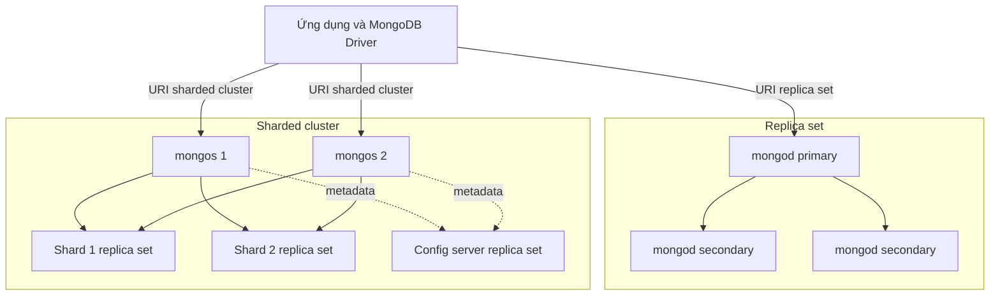
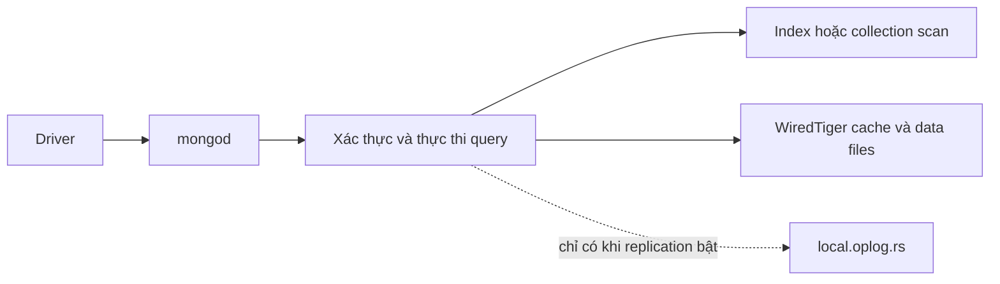
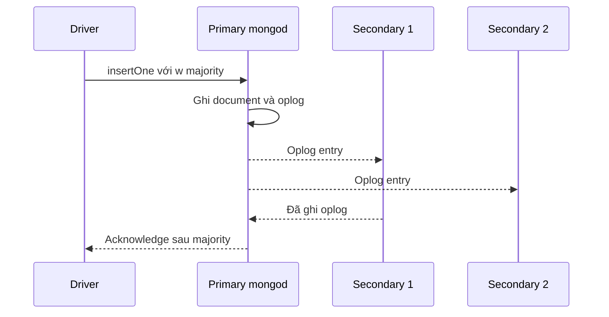
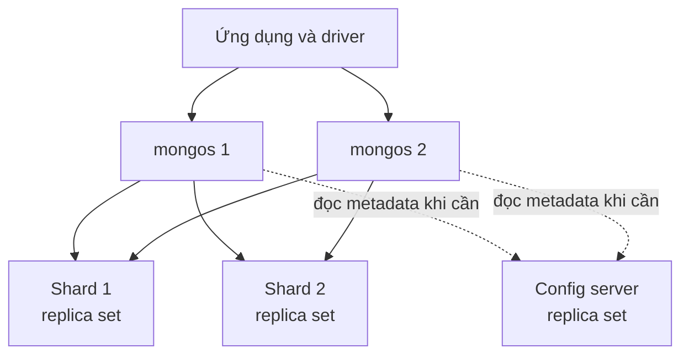
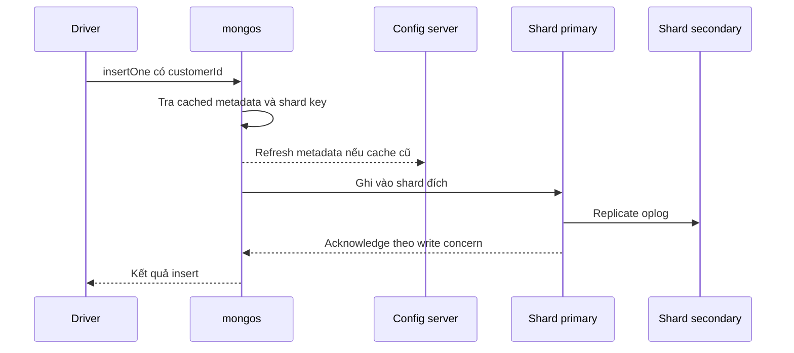

import { Step, Steps } from 'fumadocs-ui/components/steps';
import { Tab, Tabs } from 'fumadocs-ui/components/tabs';

<Callout type="info" title="Phạm vi của bài">
  Bài này giải thích kiến trúc MongoDB tự quản lý theo ba cấp độ: một tiến trình
  `mongod` standalone, một replica set và một sharded cluster. MongoDB Atlas che
  giấu phần lớn công việc triển khai, nhưng các vai trò và luồng dữ liệu bên dưới
  vẫn là nền tảng để đọc topology, chọn connection string và chẩn đoán sự cố.
</Callout>

## Mục lục

- [Mục tiêu và mô hình tư duy](#mục-tiêu-và-mô-hình-tư-duy)
  - [Hai câu hỏi để đọc mọi topology](#hai-câu-hỏi-để-đọc-mọi-topology)
- [Bức tranh tổng thể](#bức-tranh-tổng-thể)
  - [Bốn lớp kiến trúc](#bốn-lớp-kiến-trúc)
  - [Luồng kết nối từ ứng dụng](#luồng-kết-nối-từ-ứng-dụng)
- [Standalone điểm bắt đầu](#standalone-điểm-bắt-đầu)
  - [Standalone là gì](#standalone-là-gì)
  - [Luồng đọc và ghi](#luồng-đọc-và-ghi)
  - [Khi nào dùng và giới hạn](#khi-nào-dùng-và-giới-hạn)
- [mongod và vòng đời dữ liệu](#mongod-và-vòng-đời-dữ-liệu)
  - [Vai trò của mongod](#vai-trò-của-mongod)
  - [Cấu hình tối thiểu](#cấu-hình-tối-thiểu)
  - [Từ request đến storage engine](#từ-request-đến-storage-engine)
- [Replica set cho tính sẵn sàng](#replica-set-cho-tính-sẵn-sàng)
  - [Thành phần và vai trò](#thành-phần-và-vai-trò)
  - [Oplog và đồng bộ](#oplog-và-đồng-bộ)
  - [Election và failover](#election-và-failover)
  - [Khởi tạo replica set ba thành viên](#khởi-tạo-replica-set-ba-thành-viên)
  - [Luồng ghi](#luồng-ghi)
  - [Luồng đọc](#luồng-đọc)
- [Sharded cluster cho mở rộng theo chiều ngang](#sharded-cluster-cho-mở-rộng-theo-chiều-ngang)
  - [Các thành phần chính](#các-thành-phần-chính)
  - [Shard là replica set](#shard-là-replica-set)
  - [Config server](#config-server)
  - [Mongos](#mongos)
  - [Shard key và chunk](#shard-key-và-chunk)
- [Luồng đọc và ghi trong sharded cluster](#luồng-đọc-và-ghi-trong-sharded-cluster)
  - [Luồng ghi qua mongos](#luồng-ghi-qua-mongos)
  - [Đọc targeted](#đọc-targeted)
  - [Đọc scatter gather](#đọc-scatter-gather)
  - [Cập nhật xóa và giao dịch](#cập-nhật-xóa-và-giao-dịch)
- [Tính sẵn sàng nhất quán và độ bền](#tính-sẵn-sàng-nhất-quán-và-độ-bền)
  - [Ba khái niệm cần tách biệt](#ba-khái-niệm-cần-tách-biệt)
  - [Write concern](#write-concern)
  - [Read preference và read concern](#read-preference-và-read-concern)
  - [Các kịch bản lỗi](#các-kịch-bản-lỗi)
- [Scale up và scale out](#scale-up-và-scale-out)
  - [Tăng tài nguyên cho một mongod](#tăng-tài-nguyên-cho-một-mongod)
  - [Replica set có scale write không](#replica-set-có-scale-write-không)
  - [Khi nào cần sharding](#khi-nào-cần-sharding)
- [Chọn topology và triển khai thực tế](#chọn-topology-và-triển-khai-thực-tế)
  - [Quy trình lựa chọn](#quy-trình-lựa-chọn)
  - [Các nguyên tắc triển khai](#các-nguyên-tắc-triển-khai)
- [So sánh nhanh](#so-sánh-nhanh)
- [Gotcha thường gặp](#gotcha-thường-gặp)
- [Tóm tắt](#tóm-tắt)
- [Đọc tiếp](#đọc-tiếp)

## Mục tiêu và mô hình tư duy

MongoDB không có một topology duy nhất. Topology là cách các tiến trình MongoDB
được bố trí, kết nối và sở hữu dữ liệu. Bắt đầu từ một `mongod` đơn giản giúp ta
hiểu đường đi của một request. Sau đó, replica set thêm các bản sao để chịu lỗi.
Sharded cluster chia tập dữ liệu giữa nhiều shard để tăng dung lượng và throughput
(thông lượng xử lý).

| Mô hình | Dữ liệu nằm ở đâu | Mục tiêu chính | Cái giá phải trả |
| --- | --- | --- | --- |
| Standalone | Một `mongod` giữ toàn bộ dữ liệu | Học tập, local development, thử nghiệm | Không có failover tự động |
| Replica set | Nhiều `mongod` giữ các bản sao giống nhau | High availability (HA, tính sẵn sàng cao) và durability (độ bền) | Ghi vẫn tập trung vào primary; phải vận hành replication |
| Sharded cluster | Nhiều shard, mỗi shard giữ một phần dữ liệu | Scale-out (mở rộng ngang) dung lượng và tải đọc ghi | Cần chọn shard key, vận hành `mongos` và metadata |

### Hai câu hỏi để đọc mọi topology

Khi nhìn một sơ đồ MongoDB, hãy trả lời hai câu hỏi sau theo thứ tự:

1. **Ai lưu document?** Một tiến trình `mongod` hoặc một nhóm `mongod` trong
   replica set lưu các file dữ liệu. `mongos` chỉ định tuyến request, còn config
   server lưu metadata của cluster chứ không lưu toàn bộ document người dùng.
2. **Ai quyết định request đi đâu?** Trong standalone và replica set, MongoDB
   Driver (thư viện kết nối từ ứng dụng) khám phá `mongod` phù hợp. Trong sharded
   cluster, driver gửi request tới `mongos`, rồi `mongos` dùng shard key và
   metadata để chọn shard.

Phân biệt hai câu hỏi này giúp tránh một nhầm lẫn phổ biến: thêm `mongos` không
làm tăng dung lượng lưu trữ, còn thêm secondary vào replica set cũng không tự động
tăng khả năng ghi.

## Bức tranh tổng thể

Sơ đồ dưới đây đặt ba topology cạnh nhau. Một ứng dụng có thể kết nối trực tiếp
với replica set bằng URI có `replicaSet`, hoặc kết nối tới một hay nhiều `mongos`
trong sharded cluster. Trong cluster phân mảnh, đường nét đứt biểu diễn việc
`mongos` đọc metadata từ config server khi cần; request dữ liệu đi tới shard.



### Bốn lớp kiến trúc

| Thành phần | Vai trò | Không nên nhầm với |
| --- | --- | --- |
| MongoDB Driver | Mở connection pool, khám phá topology, chọn server, quản lý session và chuyển kết quả về ứng dụng | Một proxy lưu dữ liệu |
| `mongod` | Nhận request, xác thực, thực thi query, đọc ghi storage engine và tham gia replication | `mongos` |
| `mongos` | Query router không trạng thái; phân tích request và định tuyến tới một hoặc nhiều shard | Một `mongod` có thêm bản sao |
| Config server replica set | Lưu metadata: shard key, range hoặc chunk, mapping database và các thiết lập cluster | Kho chứa document của ứng dụng |

**Data plane** là đường dữ liệu thực tế: ứng dụng, `mongos`, shard và các
`mongod`. **Control plane** là thông tin giúp định tuyến và quản trị: config
server, metadata và balancer. Balancer là cơ chế cân bằng dữ liệu giữa các shard,
không phải một loại database riêng mà ứng dụng kết nối vào.

### Luồng kết nối từ ứng dụng

Connection string không chỉ chứa địa chỉ. Nó còn cho driver biết kiểu topology và
các chính sách như read preference hoặc write concern.

<Tabs items={['Standalone', 'Replica set', 'Sharded cluster']}>
  <Tab value="Standalone">

```text
mongodb://127.0.0.1:27017/shop
```

  </Tab>
  <Tab value="Replica set">

```text
mongodb://db1.example.net:27017,db2.example.net:27017,db3.example.net:27017/shop?replicaSet=app-rs&retryWrites=true&w=majority
```

  </Tab>
  <Tab value="Sharded cluster">

```text
mongodb://mongos-1.example.net:27017,mongos-2.example.net:27017/shop?retryWrites=true&w=majority
```

  </Tab>
</Tabs>

Với URI replica set, danh sách seed ban đầu chỉ là điểm bắt đầu. Driver kết nối
vào các seed, đọc topology, biết member nào là primary và tự cập nhật khi có
election. Vì vậy, ứng dụng không nên ghim cứng vào hostname của primary hiện tại.
Với sharded cluster, ứng dụng không nên dùng URI của từng shard để truy cập dữ
liệu nghiệp vụ; hãy dùng URI của `mongos`.

## Standalone điểm bắt đầu

### Standalone là gì

Standalone là một tiến trình `mongod` không tham gia replica set. Tiến trình này
sở hữu toàn bộ database trên một `dbPath`, lắng nghe một cổng và tự xử lý cả đọc
lẫn ghi. Đây là topology nhỏ nhất, không phải phiên bản rút gọn của HA.

Ví dụ chạy local bằng một thư mục dữ liệu riêng:

```bash
mkdir -p ./data/db
mongod --dbpath ./data/db --bind_ip 127.0.0.1 --port 27017
```

Ở terminal khác, mở shell và ghi một document (bản ghi dạng tài liệu):

```javascript
mongosh "mongodb://127.0.0.1:27017/shop"

use shop

db.orders.insertOne({
  orderId: "ord-1001",
  customerId: "cust-042",
  status: "PAID",
  total: NumberDecimal("125.50"),
  createdAt: ISODate("2026-01-15T10:00:00Z")
})

db.orders.findOne({ orderId: "ord-1001" })
```

Trong URI trên, `shop` là database logic. Database và collection có thể được tạo
ngầm khi lệnh ghi đầu tiên chạy, nên không cần tạo chúng bằng một bước riêng.

### Luồng đọc và ghi

Với standalone, đường đi không có bước chọn primary, nhân bản oplog hay định tuyến
shard:



`mongod` thường dùng WiredTiger làm storage engine mặc định. Query planner (bộ
phận chọn kế hoạch thực thi) quyết định dùng index hay quét collection. Với một
lệnh ghi, storage engine cập nhật dữ liệu và journal theo cấu hình; sau đó server
trả acknowledgment (xác nhận) cho client.

Một document đơn lẻ vẫn có tính nguyên tử trong standalone. Tuy nhiên, transaction
nhiều document yêu cầu deployment là replica set hoặc sharded cluster. Khi cần
transaction trong môi trường local, có thể chạy **single-node replica set**; đó
là một `mongod` có `replSetName`, không còn là standalone thuần túy.

### Khi nào dùng và giới hạn

Standalone phù hợp cho:

- học `mongosh`, phát triển tính năng trên máy cá nhân và chạy test đơn giản;
- benchmark cô lập khi ta không muốn chi phí replication;
- công cụ tạm thời hoặc dữ liệu có thể tạo lại.

Standalone không phù hợp khi SLA yêu cầu tiếp tục phục vụ sau khi máy hoặc tiến
trình hỏng. Backup giúp khôi phục dữ liệu, nhưng không tạo ra failover tự động.
Một bản backup được chụp từ standalone cũng không thay thế cho bản sao online của
replica set.

<Callout type="warn" title="Đừng mở standalone ra Internet">
  `--bind_ip 127.0.0.1` giới hạn listener vào máy local. Nếu đổi sang địa chỉ khác,
  cần cấu hình firewall, authentication và TLS trước khi cho client bên ngoài
  kết nối. `--bind_ip 0.0.0.0` một mình không phải là cấu hình production an toàn.
</Callout>

## mongod và vòng đời dữ liệu

### Vai trò của mongod

`mongod` là server process thực sự sở hữu dữ liệu và thực thi lệnh MongoDB. Cùng
một binary có thể chạy ở các vai trò khác nhau:

- standalone: không có `replication.replSetName`;
- member của replica set: có `replSetName`, một primary hoặc secondary;
- shard server: `mongod` của một shard, thường khởi động với vai trò `--shardsvr`;
- config server: `mongod` của config server replica set, khởi động với vai trò
  `--configsvr`.

`--shardsvr` và `--configsvr` không biến `mongod` thành `mongos`. Chúng áp dụng các
mặc định và ràng buộc phù hợp với vai trò; `mongod` vẫn là tiến trình xử lý dữ liệu
hoặc metadata ở phía server.

### Cấu hình tối thiểu

Một member của replica set có thể có cấu hình khái niệm như sau:

```yaml
storage:
  dbPath: /var/lib/mongodb

systemLog:
  destination: file
  path: /var/log/mongodb/mongod.log

net:
  bindIp: 10.10.0.11
  port: 27017

replication:
  replSetName: app-rs
```

Mỗi host cần `dbPath`, port và địa chỉ riêng, nhưng `replSetName` phải giống nhau.
Các hostname trong `rs.initiate()` phải phân giải được từ mọi member và từ ứng dụng.
Đoạn YAML chưa bao gồm authentication, TLS, keyfile hoặc phân quyền hệ điều hành;
đó là các phần bắt buộc khi triển khai thật.

### Từ request đến storage engine

Một request thông thường đi qua các lớp sau:

1. Driver chọn connection và gửi lệnh tới `mongod` hoặc `mongos`.
2. Server xác thực client, kiểm tra authorization rồi phân tích lệnh.
3. Query planner chọn index hoặc collection scan và thực thi lệnh.
4. WiredTiger đọc cache, index và data files; với ghi trong replica set, primary
   đồng thời ghi operation vào oplog.
5. Server trả kết quả hoặc acknowledgment theo chính sách của request.

Oplog chỉ xuất hiện khi `mongod` tham gia replication. `mongos` không có data files
để đi qua các bước storage engine này.

## Replica set cho tính sẵn sàng

Replica set là một nhóm `mongod` cùng duy trì một dataset. Tại một thời điểm,
nhóm có một primary nhận ghi và một hoặc nhiều secondary sao chép dữ liệu. Nếu
primary mất kết nối, các member đủ điều kiện có thể bầu một primary mới.

Replica set giải quyết **HA và redundancy** (dư thừa), không giải quyết trực tiếp
việc một dataset lớn hơn dung lượng của một máy. Nó cũng không làm mọi write chạy
song song trên mọi member.

### Thành phần và vai trò

| Thành phần | Nhiệm vụ | Có giữ dữ liệu không | Có thể trở thành primary không |
| --- | --- | --- | --- |
| Primary | Nhận write và mặc định nhận read; tạo oplog entry | Có | Đang là primary |
| Secondary | Đọc oplog rồi apply thay đổi; có thể phục vụ read nếu driver chọn | Có | Có, nếu đủ điều kiện |
| Arbiter | Chỉ bỏ phiếu trong election | Không | Không |
| Hidden hoặc delayed secondary | Bản sao phục vụ backup, báo cáo hoặc khôi phục theo thiết kế | Có | Thường cấu hình không được bầu |

Ba member **data-bearing** (primary-secondary-secondary, thường gọi là P-S-S) là
lựa chọn production phổ biến. Arbiter tiết kiệm tài nguyên nhưng không tạo thêm
bản sao dữ liệu, vì vậy P-S-arbiter chỉ có hai bản đầy đủ của dataset. Số phiếu
majority cho một replica set ba member là hai; mất majority thường đồng nghĩa
không thể bầu primary mới.

### Oplog và đồng bộ

Oplog (operations log) là log tuần tự của các thay đổi mà primary đã ghi. Nó nằm
trong `local.oplog.rs`, có dung lượng giới hạn và được secondary đọc tuần tự để
apply vào dataset riêng của mình.

```text
Primary mongod
    │ ghi document và local.oplog.rs
    ├──────────────► Secondary 1: đọc oplog rồi apply
    └──────────────► Secondary 2: đọc oplog rồi apply
```

Replication giữa primary và secondary là bất đồng bộ. Vì vậy, ngay sau một write,
secondary có thể chưa nhìn thấy document. Khoảng thời gian các entry còn nằm trong
oplog được gọi là **oplog window**. Nếu secondary bị chậm lâu hơn window, nó không
thể chỉ tiếp tục từ entry cũ; member đó thường cần initial sync, tức sao chép lại
dataset rồi tiếp tục theo oplog.

Có thể xem trạng thái cơ bản trong `mongosh`:

```javascript
rs.status()
rs.printReplicationInfo()
rs.printSecondaryReplicationInfo()
```

Replication không phải backup. Một lệnh `deleteMany()` hợp lệ cũng được ghi vào
oplog và xóa trên các bản sao. Muốn chống xóa nhầm hoặc ransomware, cần backup,
retention và kiểm thử restore độc lập.

### Election và failover

Các member gửi heartbeat để theo dõi nhau. Khi primary không còn reachable, một
secondary đủ điều kiện khởi động election. Candidate cần majority phiếu bầu để
trở thành primary; cơ chế này giúp một partition thiểu số không tự tạo primary
thứ hai.

Trong khoảng giữa lúc primary hỏng và election hoàn tất:

- các write dùng read preference mặc định `primary` có thể nhận lỗi tạm thời;
- driver có thể khám phá primary mới và retry một số write nếu bật retryable writes;
- ứng dụng vẫn phải xử lý timeout, lỗi mạng và khả năng request đã được server
  thực thi nhưng acknowledgment bị mất;
- write chỉ được xác nhận ở primary (`w: 1`) có thể bị rollback nếu primary cũ
  step down trước khi thay đổi được sao chép.

Failover là một khoảng gián đoạn ngắn, không phải lời hứa zero downtime. Hãy đo
thời gian election, cấu hình timeout phù hợp và viết retry theo hướng idempotent.

### Khởi tạo replica set ba thành viên

Đây là luồng minh họa cho môi trường học tập. Production cần bổ sung TLS,
authentication, internal authentication, giám sát và phân bố member qua các failure
domain (miền lỗi) khác nhau.

<Steps>
  <Step>
    **Chuẩn bị ba host.** Đặt tên `db1`, `db2`, `db3`, mở kết nối nội bộ tới port
    MongoDB và bảo đảm mỗi host phân giải được tên của hai host còn lại.
  </Step>
  <Step>
    **Bật cùng một replica set name.** Trên cả ba `mongod`, dùng cấu hình tương tự
    và thay `dbPath`, `bindIp` theo từng host:

```yaml
replication:
  replSetName: app-rs
```

    Khởi động từng server bằng file cấu hình tương ứng:

```bash
mongod --config /etc/mongodb/mongod.conf
```
  </Step>
  <Step>
    **Initiate từ một member.** Chạy lệnh sau trong `mongosh` kết nối tới `db1`:

```javascript
rs.initiate({
  _id: "app-rs",
  members: [
    { _id: 0, host: "db1.example.net:27017" },
    { _id: 1, host: "db2.example.net:27017" },
    { _id: 2, host: "db3.example.net:27017" }
  ]
})
```
  </Step>
  <Step>
    **Kiểm tra topology và thử failover.** Xác nhận có một primary, hai secondary
    rồi tắt primary trong môi trường test. Sau election, driver phải kết nối được
    primary mới qua URI có đủ seed và `replicaSet=app-rs`.

```javascript
rs.status()
db.hello()
```
  </Step>
</Steps>

### Luồng ghi

Ứng dụng gửi write tới primary. Primary cập nhật dataset của nó và ghi oplog; các
secondary theo dõi oplog và apply cùng thay đổi. `write concern` (chính sách yêu
cầu xác nhận ghi) quyết định thời điểm client nhận acknowledgment.



Với replica set P-S-S, `w: "majority"` thường cần primary và ít nhất một
secondary ghi bền vững vào oplog trước khi xác nhận. Các secondary còn lại vẫn
tiếp tục apply bất đồng bộ. Nếu nghiệp vụ có khóa tự nhiên, tạo unique index để
retry an toàn hơn:

```javascript
db.orders.createIndex({ orderId: 1 }, { unique: true })

db.orders.insertOne(
  {
    orderId: "ord-1002",
    customerId: "cust-042",
    status: "PAID",
    total: NumberDecimal("49.90"),
    createdAt: ISODate("2026-01-15T10:05:00Z")
  },
  { writeConcern: { w: "majority", j: true, wtimeout: 5000 } }
)
```

`wtimeout` chỉ giới hạn thời gian chờ acknowledgment. Timeout không chứng minh
write đã rollback; write có thể đã tới server và sau đó tiếp tục replicate. Vì
vậy, retry phải chịu được việc gửi lại cùng `orderId`.

### Luồng đọc

Read preference mặc định là `primary`. Driver chọn primary hiện tại, nên ứng
 dụng thường thấy dữ liệu mới nhất trên đường đọc chính sau khi write được xác
nhận. Có thể chuyển một số workload ít nhạy với độ mới sang secondary để phân tán
read, nhưng secondary có thể có replication lag (độ trễ sao chép).

Ví dụ mở một shell ưu tiên secondary khi có thể:

```bash
mongosh "mongodb://db1.example.net:27017,db2.example.net:27017,db3.example.net:27017/shop?replicaSet=app-rs&readPreference=secondaryPreferred"
```

Các mode chính là `primary`, `primaryPreferred`, `secondary`,
`secondaryPreferred` và `nearest`. `nearest` chọn member đủ điều kiện có độ trễ
mạng thấp, không có nghĩa là member có dữ liệu mới nhất. Read preference chỉ nói
**đọc từ member nào**; nó không tự đặt mức nhất quán hay độ mới của dữ liệu.

## Sharded cluster cho mở rộng theo chiều ngang

Sharded cluster phân phối một collection giữa nhiều shard theo **shard key**.
Shard key là một hoặc nhiều field mà MongoDB dùng để ánh xạ document tới vùng dữ
liệu. Khác với replica set, sharding có thể tăng tổng dung lượng và write capacity
bằng cách đưa các vùng dữ liệu tới các shard khác nhau.

Trong production, mỗi shard là một replica set và config server cũng là một
replica set. Một `mongos` đơn lẻ có thể đủ cho development, nhưng production nên
có nhiều router và phân bố chúng khỏi cùng một failure domain.



### Các thành phần chính

| Thành phần | Nhiệm vụ trong sharded cluster | Nếu thành phần hỏng |
| --- | --- | --- |
| Shard | Giữ một phần dữ liệu sharded; production thường là một replica set | Chỉ shard liên quan bị ảnh hưởng, nhưng request cần shard đó có thể lỗi trong lúc failover |
| Config server replica set | Giữ metadata và cấu hình định tuyến của cluster | Mất majority có thể làm cluster không thể cập nhật hoặc tin cậy metadata |
| `mongos` | Nhận request, chọn shard, gửi request song song và merge kết quả | Router đó mất kết nối; driver có thể dùng router khác |
| Balancer | Di chuyển range hoặc chunk giữa shard để cân bằng dữ liệu | Dữ liệu hiện có vẫn phục vụ, nhưng mất cân bằng có thể kéo dài |

Metadata là dữ liệu điều khiển, chẳng hạn database thuộc primary shard nào,
collection dùng shard key nào và range hiện ở shard nào. Config server không phải
một bản sao của mọi collection người dùng.

### Shard là replica set

Một shard production nên có ít nhất ba data-bearing member. Replica set bên trong
shard cung cấp HA cho phần dữ liệu mà shard đó sở hữu; sharding bên ngoài cung cấp
phân phối dữ liệu giữa các shard. Hai lớp này bổ sung cho nhau:

```text
Sharded cluster
├── Shard 1: orders-rs → primary + secondary + secondary
├── Shard 2: orders-rs → primary + secondary + secondary
└── Config server: cfg-rs → 3 member metadata
```

Một cluster có nhiều shard nhưng mỗi shard là standalone vẫn có điểm lỗi đơn
(single point of failure) ở từng shard. Thêm shard không tự chữa lỗi của shard
đang giữ phần dữ liệu bị hỏng.

Cũng cần phân biệt **primary shard** với **primary member**. Primary member là
vai trò của một `mongod` trong replica set. Primary shard là shard mặc định giữ
các collection **chưa shard** của một database; đây là hai khái niệm khác nhau.

### Config server

Config server chạy `mongod` ở vai trò `--configsvr` và được triển khai thành
config server replica set (CSRS). Nó lưu metadata để `mongos` biết cách route,
không lưu toàn bộ document như một database trung tâm.

`mongos` thường cache metadata để không hỏi config server cho từng document. Khi
metadata thay đổi, ví dụ chunk migration, router refresh cache. Config server vẫn
là dependency quan trọng của control plane, nên cần majority, disk bền vững,
backup và giám sát riêng.

Một lệnh khởi động router thường tham chiếu CSRS bằng replica set name và seed list:

```bash
mongos \
  --configdb cfg-rs/cfg1.example.net:27019,cfg2.example.net:27019,cfg3.example.net:27019 \
  --bind_ip 10.10.20.10 \
  --port 27017
```

Lệnh trên chỉ là phần kết nối của router. Cần initiate `cfg-rs`, bật bảo mật và
khởi động các shard trước khi cấu hình cluster hoàn chỉnh.

### Mongos

`mongos` là query router stateless (không giữ state dữ liệu bền vững). Nó:

1. nhận request từ driver;
2. đọc shard key và metadata đang cache;
3. gửi request tới shard đích hoặc nhiều shard;
4. merge kết quả, thứ tự sort và các phần cursor cần thiết;
5. trả một kết quả thống nhất cho driver.

Có thể chạy nhiều `mongos` để tránh một router trở thành điểm lỗi và để tăng khả
năng nhận connection. Tuy nhiên, tăng số router không tăng dung lượng lưu trữ.
Nhiều router cũng tạo thêm lưu lượng trao đổi metadata với config server, nên cần
đo trước khi nhân bản vô hạn.

Ứng dụng nên kết nối tới nhiều địa chỉ `mongos` hoặc một load balancer được cấu
hình phù hợp. Không nên bypass `mongos` để ứng dụng tự kết nối thẳng từng shard,
vì khi đó ứng dụng tự gánh việc định tuyến, metadata và thay đổi topology.

### Shard key và chunk

MongoDB dùng shard key để chia không gian key thành các range hoặc chunk và gán
chúng cho shard. Một shard key tốt cần cân bằng ba mục tiêu:

- **Cardinality cao:** có đủ giá trị khác nhau để dữ liệu không dồn vào vài vùng;
- **Phân phối đều:** tốc độ ghi và kích thước dữ liệu không tạo một shard nóng;
- **Query isolation:** phần lớn query quan trọng có thể chứa shard key để router
  nhắm đúng shard.

Ví dụ collection `orders` thường truy vấn theo khách hàng và khoảng thời gian.
Có thể chọn compound shard key `{ customerId: 1, createdAt: 1 }` nếu dữ liệu và
workload thực tế phù hợp:

```javascript
// Chạy từ mongos. Với MongoDB 6.0 trở lên, không cần gọi
// sh.enableSharding() chỉ để shard collection.
use shop

db.orders.createIndex({ customerId: 1, createdAt: 1 })
sh.shardCollection("shop.orders", { customerId: 1, createdAt: 1 })

sh.status()
```

Đây là ví dụ để minh họa cách lệnh hoạt động, không phải lời khẳng định rằng
`customerId` luôn là shard key đúng. Nếu một khách hàng tạo phần lớn traffic, key
này vẫn có thể tạo hotspot. Shard key dạng hashed giúp phân tán giá trị tốt hơn
nhưng thường làm các range query khó target hơn. Hãy đo query shape, cardinality,
tần suất ghi và kích thước document trước khi chốt key.

Balancer có thể di chuyển chunk để giảm mất cân bằng. Migration dùng network và
I/O; nó không làm cho một shard key kém trở thành tốt. Đổi shard key là thay đổi
lớn, cần kế hoạch resharding và kiểm thử riêng.

## Luồng đọc và ghi trong sharded cluster

### Luồng ghi qua mongos

Với collection đã shard, `mongos` dùng shard key để chọn nơi ghi. Mỗi shard đích
vẫn dùng primary của replica set bên trong để ghi và áp dụng write concern. Config
server chỉ được hỏi khi router cần refresh metadata, không phải là nơi nhận
document thay cho shard.



Nếu request không có đủ thông tin shard key, router có thể phải gửi request tới
nhiều shard. Với `insertOne`, luôn đưa các field shard key vào document. Với update
hoặc delete, đưa shard key vào filter khi nghiệp vụ cho phép để tránh broadcast.

### Đọc targeted

**Targeted read** là read mà `mongos` xác định được một shard hoặc một tập nhỏ
shard từ filter và shard key. Ví dụ với key `{ customerId: 1, createdAt: 1 }`,
filter có equality trên `customerId` và range trên `createdAt` thường giúp query
được target:

```javascript
db.orders.find({
  customerId: "cust-042",
  createdAt: {
    $gte: ISODate("2026-01-01T00:00:00Z"),
    $lt: ISODate("2026-02-01T00:00:00Z")
  }
}).explain("executionStats")
```

`explain("executionStats")` giúp kiểm tra query thực tế đã đi qua bao nhiêu shard,
không nên suy luận chỉ từ câu query. Targeted query thường giảm network, CPU merge
và độ trễ tail (độ trễ ở percentile cao).

### Đọc scatter gather

**Scatter-gather** xảy ra khi `mongos` phải broadcast query tới nhiều hoặc tất cả
shard rồi gom kết quả. Ví dụ sau không có `customerId`, nên không cung cấp phần
đầu của shard key đã chọn:

```javascript
db.orders.find({ status: "PAID" }).sort({ createdAt: -1 }).limit(20)
```

Query vẫn có thể đúng, nhưng mỗi shard phải xử lý phần của nó và `mongos` phải
merge, sort hoặc giới hạn kết quả. Khi số shard tăng, chi phí fan-out và merge có
thể tăng theo. Index `{ status: 1, createdAt: -1 }` trên từng shard có thể giúp
mỗi shard xử lý nhanh hơn, nhưng không biến query này thành targeted read.

### Cập nhật xóa và giao dịch

`updateMany()` hoặc `deleteMany()` không có shard key có thể broadcast. Đây là
rủi ro vận hành lớn trong job batch: một lệnh tưởng như chạy một lần có thể tạo tải
trên mọi shard. Nên giới hạn theo shard key, chia batch có kiểm soát và kiểm tra
`explain` hoặc kế hoạch phù hợp trước khi chạy production.

Transaction nhiều document trong sharded cluster có thể cần phối hợp giữa nhiều
shard. Coordination bổ sung latency và failure mode. Nếu các document luôn được
đọc ghi cùng nhau, hãy cân nhắc embedding hoặc chọn shard key giúp chúng có data
locality (nằm cùng vùng dữ liệu). Khi thật sự cần transaction, đọc trong transaction
phải dùng read preference `primary` và cần đặt write concern ở cấp transaction,
không phải từng operation. Xem thêm [transaction nhiều document](../transactions-va-consistency/multi-document-transactions).

## Tính sẵn sàng nhất quán và độ bền

### Ba khái niệm cần tách biệt

Ba thuật ngữ thường bị dùng lẫn nhưng trả lời ba câu hỏi khác nhau:

| Khái niệm | Câu hỏi | Cơ chế liên quan |
| --- | --- | --- |
| Availability hoặc HA | Sau khi một process, host hoặc zone hỏng, hệ thống còn phục vụ được không? | Replica set, election, nhiều `mongos`, majority |
| Durability | Khi server đã xác nhận write, thay đổi có sống sót sau lỗi node không? | `writeConcern`, journal, replica, backup |
| Consistency và recency | Read được nhìn thấy phiên bản dữ liệu nào và có thể cũ bao lâu? | `readConcern`, `readPreference`, session, replication lag |

Một secondary là bản sao cho HA, nhưng read từ secondary có thể cũ. Một write có
`w: 1` có thể nhanh, nhưng dễ bị rollback hơn write đã được majority ghi nhận.
Backup là lớp khôi phục theo thời điểm, không phải cơ chế phục vụ request khi
primary fail.

### Write concern

Write concern có thể yêu cầu:

- `w: 1`: primary đã nhận write;
- `w: "majority"`: majority data-bearing voting members đã ghi change vào oplog
  bền vững;
- `j: true`: yêu cầu journal trên node đáp ứng concern;
- `wtimeout`: giới hạn thời gian chờ, không hủy chắc chắn write đã bắt đầu.

Replica set và sharded cluster thường dùng default write concern là majority, nhưng
với nghiệp vụ quan trọng đặt rõ chính sách trong driver giúp code dễ đọc và tránh
phụ thuộc cấu hình deployment. Ví dụ trong `mongosh`:

```javascript
db.payments.insertOne(
  {
    paymentId: "pay-9001",
    orderId: "ord-1002",
    amount: NumberDecimal("49.90"),
    status: "CAPTURED",
    createdAt: ISODate("2026-01-15T10:06:00Z")
  },
  {
    writeConcern: {
      w: "majority",
      j: true,
      wtimeout: 5000
    }
  }
)
```

Majority an toàn hơn nhưng có thể làm write chậm hoặc trả write concern timeout
khi deployment mất majority. Không nên tự động retry vô hạn; hãy phân loại lỗi,
dùng idempotency key và quyết định trạng thái nghiệp vụ bằng cách đọc lại khi cần.
Trong sharded cluster, `mongos` chuyển write concern tới shard liên quan.

### Read preference và read concern

Read preference chọn member; read concern chọn mức dữ liệu được phép nhìn thấy.
Ví dụ sau ưu tiên secondary nhưng chỉ yêu cầu dữ liệu đã majority-commit:

```bash
mongosh "mongodb://db1.example.net:27017,db2.example.net:27017,db3.example.net:27017/shop?replicaSet=app-rs&readPreference=secondaryPreferred&readConcernLevel=majority"
```

| Thiết lập | Điều khiển | Gotcha chính |
| --- | --- | --- |
| `readPreference: primary` | Đọc từ primary hiện tại | Không đọc được khi chưa có primary |
| `readPreference: secondaryPreferred` | Ưu tiên secondary, fallback về primary | Có thể thấy dữ liệu cũ; không phải read mới nhất |
| `readPreference: nearest` | Chọn member đủ điều kiện có latency thấp | Latency thấp không đồng nghĩa recency cao |
| `readConcern: majority` | Chỉ thấy dữ liệu đã commit theo majority | Có thể tăng thời gian chờ khi majority không sẵn sàng |
| Session có causal consistency | Giữ quan hệ trước-sau giữa các operation trong cùng session | Cần dùng cùng session và thiết lập concern phù hợp |

`readPreference` không biến secondary thành một bản sao đồng bộ. Nếu use case là
read-after-write nghiêm ngặt, đọc từ primary hoặc dùng causal consistent session
thay vì mặc định gửi read sang secondary.

### Các kịch bản lỗi

| Sự cố | Điều MongoDB có thể làm | Điều ứng dụng hoặc vận hành vẫn phải làm |
| --- | --- | --- |
| Primary của replica set hỏng | Secondary đủ điều kiện bầu primary mới | Retry có giới hạn, xử lý timeout và kiểm tra trạng thái request |
| Một secondary hỏng | Primary vẫn ghi; còn ít redundancy hơn | Sửa member, theo dõi oplog window và không coi cluster đã an toàn như cũ |
| Partition làm mất majority | Không bầu primary ở phía thiểu số để tránh split-brain | Khôi phục network hoặc majority; chấp nhận write có thể tạm dừng |
| Primary của một shard hỏng | Shard đó election; request tới shard khác có thể vẫn chạy | Đảm bảo mỗi shard là replica set và xử lý lỗi request chạm shard đang failover |
| Config server mất majority | Metadata/control plane không còn đáng tin cậy | Khôi phục CSRS; đừng coi dữ liệu shard tự động thay thế metadata |
| Người dùng xóa nhầm dữ liệu | Oplog replicate thao tác xóa | Dùng backup, point-in-time recovery và quy trình restore |

## Scale up và scale out

### Tăng tài nguyên cho một mongod

**Scale up** là tăng CPU, RAM, NVMe hoặc network cho host chứa `mongod`. Đây là
bước đơn giản nhất khi dataset và workload còn vừa một máy. Nó giữ nguyên shard
key, query routing và mô hình vận hành.

Giới hạn của scale up là dung lượng và failure domain vẫn tập trung. Nâng máy
thường cần thay đổi hạ tầng hoặc restart; một máy rất lớn cũng không loại bỏ nhu
cầu backup và failover.

### Replica set có scale write không

Thêm secondary chủ yếu tăng redundancy và có thể tăng năng lực **read workload**
được phép đọc từ secondary. Write của một collection vẫn đi qua primary của
replica set. Vì vậy, thêm ba secondary không biến một write-heavy primary thành
bốn writer độc lập.

Replica set phù hợp khi bài toán là:

- mất một node mà dịch vụ vẫn cần tiếp tục;
- đọc nhiều và có thể chấp nhận độ trễ dữ liệu;
- cần bản sao cho backup, analytics hoặc migration;
- dataset vẫn nằm vừa trong một replica set.

Nếu mọi read đều phải tới primary và write đã bão hòa primary, thêm secondary
không giải quyết bottleneck chính. Hãy tối ưu schema, index, query và cân nhắc
sharding khi giới hạn của một replica set đã rõ ràng.

### Khi nào cần sharding

Sharding phù hợp khi một replica set không còn đủ một hoặc nhiều điều sau:

- dung lượng disk cần lớn hơn một host;
- write throughput cần phân tán;
- working set và index không thể giữ hiệu quả trên một máy;
- có shard key tốt và query workload tương thích với việc định tuyến.

Sharding không phải nút bấm để sửa query chậm. Query thiếu shard key vẫn có thể
scatter-gather trên mọi shard. Thêm shard khi key tạo hotspot còn làm topology
phức tạp hơn mà không tăng throughput như mong đợi.

## Chọn topology và triển khai thực tế

### Quy trình lựa chọn

<Steps>
  <Step>
    **Xác định SLA và failure domain.** Nếu chỉ cần local development, standalone
    đủ. Nếu cần sống qua lỗi một host, bắt đầu với replica set có các member ở
    failure domain khác nhau.
  </Step>
  <Step>
    **Đo dữ liệu và workload.** Ghi lại kích thước dataset, tốc độ tăng trưởng,
    read/write ratio, peak throughput, latency target và query shape. Đừng chọn
    sharding chỉ vì tên topology nghe có vẻ lớn hơn.
  </Step>
  <Step>
    **Kiểm tra shard key trước khi triển khai.** Tìm field có cardinality cao,
    phân phối đều và xuất hiện trong query quan trọng. Dùng dữ liệu gần production
    để kiểm tra hotspot và targeted query.
  </Step>
  <Step>
    **Thiết kế đường kết nối và kiểm thử lỗi.** Ứng dụng dùng URI topology-aware,
    đặt write/read concern rõ ràng, rồi thử primary failure, secondary lag, mất
    router, mất config server majority và restore backup trong môi trường staging.
  </Step>
</Steps>

### Các nguyên tắc triển khai

- Dùng ba data-bearing voting members cho mỗi replica set quan trọng; phân bố qua
  các availability zone hoặc failure domain khác nhau. Arbiter chỉ nên là lựa chọn
  có chủ đích khi chi phí ngăn cản member lưu dữ liệu thứ ba.
- Cho ứng dụng kết nối tới connection string có seed list và `replicaSet`, hoặc
  tới nhiều `mongos`. Không lưu hostname của primary hiện tại trong code.
- Bật TLS, authentication, internal authentication và least privilege. Giới hạn
  network path giữa ứng dụng, `mongos`, shard và config server.
- Theo dõi `rs.status()`, replication lag, oplog window, election, write concern
  timeout, connection pool, router latency và chunk imbalance.
- Chạy index/query review bằng `explain` trước và sau khi thêm shard. Một index
  trên từng shard không thay thế việc target đúng shard.
- Tách backup khỏi replica online và thường xuyên kiểm thử restore. Replication
  nhanh chỉ nhân bản cả lỗi logic lẫn thao tác xóa.

## So sánh nhanh

| Tiêu chí | Standalone | Replica set | Sharded cluster |
| --- | --- | --- | --- |
| Số lớp server | Một `mongod` | Nhiều `mongod` cùng dataset | `mongos` + config server + nhiều shard |
| Failover | Không | Có election trong set | Có ở config server và trong từng shard; router có thể nhân bản |
| Dung lượng một dataset | Giới hạn bởi một host | Vẫn giới hạn bởi một member | Có thể phân phối qua nhiều shard |
| Write scaling | Không | Chủ yếu một primary | Có thể phân tán theo shard key |
| Read scaling | Không | Có thể dùng secondary với trade-off stale read | Có thể target nhiều shard, nhưng query kém sẽ fan-out |
| Độ phức tạp vận hành | Thấp | Trung bình | Cao |
| Trường hợp dùng | Local, test, dữ liệu tạm | Phần lớn production vừa một replica set | Dataset hoặc throughput vượt giới hạn một replica set |

## Gotcha thường gặp

1. **HA không đồng nghĩa zero downtime.** Election, DNS, connection pool và retry
   vẫn tạo một khoảng gián đoạn. Đo SLA bằng thử nghiệm failover, không chỉ bằng số
   member trên sơ đồ.
2. **Replica không phải backup.** Xóa nhầm, update sai hoặc dữ liệu độc hại đều
   được replicate. Cần backup có retention và restore test.
3. **Secondary read có thể cũ.** `secondaryPreferred` chỉ là chính sách định tuyến,
   không phải cam kết read mới nhất.
4. **`wtimeout` không phải rollback.** Timeout chỉ nói client chưa nhận đủ
   acknowledgment trong thời hạn; hãy kiểm tra trạng thái và retry idempotent.
5. **Config server không chứa mọi document.** Mất config server majority là sự cố
   control plane, không phải lý do để đọc dữ liệu từ config server.
6. **`mongos` không phải `mongod`.** Router không có data files và không nên được
   dùng như endpoint để kiểm tra dữ liệu bằng cách suy đoán nó là một shard.
7. **Primary shard không phải primary member.** Một database có primary shard,
   còn mỗi shard lại có primary member riêng.
8. **Thêm secondary không tăng write capacity.** Write vẫn đi tới primary của
   replica set; muốn phân tán write cần workload và shard key phù hợp.
9. **Thêm shard không tự làm query nhanh.** Query không target được shard vẫn có
   thể phải scatter-gather và merge trên `mongos`.
10. **Single-node replica set chỉ giúp bật tính năng.** Nó cho transaction và
    một số hành vi replica set trong local, nhưng vẫn không chịu được lỗi host.

<Callout type="idea" title="Nguyên tắc thực hành">
  Hãy bắt đầu từ workload và failure domain, không bắt đầu từ topology. Chọn
  replica set để có bản sao và failover; chỉ chọn sharding khi có lý do đo được về
  dung lượng hoặc throughput và đã chứng minh shard key có thể target query.
</Callout>

## Tóm tắt

- `mongod` là tiến trình nhận lệnh, thực thi query và sở hữu storage; `mongos` là
  router stateless; config server giữ metadata của sharded cluster.
- Standalone đơn giản nhưng không có bản sao và failover.
- Replica set dùng primary, secondary và oplog để cung cấp HA; write vẫn tập trung
  ở primary, còn read từ secondary phải chấp nhận khả năng stale.
- Sharded cluster kết hợp nhiều shard replica set với `mongos` và config server.
  Shard key quyết định request có được target hay phải scatter-gather.
- `writeConcern`, `readPreference` và `readConcern` là ba nhóm lựa chọn khác nhau;
  không nên dùng một nhóm để suy luận thay cho nhóm còn lại.
- HA cần replication và election, durability cần write concern cùng backup, còn
  scale-out cần shard key và dữ liệu được phân phối đúng.

## Đọc tiếp

Để đi tiếp theo series, hãy đọc [Document, collection và database](./document-collection-database)
để ôn đơn vị dữ liệu, rồi xem [Replica set](../replication-va-sharding/replica-set),
[Election và failover](../replication-va-sharding/election-failover) và
[Vận hành replica set](../replication-va-sharding/replica-set-operations) để đi sâu
vào replication. Phần sharding tiếp tục với [Kiến trúc sharded cluster](../replication-va-sharding/sharding-architecture),
[Chọn shard key](../replication-va-sharding/chon-shard-key) và
[Chunk và balancer](../replication-va-sharding/chunk-balancer). Khi cần điều chỉnh
semantics đọc ghi, xem [Read concern](../transactions-va-consistency/read-concern),
[Read preference](../transactions-va-consistency/read-preference) và
[Write concern](../transactions-va-consistency/write-concern).

<Cards>
  <Card
    title="Replica set"
    href="/docs/replication-va-sharding/replica-set"
    description="Primary, secondary, oplog và mô hình sao chép dữ liệu."
  />
  <Card
    title="Election và failover"
    href="/docs/replication-va-sharding/election-failover"
    description="Heartbeat, election và cách ứng dụng vượt qua primary failure."
  />
  <Card
    title="Kiến trúc sharded cluster"
    href="/docs/replication-va-sharding/sharding-architecture"
    description="Shard, mongos và config server trong cluster phân mảnh."
  />
  <Card
    title="Chọn shard key"
    href="/docs/replication-va-sharding/chon-shard-key"
    description="Cardinality, phân phối và query isolation khi chọn key."
  />
</Cards>
