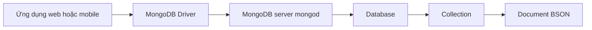
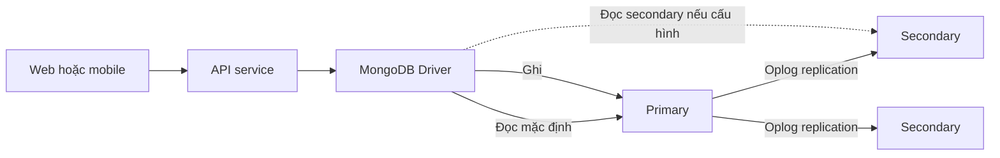

import { Step, Steps } from 'fumadocs-ui/components/steps';
import { Tab, Tabs } from 'fumadocs-ui/components/tabs';

<Callout type="info" title="Phạm vi bài học">
  Bài này dành cho người mới bắt đầu. Mục tiêu không chỉ là nhớ MongoDB lưu dữ liệu ở đâu, mà là biết cách nhìn một bài toán ứng dụng dưới góc độ document database và nhận ra các trade-off trước khi thiết kế.
</Callout>

## Mục lục

- [MongoDB là gì](#mongodb-là-gì)
- [Tư duy document database](#tư-duy-document-database)
  - [Document là đơn vị nghiệp vụ](#document-là-đơn-vị-nghiệp-vụ)
  - [Từ quan hệ đến document](#từ-quan-hệ-đến-document)
- [Mô hình dữ liệu cốt lõi](#mô-hình-dữ-liệu-cốt-lõi)
  - [Document collection và database](#document-collection-và-database)
  - [JSON để đọc BSON để lưu trữ](#json-để-đọc-bson-để-lưu-trữ)
  - [Schema linh hoạt không có nghĩa là dữ liệu tùy ý](#schema-linh-hoạt-không-có-nghĩa-là-dữ-liệu-tùy-ý)
- [Đặc trưng cốt lõi của MongoDB](#đặc-trưng-cốt-lõi-của-mongodb)
  - [Truy vấn document và aggregation](#truy-vấn-document-và-aggregation)
  - [Index và mẫu truy cập](#index-và-mẫu-truy-cập)
  - [Atomicity và transaction](#atomicity-và-transaction)
  - [Replica set và tính sẵn sàng](#replica-set-và-tính-sẵn-sàng)
  - [Sharding và mở rộng ngang](#sharding-và-mở-rộng-ngang)
- [Ví dụ thực tế đơn hàng thương mại điện tử](#ví-dụ-thực-tế-đơn-hàng-thương-mại-điện-tử)
  - [Document mẫu](#document-mẫu)
  - [Đọc và cập nhật theo màn hình](#đọc-và-cập-nhật-theo-màn-hình)
  - [Tổng hợp dữ liệu bằng aggregation](#tổng-hợp-dữ-liệu-bằng-aggregation)
- [Khi nào MongoDB phù hợp](#khi-nào-mongodb-phù-hợp)
  - [Các workload phù hợp](#các-workload-phù-hợp)
  - [Bộ câu hỏi kiểm tra độ phù hợp](#bộ-câu-hỏi-kiểm-tra-độ-phù-hợp)
- [Khi nào MongoDB không phải lựa chọn tốt nhất](#khi-nào-mongodb-không-phải-lựa-chọn-tốt-nhất)
  - [Dấu hiệu cần cân nhắc hệ quản trị khác](#dấu-hiệu-cần-cân-nhắc-hệ-quản-trị-khác)
  - [Không phù hợp không có nghĩa là không thể](#không-phù-hợp-không-có-nghĩa-là-không-thể)
- [Trade-off và gotcha cần nhớ](#trade-off-và-gotcha-cần-nhớ)
  - [Schema linh hoạt vẫn cần kỷ luật](#schema-linh-hoạt-vẫn-cần-kỷ-luật)
  - [Giới hạn kích thước và mảng tăng trưởng](#giới-hạn-kích-thước-và-mảng-tăng-trưởng)
  - [Index giúp đọc nhanh nhưng làm ghi đắt hơn](#index-giúp-đọc-nhanh-nhưng-làm-ghi-đắt-hơn)
  - [Replica set và độ trễ đọc](#replica-set-và-độ-trễ-đọc)
  - [Transaction không thay thế cho data modeling](#transaction-không-thay-thế-cho-data-modeling)
- [Cách bắt đầu hình dung hệ thống](#cách-bắt-đầu-hình-dung-hệ-thống)
  - [Từ use case đến access pattern](#từ-use-case-đến-access-pattern)
  - [Đường đi của một request](#đường-đi-của-một-request)
  - [Chọn deployment tối thiểu](#chọn-deployment-tối-thiểu)
- [Lộ trình bắt đầu](#lộ-trình-bắt-đầu)
  - [Bước 1 chọn một use case nhỏ](#bước-1-chọn-một-use-case-nhỏ)
  - [Bước 2 vẽ document trước khi tạo collection](#bước-2-vẽ-document-trước-khi-tạo-collection)
  - [Bước 3 viết các truy vấn chính](#bước-3-viết-các-truy-vấn-chính)
  - [Bước 4 đo bằng dữ liệu gần thực tế](#bước-4-đo-bằng-dữ-liệu-gần-thực-tế)
  - [Bước 5 chọn topology và mức nhất quán](#bước-5-chọn-topology-và-mức-nhất-quán)
- [Kết luận](#kết-luận)
- [Đọc tiếp trong series](#đọc-tiếp-trong-series)

## MongoDB là gì

MongoDB là một **hệ quản trị cơ sở dữ liệu hướng document** (document-oriented database). Thay vì bắt buộc chia mọi dữ liệu thành các hàng và bảng, MongoDB lưu các **document** — những bản ghi có cấu trúc giống JSON — trong các **collection**.

MongoDB thuộc nhóm **NoSQL**. Trong ngữ cảnh này, NoSQL không có nghĩa là “không thể dùng ngôn ngữ truy vấn” hay “không có transaction”. Nó chỉ một nhóm hệ quản trị không lấy mô hình bảng quan hệ làm trung tâm. MongoDB vẫn có ngôn ngữ truy vấn, index, transaction nhiều document và các cơ chế đảm bảo độ bền dữ liệu.

Ví dụ, một hồ sơ người dùng có thể nằm cùng một document:

```javascript
{
  _id: ObjectId("65f1a0000000000000000101"),
  email: "linh@example.com",
  displayName: "Linh Nguyễn",
  roles: ["customer"],
  address: {
    city: "Đà Nẵng",
    country: "VN"
  },
  createdAt: ISODate("2026-03-01T09:00:00Z")
}
```

`ObjectId` là một kiểu BSON thường dùng cho định danh. `ISODate` trong ví dụ là cách `mongosh` hiển thị một giá trị ngày giờ. Khi document được gửi từ ứng dụng, MongoDB Driver — thư viện kết nối MongoDB trong ngôn ngữ của ứng dụng — sẽ chuyển dữ liệu sang định dạng BSON thích hợp.

Một request thông thường đi qua các lớp sau:



Điểm quan trọng là MongoDB không chỉ là “nơi lưu JSON”. Cách thiết kế document, cách truy vấn và cách triển khai replica set hoặc sharded cluster đều ảnh hưởng trực tiếp đến hiệu năng, độ nhất quán và chi phí vận hành.

## Tư duy document database

Khi dùng cơ sở dữ liệu quan hệ, ta thường bắt đầu bằng việc chuẩn hóa bảng và mô tả quan hệ giữa chúng. Với MongoDB, điểm bắt đầu hữu ích hơn thường là **màn hình, API và thao tác người dùng**: ứng dụng cần đọc hoặc cập nhật nhóm dữ liệu nào cùng nhau?

MongoDB khuyến khích mô hình hóa theo **aggregate**. Aggregate là một nhóm dữ liệu có ranh giới rõ ràng, thường được đọc hoặc cập nhật như một đơn vị. Trong MongoDB, document thường đóng vai trò ranh giới đó.

### Document là đơn vị nghiệp vụ

Giả sử màn hình chi tiết đơn hàng luôn cần mã đơn, trạng thái, địa chỉ giao hàng và các dòng sản phẩm. Ta có thể đặt các thông tin này trong một document `orders`:

```javascript
{
  _id: ObjectId("65f1a0000000000000000201"),
  status: "paid",
  shippingAddress: {
    recipient: "Linh Nguyễn",
    phone: "0900000000",
    city: "Đà Nẵng"
  },
  items: [
    { sku: "KB-001", name: "Bàn phím cơ", quantity: 1 },
    { sku: "MS-002", name: "Chuột không dây", quantity: 2 }
  ]
}
```

Cách này có ba lợi ích rõ ràng:

- Một lần đọc có thể lấy đủ dữ liệu cho màn hình chi tiết đơn hàng.
- Cập nhật trạng thái và các trường trong cùng document có tính nguyên tử.
- Dữ liệu lịch sử như địa chỉ giao hàng hoặc tên sản phẩm tại thời điểm mua không bị thay đổi chỉ vì hồ sơ hiện tại đã đổi.

Đây không phải quy tắc “mọi thứ liên quan đều phải nhúng”. Một document nên có kích thước và vòng đời hợp lý. Nếu `items` có thể tăng không giới hạn, hoặc các item được chỉnh sửa độc lập bởi nhiều màn hình, ta cần cân nhắc collection riêng và lưu reference.

> **Reference** là một định danh trỏ sang document khác, thường là giá trị trong trường như `customerId` hoặc `productId`. MongoDB không tự thực thi foreign key như nhiều hệ quản trị quan hệ, nên ứng dụng hoặc quy trình dữ liệu phải đảm bảo reference hợp lệ.

### Từ quan hệ đến document

Cùng một bài toán có thể được nhìn theo hai cách:

| Câu hỏi | Thói quen từ mô hình quan hệ | Tư duy document |
| --- | --- | --- |
| Dữ liệu nào đi cùng một màn hình? | Tách thành bảng rồi join khi đọc | Cân nhắc nhúng vào cùng document |
| Dữ liệu nào được dùng chung và thay đổi độc lập? | Tạo bảng riêng với khóa ngoại | Lưu reference và truy vấn riêng khi cần |
| Truy vấn nào quan trọng nhất? | Thiết kế bảng trước, tối ưu sau | Liệt kê access pattern trước khi chọn index |
| Một thao tác phải nhất quán tới đâu? | Thường nghĩ theo nhiều bảng | Chọn ranh giới document hoặc dùng transaction |

Ví dụ, `shippingAddress` của một đơn hàng nên là **ảnh chụp tại thời điểm đặt hàng**, không nhất thiết là reference tới địa chỉ hiện tại của người dùng. Ngược lại, thông tin tồn kho là dữ liệu được nhiều đơn hàng dùng chung và thay đổi độc lập. Ta thường quản lý tồn kho ở collection riêng, rồi cập nhật nó bằng một thao tác có kiểm soát.

<Callout type="idea" title="Nguyên tắc dễ nhớ">
  Hãy thiết kế để thao tác đọc và ghi phổ biến chạm vào ít document nhất, nhưng đừng nhúng dữ liệu có thể tăng vô hạn hoặc cần vòng đời độc lập. “Đọc cùng nhau” và “sống cùng nhau” là hai tín hiệu mạnh để quyết định ranh giới document.
</Callout>

## Mô hình dữ liệu cốt lõi

### Document collection và database

MongoDB tổ chức dữ liệu theo ba tầng:

```text
database
└── collection
    └── document
        ├── field: value
        ├── nested document
        └── array
```

- **Document** là bản ghi dạng BSON, gồm các field và value. Value có thể là chuỗi, số, ngày giờ, mảng hoặc document lồng nhau.
- **Collection** là nhóm các document liên quan. Collection tương tự table ở mức tổ chức, nhưng không bắt buộc mọi document phải có cùng field.
- **Database** là không gian chứa nhiều collection, cùng các metadata và cấu hình liên quan.

Database và collection có thể được tạo một cách lười (lazy). Chẳng hạn, lệnh `insertOne` vào `shop.orders` thường tạo database `shop` và collection `orders` nếu chúng chưa tồn tại. Một database rỗng có thể không xuất hiện trong danh sách cho tới khi có dữ liệu được ghi.

Tên collection nên phản ánh tập tài nguyên hoặc sự kiện, chẳng hạn `users`, `orders`, `auditEvents`. Cần thống nhất quy ước đặt tên từ đầu để truy vấn, phân quyền và theo dõi metrics dễ hơn.

### JSON để đọc BSON để lưu trữ

JSON (JavaScript Object Notation) dễ đọc và phù hợp để minh họa document. MongoDB dùng **BSON** (Binary JSON) để lưu trữ và truyền dữ liệu. BSON giữ cấu trúc kiểu document nhưng có thêm các kiểu dữ liệu mà JSON thuần không biểu diễn được rõ ràng:

- `ObjectId` cho định danh.
- `Date` cho thời điểm, giúp so sánh và sắp xếp theo thời gian.
- `Decimal128` cho số thập phân cần độ chính xác, chẳng hạn tiền tệ.
- Binary cho dữ liệu nhị phân.
- Mảng và document lồng nhau.

Ví dụ sau phân biệt ngày giờ và tiền với chuỗi thông thường:

```javascript
{
  orderNumber: "ORD-2026-0001",
  createdAt: ISODate("2026-03-01T09:30:00Z"),
  total: Decimal128("1890000.00"),
  tags: ["online", "priority"]
}
```

Nếu lưu `createdAt` thành chuỗi với nhiều định dạng khác nhau, việc lọc theo khoảng thời gian sẽ dễ sai. Nếu lưu tiền bằng số thực nhị phân, phép tính có thể gặp sai số. Chọn BSON type ngay từ lúc thiết kế sẽ tránh một lớp chuyển đổi và sửa dữ liệu về sau.

Xem thêm danh sách kiểu dữ liệu và cách chúng được biểu diễn trong [BSON và kiểu dữ liệu](./bson-va-kieu-du-lieu).

### Schema linh hoạt không có nghĩa là dữ liệu tùy ý

MongoDB cho phép hai document trong cùng collection có field khác nhau. Đây là **schema linh hoạt** (flexible schema), hữu ích khi thuộc tính thay đổi theo loại sản phẩm hoặc phiên bản ứng dụng.

Ví dụ, hai sản phẩm có thể có thuộc tính riêng:

```javascript
{
  name: "Laptop A",
  category: "laptop",
  attributes: {
    ramGb: 16,
    screenInch: 14
  }
}

{
  name: "Áo khoác B",
  category: "jacket",
  attributes: {
    size: "L",
    color: "navy"
  }
}
```

Linh hoạt ở tầng database không có nghĩa là bỏ qua quy tắc ở tầng ứng dụng. Nếu không có validation, các client khác nhau có thể ghi `price` lúc là số, lúc là chuỗi. Query và báo cáo sau đó sẽ trở nên khó đoán.

Có thể dùng schema validation để đặt ranh giới tối thiểu:

```javascript
db.createCollection("users", {
  validator: {
    $jsonSchema: {
      bsonType: "object",
      required: ["email"],
      properties: {
        email: { bsonType: "string" },
        status: { enum: ["active", "disabled"] }
      }
    }
  }
})
```

Validation nên bắt các invariant quan trọng như kiểu dữ liệu, field bắt buộc và enum. Quy tắc phụ thuộc vào ngữ cảnh nghiệp vụ vẫn thường cần được kiểm tra trong service hoặc transaction.

## Đặc trưng cốt lõi của MongoDB

### Truy vấn document và aggregation

MongoDB truy vấn field lồng nhau bằng **dot notation** và hỗ trợ toán tử cho điều kiện, mảng, biểu thức và thời gian. Ví dụ, tìm laptop có RAM từ 16 GB:

```javascript
db.products.find(
  {
    category: "laptop",
    "attributes.ramGb": { $gte: 16 }
  },
  {
    _id: 1,
    name: 1,
    "attributes.ramGb": 1
  }
)
```

**Aggregation** là cách đưa document qua một chuỗi stage để lọc, biến đổi, nhóm và sắp xếp. Mỗi stage nhận đầu ra của stage trước. Vì vậy, `$match` thường nên được đặt sớm để giảm số document phải xử lý.

Ví dụ tổng hợp doanh thu theo SKU được trình bày đầy đủ ở phần [Tổng hợp dữ liệu bằng aggregation](#tổng-hợp-dữ-liệu-bằng-aggregation).

### Index và mẫu truy cập

**Index** là cấu trúc dữ liệu phụ giúp MongoDB tìm document mà không phải quét toàn bộ collection. Index làm truy vấn phù hợp nhanh hơn, nhưng mỗi index cũng chiếm bộ nhớ và phải được cập nhật khi ghi.

Index nên xuất phát từ **access pattern** — một kiểu đọc hoặc ghi lặp lại mà ứng dụng thực sự cần. Nếu API thường lọc đơn hàng theo `customerId` rồi sắp xếp theo `createdAt` giảm dần, một điểm bắt đầu hợp lý là:

```javascript
db.orders.createIndex({ customerId: 1, createdAt: -1 })
```

Không nên tạo index cho mọi field chỉ vì field đó có thể được truy vấn. Hãy kiểm tra query plan bằng `explain("executionStats")`, đo `docsExamined` và `nReturned`, rồi mới quyết định index có thực sự giúp workload hay không.

### Atomicity và transaction

**Atomicity** nghĩa là một thao tác được nhìn như một đơn vị: hoặc toàn bộ thay đổi của thao tác đó được áp dụng, hoặc không thay đổi nào được áp dụng. MongoDB đảm bảo atomicity ở cấp document. Vì vậy, cập nhật trạng thái đơn hàng và một field khác trong cùng document có thể thực hiện bằng một `updateOne` nguyên tử.

```javascript
db.orders.updateOne(
  {
    _id: ObjectId("65f1a0000000000000000201"),
    status: "paid"
  },
  {
    $set: {
      status: "shipped",
      updatedAt: new Date()
    }
  }
)
```

**Transaction** là nhóm nhiều thao tác được commit hoặc abort cùng nhau. MongoDB hỗ trợ transaction nhiều document, nhưng transaction không nên là cách mặc định để bù cho một document boundary chưa hợp lý. Transaction kéo theo chi phí về session, thời gian giữ tài nguyên và xử lý retry.

Ví dụ trừ tồn kho ở `products` đồng thời ghi một order có thể cần transaction nếu cả hai thay đổi phải thành công cùng nhau. Nếu chỉ cập nhật hai field trong cùng document order, một transaction nhiều document là không cần thiết.

### Replica set và tính sẵn sàng

**Replica set** là một nhóm các tiến trình MongoDB duy trì nhiều bản sao của cùng dữ liệu. Một thành viên giữ vai trò **primary** nhận ghi; các **secondary** sao chép thay đổi và có thể được bầu lên primary khi primary gặp sự cố.

Các thành viên truyền thay đổi qua **oplog** (operation log), tức nhật ký các thao tác ghi. Replica set không chỉ tăng khả năng đọc. Mục tiêu chính của nó là có bản sao và chuyển đổi vai trò khi có lỗi.

Ứng dụng kết nối bằng MongoDB Driver thường cung cấp connection string của cả deployment để driver tự khám phá topology và xử lý thay đổi primary. Các lựa chọn như `writeConcern` — mức xác nhận cần có cho thao tác ghi — và `readPreference` — nơi driver ưu tiên đọc — quyết định trade-off giữa độ bền, độ trễ và tính mới của dữ liệu.

### Sharding và mở rộng ngang

**Sharding** là chia dữ liệu theo một **shard key** giữa nhiều shard để mở rộng dung lượng và throughput theo chiều ngang. Mỗi shard thường là một replica set. `mongos` là router nhận query từ ứng dụng và chuyển tới shard phù hợp; config server lưu metadata về phân bố dữ liệu.

Sharding không phải bước cài đặt mặc định cho mọi ứng dụng. Shard key cần phù hợp với query pattern và tốc độ tăng dữ liệu. Một shard key kém có thể tạo hotspot, khiến một shard nhận phần lớn traffic hoặc dữ liệu. Vì vậy, hãy chứng minh giới hạn của replica set và workload trước khi đưa sharding vào thiết kế.

## Ví dụ thực tế đơn hàng thương mại điện tử

Phần này dùng một collection `orders` để nối các ý tưởng thành một mô hình cụ thể. Mục tiêu của mô hình là phục vụ các thao tác phổ biến: xem chi tiết đơn, xem lịch sử đơn của khách và tính doanh thu theo sản phẩm.

### Document mẫu

Một order có thể được lưu như sau trong `mongosh`:

```javascript
use shop

db.orders.insertOne({
  _id: ObjectId("65f1a0000000000000000201"),
  customerId: ObjectId("65f1a0000000000000000010"),
  status: "paid",
  currency: "VND",
  items: [
    {
      sku: "KB-001",
      name: "Bàn phím cơ",
      quantity: 1,
      unitPrice: Decimal128("1590000.00")
    },
    {
      sku: "MS-002",
      name: "Chuột không dây",
      quantity: 2,
      unitPrice: Decimal128("495000.00")
    }
  ],
  shippingAddress: {
    recipient: "Linh Nguyễn",
    phone: "0900000000",
    city: "Đà Nẵng",
    addressLine: "12 Nguyễn Văn Linh"
  },
  createdAt: ISODate("2026-03-01T09:30:00Z"),
  updatedAt: ISODate("2026-03-01T09:35:00Z")
})
```

`items` được nhúng vì màn hình chi tiết đơn hàng gần như luôn cần chúng. `name` và `unitPrice` là snapshot của thời điểm mua. Nếu sản phẩm đổi tên hoặc giá, lịch sử đơn vẫn phải hiển thị đúng những gì khách đã mua.

`customerId` là reference tới người dùng thay vì nhúng toàn bộ hồ sơ. Hồ sơ người dùng được chia sẻ bởi nhiều order và có vòng đời riêng. Địa chỉ giao hàng lại được nhúng vì nó là dữ liệu lịch sử của order.

Đây là một ví dụ về việc chấp nhận **duplicate data có chủ đích**. Ta lặp lại tên và giá trong order để đổi lấy khả năng đọc độc lập và tính đúng của lịch sử. Duplicate data chỉ trở thành vấn đề khi không xác định rõ field nào là dữ liệu hiện tại và field nào là snapshot.

### Đọc và cập nhật theo màn hình

Query lịch sử đơn của một khách hàng lọc theo trạng thái, lấy một số field cần thiết và sắp xếp mới nhất trước:

<Tabs items={['mongosh', 'Node.js Driver']}>
  <Tab value="mongosh">

```javascript
db.orders.find(
  {
    customerId: ObjectId("65f1a0000000000000000010"),
    status: { $in: ["paid", "shipped"] }
  },
  {
    _id: 1,
    status: 1,
    currency: 1,
    items: 1,
    createdAt: 1
  }
).sort({ createdAt: -1 }).limit(20)
```

  </Tab>
  <Tab value="Node.js Driver">

```javascript
import { MongoClient, ObjectId } from "mongodb";

const client = new MongoClient(process.env.MONGODB_URI);
await client.connect();

const orders = await client
  .db("shop")
  .collection("orders")
  .find(
    {
      customerId: new ObjectId("65f1a0000000000000000010"),
      status: { $in: ["paid", "shipped"] }
    },
    {
      projection: {
        _id: 1,
        status: 1,
        currency: 1,
        items: 1,
        createdAt: 1
      }
    }
  )
  .sort({ createdAt: -1 })
  .limit(20)
  .toArray();

await client.close();
```

  </Tab>
</Tabs>

Với access pattern này, index `{ customerId: 1, createdAt: -1 }` hỗ trợ điều kiện chính và thứ tự sắp xếp. `status` vẫn được lọc trong quá trình đọc; có nên đưa `status` vào compound index hay không còn phụ thuộc vào độ chọn lọc, tỷ lệ dữ liệu và workload thực tế. Không nên kết luận chỉ từ một query mẫu.

### Tổng hợp dữ liệu bằng aggregation

Để tìm mười SKU có doanh thu cao nhất trong một khoảng thời gian, ta có thể dùng aggregation pipeline:

```javascript
db.orders.aggregate([
  {
    $match: {
      status: { $in: ["paid", "shipped"] },
      createdAt: {
        $gte: ISODate("2026-03-01T00:00:00Z"),
        $lt: ISODate("2026-04-01T00:00:00Z")
      }
    }
  },
  { $unwind: "$items" },
  {
    $group: {
      _id: "$items.sku",
      units: { $sum: "$items.quantity" },
      revenue: {
        $sum: {
          $multiply: ["$items.quantity", "$items.unitPrice"]
        }
      }
    }
  },
  { $sort: { revenue: -1 } },
  { $limit: 10 }
])
```

`$match` giảm số order đầu vào. `$unwind` tách mỗi phần tử trong `items` thành một dòng xử lý. `$group` gom lại theo SKU và `$sort` chọn kết quả đứng đầu. Pipeline này minh họa khả năng phân tích ngay trên document; với báo cáo lớn chạy liên tục, vẫn cần cân nhắc workload đọc, index, materialized view hoặc hệ thống phân tích chuyên dụng.

## Khi nào MongoDB phù hợp

Không có database tốt nhất cho mọi bài toán. MongoDB thường phù hợp khi hình dạng dữ liệu gần với object trong ứng dụng, các thao tác chính xoay quanh document và schema cần tiến hóa có kiểm soát.

### Các workload phù hợp

| Workload | Vì sao MongoDB thường phù hợp | Điều cần kiểm tra |
| --- | --- | --- |
| Catalog sản phẩm nhiều thuộc tính | Mỗi loại sản phẩm có thể có tập thuộc tính khác nhau | Field nào cần filter hoặc sort phải có index phù hợp |
| Hồ sơ người dùng và cấu hình | Document gần với object API, dễ đọc và cập nhật theo hồ sơ | Dữ liệu nhạy cảm, phân quyền và lịch sử thay đổi |
| Nội dung và metadata | Bài viết, trang, block nội dung có thể tiến hóa theo loại | Mảng hoặc nội dung nhúng phải có giới hạn kích thước |
| Đơn hàng và giỏ hàng | Một aggregate thường được đọc cùng một lần | Tồn kho, thanh toán và order có thể cần boundary transaction riêng |
| Event, activity và telemetry | Schema có thể bổ sung field theo phiên bản nguồn | Retention, TTL, dung lượng và chiến lược archive |
| API cần mở rộng nhanh | Document linh hoạt giúp thêm field mà không phải đổi mọi bản ghi ngay lập tức | Vẫn cần migration, validation và backward compatibility |

Điểm chung của các ví dụ trên không phải là tên sản phẩm. Điểm chung là dữ liệu có **aggregate boundary** tương đối rõ, phần lớn request cần một document hoặc một pipeline có thể dự đoán, và các thay đổi schema có thể được quản lý bởi ứng dụng.

### Bộ câu hỏi kiểm tra độ phù hợp

Trước khi chọn MongoDB, hãy trả lời bằng ví dụ cụ thể:

1. Màn hình hoặc API quan trọng nhất cần trả về document nào?
2. Dữ liệu nào luôn được đọc cùng nhau và có kích thước hữu hạn?
3. Dữ liệu nào được chia sẻ, thay đổi độc lập hoặc có vòng đời khác?
4. Có bao nhiêu thao tác cần cập nhật nhiều document như một đơn vị không thể tách rời?
5. Query chính sẽ lọc, sắp xếp và phân trang theo field nào?
6. Dữ liệu tăng nhanh tới mức nào, và một node đơn có còn đủ không?
7. Ứng dụng chấp nhận mức độ trễ đọc hoặc độ trễ replication nào?

Nếu chưa trả lời được các câu hỏi này, việc tranh luận MongoDB hay SQL thường còn quá sớm. Hãy bắt đầu bằng workload và invariant nghiệp vụ.

## Khi nào MongoDB không phải lựa chọn tốt nhất

MongoDB có thể biểu diễn rất nhiều mô hình, nhưng khả năng làm được không đồng nghĩa với phù hợp về vận hành. Một thiết kế có quá nhiều join, transaction dài hoặc quy tắc liên kết phải tự duy trì có thể tạo chi phí lớn về lâu dài.

### Dấu hiệu cần cân nhắc hệ quản trị khác

| Dấu hiệu | Vấn đề có thể gặp | Hướng đánh giá |
| --- | --- | --- |
| Nghiệp vụ phụ thuộc vào nhiều quan hệ chéo và join thường xuyên | Mỗi request cần ghép nhiều collection, khó giữ latency ổn định | So sánh với cơ sở dữ liệu quan hệ hoặc mô hình đọc chuyên dụng |
| Foreign key, unique constraint liên bảng và referential integrity là trung tâm | Nhiều invariant phải tự kiểm tra trong application | Đánh giá khả năng enforcement, transaction và chi phí kiểm thử |
| Ghi sổ tài chính cần cập nhật nhiều thực thể trong mọi request | Transaction nhiều document trở thành đường đi mặc định | Kiểm tra isolation, retry, audit và yêu cầu compliance |
| Báo cáo ad-hoc trên nhiều chiều dữ liệu là workload chính | Query phân tích có thể quét và join lớn | Cân nhắc data warehouse hoặc hệ thống phân tích phù hợp |
| File nhị phân lớn là dữ liệu chính | Document có giới hạn kích thước và không phải object storage | Dùng object storage hoặc cơ chế lưu file chuyên dụng, giữ metadata trong MongoDB |
| Dữ liệu là graph với traversal sâu và liên tục | Mô hình document có thể phải thực hiện nhiều bước truy vấn | Đánh giá graph database hoặc mô hình chuyên biệt |

Đây không phải danh sách cấm tuyệt đối. Một hệ thống có thể dùng MongoDB cho catalog và một hệ quản trị khác cho ledger. Quyết định nên dựa trên ranh giới dữ liệu, SLA và năng lực vận hành của đội ngũ.

### Không phù hợp không có nghĩa là không thể

MongoDB có `$lookup` để nối dữ liệu trong aggregation và có transaction nhiều document. Hai tính năng này hữu ích khi cần, nhưng chúng không biến mọi mô hình quan hệ thành mô hình document hiệu quả.

Nếu gần như mọi request đều cần nhiều `$lookup`, transaction dài và kiểm tra liên kết thủ công, đó là tín hiệu cần xem lại data model hoặc lựa chọn hệ quản trị. Hãy đo query thực tế thay vì dựa vào khẩu hiệu “MongoDB không có join” hoặc “MongoDB làm được mọi join”.

<Callout type="warn" title="Đừng chọn database theo nhãn">
  “NoSQL nhanh hơn SQL” và “MongoDB không có schema” đều là cách nói quá đơn giản. Hiệu năng đến từ workload, model, index, topology và cách đo. Hãy so sánh bằng dữ liệu và query gần production.
</Callout>

## Trade-off và gotcha cần nhớ

### Schema linh hoạt vẫn cần kỷ luật

Schema linh hoạt giúp triển khai phiên bản mới theo từng bước, nhưng cũng có thể tạo **schema drift** — cùng một field xuất hiện với nhiều kiểu hoặc nhiều tên. Ví dụ `phone`, `phoneNumber` và `mobile` cùng tồn tại sau nhiều lần thay đổi client.

Thực hành tốt là:

- đặt quy ước field và BSON type;
- dùng schema validation cho invariant cơ bản;
- version hóa document khi cấu trúc thay đổi lớn;
- có migration hoặc backfill cho các field cần thống nhất;
- kiểm tra dữ liệu thực tế bằng metrics và các truy vấn audit.

Nói ngắn gọn: hãy xem flexible schema là quyền trì hoãn migration, không phải quyền bỏ qua data contract.

### Giới hạn kích thước và mảng tăng trưởng

Một BSON document có giới hạn kích thước **16 MiB**. Giới hạn này bao gồm dữ liệu và overhead của document. Ngoài giới hạn cứng, document quá lớn còn làm tăng chi phí đọc, ghi và truyền qua mạng.

Mảng cũng có thể tăng không giới hạn theo thời gian. Danh sách comment, log hoặc lịch sử trạng thái không nên được nhúng mãi vào một document chỉ vì vài phần tử đầu tiên còn nhỏ.

<Callout type="warn" title="Gotcha về mảng">
  Nếu một field có thể tăng theo số lượng người dùng, số sự kiện hoặc thời gian, hãy đặt ngưỡng và nghĩ trước chiến lược tách collection, bucket, archive hoặc TTL. Đừng chờ tới khi document chạm giới hạn mới đổi model.
</Callout>

### Index giúp đọc nhanh nhưng làm ghi đắt hơn

Mỗi index là một cấu trúc cần được duy trì. Thêm quá nhiều index có thể:

- tăng dung lượng lưu trữ và áp lực bộ nhớ;
- làm insert, update và delete chậm hơn;
- tạo nhiều lựa chọn khiến việc phân tích query phức tạp;
- không giúp ích nếu query không dùng được prefix của compound index.

Hãy tạo index cho các access pattern có tác động, kiểm tra bằng `explain` và xóa index không còn dùng. Một index tốt cho endpoint lịch sử order chưa chắc tốt cho pipeline dashboard.

### Replica set và độ trễ đọc

Đọc từ secondary có thể giảm tải cho primary, nhưng secondary có thể chậm hơn primary một khoảng thời gian. Khoảng chênh lệch đó gọi là **replication lag**. Nếu màn hình vừa ghi dữ liệu rồi lập tức đọc từ secondary, người dùng có thể tạm thời không thấy thay đổi của chính họ.

Hãy chọn `readPreference` theo yêu cầu:

- đọc primary khi tính mới của dữ liệu là quan trọng;
- cân nhắc secondary cho các đọc có thể chấp nhận stale data;
- theo dõi replication lag và đặt ngưỡng cảnh báo;
- chọn `writeConcern` phù hợp với độ bền cần thiết thay vì chỉ tối ưu latency.

### Transaction không thay thế cho data modeling

Transaction giải quyết tính toàn vẹn cho một nhóm thao tác, nhưng không làm mất chi phí của việc truy cập nhiều document. Một transaction dài có thể giữ tài nguyên lâu, dễ gặp retry hoặc conflict hơn và làm hệ thống khó scale.

Trước khi dùng transaction, hãy hỏi:

1. Các field này có thể nằm trong cùng một document không?
2. Có thể thiết kế thao tác idempotent — chạy lại không tạo sai lệch — không?
3. Nếu tách thành nhiều document, invariant nào thật sự cần atomicity?
4. Có thể xử lý quy trình bằng trạng thái và retry thay vì giữ transaction lâu không?

Transaction là công cụ quan trọng, nhưng document boundary hợp lý thường là cách đơn giản và rẻ hơn để đạt atomicity.

## Cách bắt đầu hình dung hệ thống

Đừng bắt đầu bằng câu hỏi “cần bao nhiêu shard?”. Hãy bắt đầu từ một request cụ thể, lần theo document mà request đọc hoặc ghi, rồi mới đi tới topology.

### Từ use case đến access pattern

Một access pattern là một dạng truy cập có thể mô tả bằng filter, sort, projection hoặc update. Với ví dụ `orders`, ta có thể lập bảng đầu tiên như sau:

| Nhu cầu | Access pattern | Model hoặc index cần nghĩ tới |
| --- | --- | --- |
| Xem chi tiết order | Tìm theo `_id` | Một order là một document; `_id` đã có index mặc định |
| Xem lịch sử order | Lọc `customerId`, sort `createdAt` | Compound index bắt đầu bằng `customerId` |
| Đổi trạng thái order | Lọc `_id` và trạng thái hiện tại, rồi `$set` | Update có điều kiện để tránh chuyển trạng thái sai |
| Báo cáo doanh thu | Lọc thời gian, unwind item, group theo SKU | Aggregation pipeline và index cho `$match` |

Bảng này biến một yêu cầu mơ hồ như “database phải nhanh” thành các query có thể đo. Sau đó mới kiểm tra model có trả về đủ dữ liệu, có đọc quá nhiều document hay có cần denormalize thêm không.

### Đường đi của một request

Trong một replica set đơn giản, có thể hình dung request như sau:



Ứng dụng không nên tự viết logic “nếu node A chết thì thử node B” ở mọi nơi. MongoDB Driver hiểu connection string và topology để chọn server phù hợp, xử lý pool kết nối và phản ứng với election. Service vẫn phải cấu hình timeout, retry policy, write concern và read preference theo yêu cầu nghiệp vụ.

Trong sharded cluster, driver thường kết nối qua `mongos`. Router này dựa trên metadata để gửi query tới shard liên quan. Càng thêm lớp routing, shard key và metadata, hệ thống càng cần quan sát và kiểm thử kỹ hơn.

### Chọn deployment tối thiểu

| Mục tiêu | Deployment bắt đầu | Trade-off |
| --- | --- | --- |
| Học query và CRUD trên máy cá nhân | Một MongoDB local standalone | Đơn giản, nhưng không có failover và không đại diện cho production HA |
| Ứng dụng cần khả năng chuyển đổi khi lỗi | Replica set, thường gồm nhiều member | Có bản sao và election, đổi lại cần cấu hình network, backup và monitoring |
| Dữ liệu hoặc throughput vượt giới hạn một replica set | Sharded cluster sau khi đã đo workload | Mở rộng ngang, nhưng shard key và vận hành phức tạp hơn |
| Không muốn tự quản lý server | MongoDB Atlas với topology phù hợp | Giảm việc vận hành hạ tầng, nhưng vẫn phải tự thiết kế model, index, quyền và chi phí |

Atlas là dịch vụ managed, không phải một data model thay thế cho MongoDB. Dù chạy local, self-managed hay Atlas, các câu hỏi về document boundary, index và consistency vẫn giữ nguyên.

## Lộ trình bắt đầu

<Steps>
  <Step>

### Bước 1 chọn một use case nhỏ

Chọn một luồng có đầu ra rõ ràng, chẳng hạn “khách xem 20 order gần nhất”. Viết request và response mẫu trước khi tạo nhiều collection. Một use case nhỏ giúp ta đo được latency và dễ thay đổi model.

  </Step>
  <Step>

### Bước 2 vẽ document trước khi tạo collection

Vẽ một document đại diện cho aggregate. Đánh dấu field nào nhúng, field nào là reference và field nào là snapshot. Dùng [Document, collection và database](./document-collection-database) để củng cố các đơn vị dữ liệu nền tảng.

  </Step>
  <Step>

### Bước 3 viết các truy vấn chính

Viết query cho đọc, ghi, sort và phân trang quan trọng nhất. Sau đó chọn index theo query thật, thay vì tạo index theo cảm giác. Có thể thực hành CRUD tối thiểu trong [CRUD đầu tiên](../bat-dau/crud-dau-tien).

  </Step>
  <Step>

### Bước 4 đo bằng dữ liệu gần thực tế

Tạo dữ liệu có cùng độ dài mảng, tỷ lệ field thiếu, kích thước document và phân bố giá trị như production dự kiến. Dùng `explain("executionStats")`, đo latency p95, số document đã kiểm tra và dung lượng index. Đọc thêm [Explain và query plan](../indexes-va-hieu-nang/explain-query-plan) khi bắt đầu tối ưu.

  </Step>
  <Step>

### Bước 5 chọn topology và mức nhất quán

Chỉ sau khi hiểu workload mới chọn standalone, replica set hoặc sharded cluster. Xác định request nào cần đọc mới nhất, request nào chấp nhận stale data, write concern nào phù hợp và cần backup hoặc failover ra sao. [Kiến trúc MongoDB](./kien-truc-mongodb) sẽ đi sâu hơn vào các thành phần triển khai.

  </Step>
</Steps>

## Kết luận

MongoDB là document database lưu document BSON trong collection và database. Giá trị lớn nhất của nó không chỉ nằm ở cú pháp JSON dễ tiếp cận, mà ở khả năng mô hình hóa một aggregate gần với cách ứng dụng đọc và ghi dữ liệu.

Hãy ghi nhớ bốn ý chính:

- Bắt đầu từ use case và access pattern, không bắt đầu từ danh sách tính năng.
- Nhúng dữ liệu được đọc và sống cùng nhau; tham chiếu dữ liệu dùng chung, độc lập hoặc tăng không giới hạn.
- Flexible schema vẫn cần validation, convention và migration.
- MongoDB hỗ trợ transaction, replication và sharding, nhưng mỗi khả năng đều có chi phí và điều kiện sử dụng.

Khi một hệ thống không có ranh giới document rõ ràng, quá phụ thuộc vào join hoặc cần integrity liên bảng trong hầu hết request, hãy so sánh nghiêm túc với các hệ quản trị khác. Chọn công cụ dựa trên workload đo được sẽ an toàn hơn chọn theo khẩu hiệu.

## Đọc tiếp trong series

<Cards>
  <Card
    title="Document, collection và database"
    href="/docs/nen-tang/document-collection-database"
    description="Đi sâu vào các đơn vị tổ chức dữ liệu và cách chúng liên hệ với nhau."
  />
  <Card
    title="BSON và kiểu dữ liệu"
    href="/docs/nen-tang/bson-va-kieu-du-lieu"
    description="Chọn ObjectId, Date, Decimal128, array và các BSON type quan trọng."
  />
  <Card
    title="Kiến trúc MongoDB"
    href="/docs/nen-tang/kien-truc-mongodb"
    description="Hiểu mongod, replica set, mongos và config server trong deployment."
  />
  <Card
    title="MongoDB và cơ sở dữ liệu SQL"
    href="/docs/nen-tang/mongodb-vs-sql"
    description="So sánh mô hình dữ liệu, transaction, khả năng mở rộng và tiêu chí lựa chọn."
  />
</Cards>
