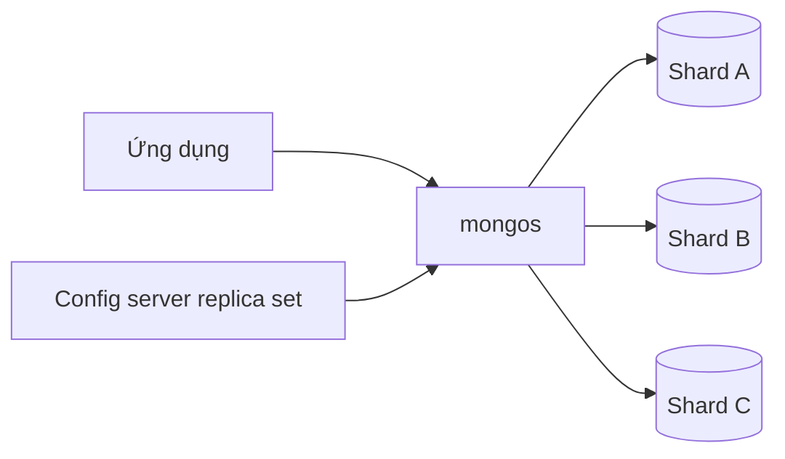

import { Step, Steps } from 'fumadocs-ui/components/steps';

MongoDB và cơ sở dữ liệu quan hệ đều có thể lưu dữ liệu nghiệp vụ, phục vụ ứng dụng giao dịch và chạy báo cáo. Khác biệt quan trọng nằm ở cách mỗi hệ thống tổ chức dữ liệu, biểu diễn quan hệ và phân phối trách nhiệm kiểm tra tính đúng đắn. Vì vậy, không có lựa chọn thắng tuyệt đối cho mọi workload.

<Callout type="info" title="Phạm vi so sánh">
  Trong bài này, “SQL” chỉ nhóm cơ sở dữ liệu quan hệ như PostgreSQL và MySQL, không phải một sản phẩm duy nhất. Cú pháp SQL minh họa dùng phong cách PostgreSQL; các chi tiết về kiểu dữ liệu, isolation và replication có thể khác giữa từng engine. MongoDB cũng có thể dùng schema validation, transaction và join, còn SQL cũng có thể lưu JSON và scale ngang.
</Callout>

## Mục lục

- [Cách đọc so sánh](#cách-đọc-so-sánh)
- [Tóm tắt nhanh](#tóm-tắt-nhanh)
- [Mô hình dữ liệu document và bảng](#mô-hình-dữ-liệu-document-và-bảng)
  - [Ví dụ cùng một miền dữ liệu](#ví-dụ-cùng-một-miền-dữ-liệu)
  - [Embedding và referencing so với chuẩn hóa](#embedding-và-referencing-so-với-chuẩn-hóa)
  - [Trade-off của mỗi mô hình](#trade-off-của-mỗi-mô-hình)
- [Schema và cách kiểm soát cấu trúc](#schema-và-cách-kiểm-soát-cấu-trúc)
  - [Schema linh hoạt và validation trong MongoDB](#schema-linh-hoạt-và-validation-trong-mongodb)
  - [Schema bắt buộc và migration trong SQL](#schema-bắt-buộc-và-migration-trong-sql)
  - [Kết luận thực dụng về schema](#kết-luận-thực-dụng-về-schema)
- [Query và join](#query-và-join)
  - [Truy vấn một aggregate](#truy-vấn-một-aggregate)
  - [Join trong SQL và lookup trong MongoDB](#join-trong-sql-và-lookup-trong-mongodb)
  - [Khi nào join là tín hiệu thiết kế](#khi-nào-join-là-tín-hiệu-thiết-kế)
  - [Gotcha của query](#gotcha-của-query)
- [Transaction và tính nguyên tử](#transaction-và-tính-nguyên-tử)
  - [Atomicity trên một document](#atomicity-trên-một-document)
  - [Giao dịch nhiều document](#giao-dịch-nhiều-document)
  - [So sánh với transaction trong SQL](#so-sánh-với-transaction-trong-sql)
- [Tính nhất quán và độ bền dữ liệu](#tính-nhất-quán-và-độ-bền-dữ-liệu)
  - [Thuật ngữ cần tách bạch](#thuật-ngữ-cần-tách-bạch)
  - [MongoDB chọn mức đảm bảo qua concern](#mongodb-chọn-mức-đảm-bảo-qua-concern)
  - [SQL và isolation](#sql-và-isolation)
  - [Khung chọn mức đảm bảo](#khung-chọn-mức-đảm-bảo)
- [Indexing và kế hoạch truy vấn](#indexing-và-kế-hoạch-truy-vấn)
  - [Điểm chung của index](#điểm-chung-của-index)
  - [Khác biệt đáng chú ý](#khác-biệt-đáng-chú-ý)
  - [Ví dụ index nhất quán với query](#ví-dụ-index-nhất-quán-với-query)
  - [Đo thay vì đoán](#đo-thay-vì-đoán)
- [Scaling và vận hành](#scaling-và-vận-hành)
  - [Scale up và replication](#scale-up-và-replication)
  - [Scale out với sharding và partitioning](#scale-out-với-sharding-và-partitioning)
  - [Trade-off vận hành](#trade-off-vận-hành)
- [Khung ra quyết định](#khung-ra-quyết-định)
  - [Bắt đầu từ workload](#bắt-đầu-từ-workload)
  - [Dấu hiệu nghiêng về MongoDB](#dấu-hiệu-nghiêng-về-mongodb)
  - [Dấu hiệu nghiêng về SQL](#dấu-hiệu-nghiêng-về-sql)
  - [Ma trận quyết định](#ma-trận-quyết-định)
  - [Quy trình thử nghiệm](#quy-trình-thử-nghiệm)
- [Các ngộ nhận thường gặp](#các-ngộ-nhận-thường-gặp)
- [Kết luận](#kết-luận)
- [Đọc tiếp](#đọc-tiếp)

## Cách đọc so sánh

Hãy bắt đầu từ **access pattern**, tức những cách ứng dụng thực sự đọc và ghi dữ liệu, thay vì bắt đầu từ khẩu hiệu “document” hay “table”. Ví dụ, “lấy một đơn hàng cùng các dòng hàng”, “tìm các đơn đã thanh toán của một khách hàng trong 30 ngày” và “tổng hợp doanh thu theo sản phẩm” là ba access pattern khác nhau.

Tiếp theo, liệt kê các **invariant** — điều kiện luôn phải đúng — của nghiệp vụ. Ví dụ, số lượng tồn kho không được âm, một email chỉ thuộc về một tài khoản, và một khoản thanh toán không được ghi nhận hai lần. Cơ sở dữ liệu phù hợp là cơ sở dữ liệu giúp bảo vệ các invariant đó trong đúng ranh giới transaction, với chi phí vận hành mà đội ngũ chấp nhận được.

Nói ngắn gọn: so sánh theo workload, ranh giới nhất quán và cách hệ thống sẽ scale. Đừng kết luận chỉ từ việc một câu query ngắn hơn trong shell.

## Tóm tắt nhanh

| Tiêu chí | MongoDB | Cơ sở dữ liệu SQL | Câu hỏi cần kiểm tra |
| --- | --- | --- | --- |
| Data model | Document BSON, có object lồng nhau và array | Bảng, row, column và khóa | Dữ liệu nào thường được đọc hoặc ghi cùng nhau? |
| Schema | Linh hoạt theo collection, có thể bật JSON Schema validation | Schema và constraint thường được khai báo rõ trong DDL | Schema thay đổi thường xuyên hay invariant cần khóa chặt? |
| Query và join | Query document, aggregation pipeline và `$lookup` | SQL, join và aggregate nhiều bảng | Truy vấn chủ yếu đi trong một aggregate hay xuyên nhiều quan hệ? |
| Transaction | Một document atomic; transaction nhiều document được hỗ trợ | Transaction nhiều row và nhiều bảng là mô hình cốt lõi | Một thao tác phải cập nhật bao nhiêu aggregate? |
| Consistency | Điều chỉnh bằng read concern, write concern, read preference và session | Constraint, transaction và isolation level; replica tùy engine | Đọc chậm hơn có chấp nhận được không? Ghi đã bền sau khi ack chưa? |
| Indexing | Compound, multikey, partial, TTL và các loại index khác | B-tree, partial, expression, covering và các loại theo engine | Index có phục vụ đúng filter, sort và projection không? |
| Scaling | Replica set cho availability, sharding cho phân phối dữ liệu | Scale up, read replica, partitioning, sharding hoặc distributed SQL | Khối lượng ghi có cần phân phối theo nhiều node không? |
| Lựa chọn | Mạnh khi aggregate rõ, dữ liệu lồng nhau và access pattern có thể phân vùng | Mạnh khi quan hệ chặt, constraint và truy vấn ad hoc là trung tâm | Chi phí migration và vận hành nào thấp hơn trong toàn vòng đời? |

## Mô hình dữ liệu document và bảng

MongoDB là cơ sở dữ liệu document. Một **document** là bản ghi dạng BSON — biểu diễn nhị phân của dữ liệu giống JSON, có thêm các kiểu như `ObjectId`, `Date` và `Decimal128`. Các document được nhóm trong **collection**.

Cơ sở dữ liệu quan hệ lưu **row** trong **table**. Mỗi column có kiểu và ràng buộc đã khai báo. Một **primary key** định danh row; một **foreign key** tham chiếu primary key của table khác để biểu diễn quan hệ và bảo vệ tính toàn vẹn tham chiếu. Các quy tắc như vậy thường được gọi là constraint, tức ràng buộc mà database phải kiểm tra.

### Ví dụ cùng một miền dữ liệu

Giả sử ứng dụng bán hàng cần lưu đơn hàng. Trang chi tiết đơn phải hiển thị trạng thái, địa chỉ giao hàng và các dòng hàng. Giá và tên sản phẩm trong hóa đơn là snapshot tại thời điểm mua, nên không được tự đổi khi catalog hiện tại thay đổi.

Trong MongoDB, một document `orders` có thể gom dữ liệu được đọc cùng nhau:

```javascript
{
  _id: ObjectId("64a000000000000000000001"),
  customerId: ObjectId("64a000000000000000000010"),
  status: "paid",
  items: [
    {
      productId: ObjectId("64a000000000000000000100"),
      name: "Bàn phím cơ",
      quantity: 2,
      unitPrice: Decimal128("1490000")
    }
  ],
  shippingAddress: {
    recipient: "Nguyễn An",
    city: "Hồ Chí Minh",
    line1: "12 Nguyễn Huệ"
  },
  createdAt: ISODate("2026-01-15T08:30:00Z")
}
```

`items` và `shippingAddress` được **embedding**, tức là nhúng trực tiếp vào document cha. `customerId` và `items.productId` là reference logic, tức mã trỏ đến document ở collection khác. MongoDB không tự tạo foreign key cho các reference này.

Trong SQL, cùng dữ liệu thường được chuẩn hóa thành nhiều table. “Chuẩn hóa” ở đây là tách dữ liệu dùng chung thành các bảng liên quan để giảm lặp và tránh cập nhật không nhất quán.

```sql
-- Cú pháp phác thảo theo PostgreSQL
CREATE TABLE orders (
  id BIGINT PRIMARY KEY,
  customer_id BIGINT NOT NULL REFERENCES customers(id),
  status TEXT NOT NULL CHECK (status IN ('pending', 'paid', 'shipped', 'cancelled')),
  created_at TIMESTAMPTZ NOT NULL DEFAULT CURRENT_TIMESTAMP
);

CREATE TABLE order_items (
  order_id BIGINT NOT NULL REFERENCES orders(id),
  product_id BIGINT NOT NULL REFERENCES products(id),
  quantity INTEGER NOT NULL CHECK (quantity > 0),
  unit_price NUMERIC(12, 2) NOT NULL CHECK (unit_price >= 0),
  PRIMARY KEY (order_id, product_id)
);
```

Trong thiết kế SQL này, `orders` và `order_items` giữ trạng thái đơn, số lượng và giá snapshot. `products` giữ catalog hiện tại. Ứng dụng dùng `JOIN` để lấy chúng cùng nhau. Nếu một đơn có thể chứa cùng một sản phẩm ở nhiều dòng, khóa chính thực tế nên có thêm `line_no` hoặc dùng một `order_item_id` riêng.

Bài [Document, collection và database](./document-collection-database) giải thích sâu hơn các đơn vị tổ chức dữ liệu của MongoDB. Các kiểu `ObjectId`, `Date` và `Decimal128` được trình bày trong [BSON và kiểu dữ liệu](./bson-va-kieu-du-lieu).

### Embedding và referencing so với chuẩn hóa

Một document lồng nhau thường phù hợp khi các điều kiện sau cùng đúng:

- Dữ liệu con thuộc về một aggregate — cụm dữ liệu thường được đọc và ghi cùng nhau.
- Số phần tử có giới hạn hợp lý.
- Dữ liệu con không cần được nhiều document cha dùng chung.
- Cập nhật cha và con nên có cùng ranh giới atomic.

Ví dụ, địa chỉ giao hàng của một đơn là snapshot của đơn. Nhúng địa chỉ giúp đọc trang chi tiết đơn trong một document và giữ lịch sử nếu khách hàng đổi địa chỉ sau đó.

Reference phù hợp hơn khi dữ liệu có vòng đời độc lập, được tái sử dụng nhiều nơi hoặc có cardinality lớn. **Cardinality** là số lượng phần tử trong một quan hệ. Một khách hàng có thể có hàng nghìn đơn; nhúng toàn bộ đơn vào customer sẽ tạo array tăng không giới hạn. Khi đó, giữ `customerId` trong `orders` giúp truy vấn và phân trang theo đơn dễ hơn.

Trong SQL, chuẩn hóa thường là điểm xuất phát vì mỗi sự kiện hoặc thực thể có một nơi lưu chính. SQL vẫn có thể denormalize — sao chép có chủ đích một số field để đọc nhanh — khi workload chứng minh lợi ích và có cơ chế cập nhật snapshot.

### Trade-off của mỗi mô hình

| Lựa chọn | Lợi ích chính | Chi phí và rủi ro |
| --- | --- | --- |
| Nhúng trong MongoDB | Đọc aggregate trong một lần truy vấn; update một document có tính atomic | Trùng dữ liệu; document có thể phình to; cập nhật cùng dữ liệu ở nhiều nơi khó giữ nhất quán |
| Reference trong MongoDB | Các entity có vòng đời độc lập; kích thước mỗi document ổn định | Cần nhiều truy vấn hoặc `$lookup`; phải tự xử lý reference bị thiếu |
| Chuẩn hóa trong SQL | Constraint và foreign key rõ; sửa một nơi; phù hợp quan hệ phức tạp | Nhiều bảng và join; schema migration cần phối hợp; truy vấn chi tiết có thể cần aggregate |
| Denormalize trong SQL | Giảm join trên đường đọc nóng | Phải đồng bộ bản sao; tăng logic ghi và khả năng dữ liệu cũ |

<Callout type="warn" title="Đừng nhúng array không giới hạn">
  MongoDB giới hạn kích thước một document ở 16 MiB. Quan trọng hơn giới hạn byte là tốc độ tăng của array. Lịch sử sự kiện, log hoặc danh sách bình luận lớn thường nên nằm trong collection riêng và trỏ về document cha. Quy tắc này áp dụng cho thiết kế schema, không chỉ cho hiệu năng.
</Callout>

## Schema và cách kiểm soát cấu trúc

**Schema** là mô tả cấu trúc, kiểu dữ liệu và các quy tắc hợp lệ của dữ liệu. “Schema linh hoạt” không có nghĩa là “không có schema”. Nó có nghĩa là schema có thể được kiểm tra ở nhiều lớp: ứng dụng, validator của database hoặc quy ước của từng collection.

### Schema linh hoạt và validation trong MongoDB

Mặc định, MongoDB cho phép hai document trong cùng collection có field khác nhau. Điều này hữu ích khi thêm field tùy chọn, lưu nhiều biến thể sản phẩm hoặc triển khai thay đổi theo từng bước. Mặt trái là dữ liệu nhập sai kiểu hoặc thiếu field có thể tồn tại nếu ứng dụng không kiểm tra.

Có thể đặt validator bằng JSON Schema để database từ chối document không hợp lệ:

```javascript
db.createCollection("orders", {
  validator: {
    $jsonSchema: {
      bsonType: "object",
      required: ["customerId", "status", "items", "createdAt"],
      properties: {
        customerId: { bsonType: "objectId" },
        status: {
          enum: ["pending", "paid", "shipped", "cancelled"]
        },
        items: {
          bsonType: "array",
          minItems: 1,
          items: {
            bsonType: "object",
            required: ["productId", "quantity", "unitPrice"],
            properties: {
              productId: { bsonType: "objectId" },
              quantity: { bsonType: "int", minimum: 1 },
              unitPrice: { bsonType: "decimal" }
            }
          }
        },
        createdAt: { bsonType: "date" }
      }
    }
  },
  validationLevel: "strict",
  validationAction: "error"
});
```

Validator này kiểm tra shape và kiểu của một order. Nó không kiểm tra `customerId` có tồn tại trong collection `customers` hay không. MongoDB cũng không tự thực hiện foreign key constraint. Nếu invariant đó quan trọng, hãy bảo vệ bằng transaction, logic ứng dụng, quy trình kiểm tra định kỳ hoặc thay đổi mô hình dữ liệu.

Validator áp dụng cho insert và update mới, không tự sửa các document cũ đang sai. Khi thêm validator vào collection hiện có, cần có kế hoạch quét, sửa và theo dõi dữ liệu legacy. Các pattern chi tiết hơn nằm trong [Schema validation](../thiet-ke-du-lieu/schema-validation).

### Schema bắt buộc và migration trong SQL

SQL thường yêu cầu table, column và kiểu dữ liệu tồn tại trước khi insert. `NOT NULL`, `CHECK`, `UNIQUE`, `PRIMARY KEY` và `FOREIGN KEY` biến nhiều invariant thành quy tắc mà database có thể chặn ngay cả khi có bug trong ứng dụng.

Ví dụ, `CHECK (quantity > 0)` ngăn số lượng âm, còn foreign key ngăn một `order_item` trỏ đến order không tồn tại. Đây là lợi thế lớn khi nhiều service hoặc nhiều công cụ cùng ghi vào database.

Đổi lại, thay đổi schema cần migration. Migration là script có phiên bản để thêm column, tạo index, backfill dữ liệu và loại bỏ cấu trúc cũ. Migration tốt thường tương thích ngược trong một giai đoạn: thêm field trước, deploy code đọc cả hai dạng, backfill, rồi mới xóa field cũ. Migration trên bảng lớn cũng có thể giữ lock hoặc tiêu tốn I/O, nên cần thử trên dữ liệu gần production.

SQL không phải lúc nào cũng cứng nhắc. PostgreSQL có `jsonb`, và các engine khác cũng có kiểu JSON. Tuy nhiên, việc đặt JSON trong một column không tự tạo ra foreign key hay constraint cho mọi field bên trong. Hãy so sánh mức kiểm soát thực tế, không chỉ tên gọi của kiểu dữ liệu.

### Kết luận thực dụng về schema

Chọn MongoDB không có nghĩa là bỏ qua schema. Chọn SQL không có nghĩa là mọi thay đổi đều bất khả thi. Câu hỏi thực tế là:

1. Quy tắc nào phải được database bảo vệ?
2. Field nào tùy chọn hoặc thay đổi theo loại document?
3. Ai là writer ngoài service chính?
4. Có chấp nhận giai đoạn dữ liệu cũ và mới cùng tồn tại không?

Nếu câu trả lời cần constraint tham chiếu chặt giữa nhiều entity, SQL thường giảm lượng code bảo vệ. Nếu hình dạng document thay đổi theo loại và aggregate đọc cùng nhau rõ ràng, MongoDB có thể giảm số bảng và migration. Cả hai vẫn cần contract, test và quan sát chất lượng dữ liệu.

## Query và join

MongoDB cung cấp query document cho các điều kiện trên field, object lồng nhau và array. **Aggregation pipeline** là chuỗi stage biến đổi dữ liệu, ví dụ lọc, nhóm, nối hoặc tính toán. SQL là ngôn ngữ khai báo: ứng dụng mô tả kết quả cần lấy, còn query planner chọn cách thực thi.

### Truy vấn một aggregate

Với document order ở trên, MongoDB có thể lọc theo khách hàng và trả về toàn bộ `items` đã nhúng:

```javascript
const customerId = ObjectId("64a000000000000000000010");

db.orders.find(
  {
    customerId,
    status: { $in: ["paid", "shipped"] }
  },
  {
    _id: 1,
    status: 1,
    createdAt: 1,
    items: 1,
    shippingAddress: 1
  }
).sort({ createdAt: -1 }).limit(20);
```

Projection — danh sách field cần trả về — giúp giảm payload, tức lượng dữ liệu truyền về, khi client không cần toàn bộ document. `sort` và `limit` cần index phù hợp nếu đây là query nóng.

Trong SQL, cùng màn hình có thể cần join các dòng hàng và product:

```sql
SELECT
  o.id,
  o.status,
  o.created_at,
  oi.product_id,
  p.name,
  oi.quantity,
  oi.unit_price
FROM orders AS o
JOIN order_items AS oi ON oi.order_id = o.id
JOIN products AS p ON p.id = oi.product_id
WHERE o.customer_id = :customer_id
  AND o.status IN ('paid', 'shipped')
ORDER BY o.created_at DESC
LIMIT 20;
```

Query SQL này trả về một row cho mỗi dòng hàng. Ứng dụng có thể nhóm các row thành JSON, hoặc database có thể dùng các hàm như `json_agg` của PostgreSQL. Vì vậy, “một query” không đồng nghĩa với “một document”: SQL vẫn có thể lấy dữ liệu bằng một round trip, nhưng kết quả trung gian có hình dạng phẳng hơn.

Các toán tử filter, projection và phân trang cơ bản của MongoDB được minh họa thêm trong [Find và projection](../crud-va-truy-van/find-va-projection) và [Query operators](../crud-va-truy-van/query-operators).

### Join trong SQL và lookup trong MongoDB

SQL được thiết kế quanh quan hệ giữa các bảng. Join, outer join, group và window function là các công cụ trưởng thành cho truy vấn ad hoc — truy vấn mới phát sinh từ dữ liệu mà không phải lúc nào cũng biết trước.

MongoDB có thể nối collection bằng `$lookup`. Ví dụ sau lấy tên catalog hiện tại cho từng dòng hàng của order đã thanh toán:

```javascript
db.orders.aggregate([
  { $match: { status: "paid" } },
  { $unwind: "$items" },
  {
    $lookup: {
      from: "products",
      localField: "items.productId",
      foreignField: "_id",
      as: "product"
    }
  },
  { $unwind: "$product" },
  {
    $project: {
      _id: 0,
      orderId: "$_id",
      productId: "$items.productId",
      productName: "$product.name",
      quantity: "$items.quantity"
    }
  }
]);
```

`$lookup` tạo một array kết quả, còn `$unwind` tách array đó thành từng document. Nếu không có product tương ứng, `$lookup` trả array rỗng và `$unwind` mặc định loại kết quả đó. Dùng `preserveNullAndEmptyArrays: true` khi cần giữ dòng không có bản ghi liên quan.

`$lookup` không phải là bằng chứng MongoDB không cần thiết kế quan hệ. Nó có thể phù hợp cho một số màn hình hoặc báo cáo, nhưng cần index trên field được tra cứu, kiểm soát kích thước intermediate result và đo thời gian thực thi. `$lookup` cũng không thay thế việc database tự bảo vệ foreign key.

### Khi nào join là tín hiệu thiết kế

Join thường là tín hiệu nên giữ reference hoặc mô hình chuẩn hóa khi:

- Quan hệ có cardinality lớn hoặc không bị giới hạn.
- Hai entity có vòng đời độc lập và được cập nhật bởi các luồng khác nhau.
- Nhiều query cần kết hợp cùng dữ liệu dùng chung.
- Invariant tham chiếu phải được chặn ở database, không chỉ ở code.
- Báo cáo cần nối nhiều chiều và thay đổi thường xuyên.

Ngược lại, một join lặp lại ở mọi request để lấy dữ liệu luôn đi cùng nhau có thể là dấu hiệu aggregate đang bị tách quá nhỏ. Với MongoDB, embedding có thể làm đường đọc đơn giản hơn. Với SQL, denormalization có kiểm soát hoặc materialized view có thể giảm chi phí join mà vẫn giữ table nguồn chuẩn hóa.

Không nên biến nguyên tắc này thành “MongoDB không được join”. Hãy so sánh tần suất đọc, tần suất cập nhật, kích thước dữ liệu và yêu cầu nhất quán của từng quan hệ.

### Gotcha của query

- **N plus one** là tình huống ứng dụng lấy danh sách cha rồi chạy thêm một query cho từng phần tử con. Nó có thể chậm trong MongoDB lẫn SQL. Hãy dùng embedding, batch query, join hoặc aggregation phù hợp.
- **Projection và `SELECT *`** ảnh hưởng đến bytes truyền, cache và thời gian deserialize. Chỉ đọc field cần dùng.
- **Reference bị mồ côi** có thể xuất hiện trong MongoDB nếu document đích bị xóa trước hoặc thao tác ghi thất bại. Dùng transaction, soft delete hoặc job kiểm tra tùy invariant.
- **Pagination bằng offset lớn** thường phải bỏ qua nhiều bản ghi. MongoDB `skip` lớn và SQL `OFFSET` lớn đều có thể suy giảm. Cursor hoặc keyset pagination dựa trên `createdAt` và `_id` thường ổn định hơn; xem [Cursor, sort, limit và pagination](../crud-va-truy-van/cursor-sort-limit-pagination).
- **Aggregation không tự động nhanh hơn nhiều query nhỏ**. `$match` sớm, giới hạn dữ liệu qua từng stage và dùng `explain` để kiểm chứng.

<Callout type="idea" title="Quy tắc query">
  Thiết kế schema từ những query quan trọng nhất, nhưng vẫn lập danh sách query phụ và báo cáo. Một mô hình tối ưu một màn hình có thể tạo chi phí lớn cho màn hình khác.
</Callout>

## Transaction và tính nguyên tử

**Transaction** là nhóm thao tác được commit cùng nhau hoặc rollback cùng nhau. ACID là bốn thuộc tính thường dùng để mô tả transaction: Atomicity là tất cả hoặc không gì cả; Consistency là giữ invariant; Isolation là không để transaction khác thấy trạng thái trung gian theo mức đã chọn; Durability là dữ liệu đã commit được giữ lại sau lỗi theo mức đảm bảo đã cấu hình.

### Atomicity trên một document

MongoDB đảm bảo thao tác ghi trên một document là atomic. Ví dụ, đổi trạng thái order và thời điểm thanh toán trong cùng document có thể thực hiện bằng một update có điều kiện:

```javascript
const orderId = ObjectId("64a000000000000000000001");

db.orders.updateOne(
  { _id: orderId, status: "pending" },
  {
    $set: {
      status: "paid",
      paidAt: new Date()
    }
  }
);
```

Predicate `status: "pending"` hoạt động như một kiểm tra cạnh tranh lạc quan: chỉ một thao tác chuyển được order từ `pending` sang `paid`. Ứng dụng nên kiểm tra `matchedCount` hoặc `modifiedCount`; kết quả bằng không có thể nghĩa là order không tồn tại hoặc đã được xử lý.

Nếu các field cần thay đổi được embedding trong cùng document, một lần ghi có thể giữ chúng nhất quán mà không cần transaction nhiều document. Đây là lợi thế của việc chọn đúng aggregate. Nó không có nghĩa mọi thao tác trên nhiều collection đều tự động atomic.

### Giao dịch nhiều document

MongoDB hỗ trợ transaction nhiều document trên replica set và sharded cluster. Dùng transaction khi một invariant thật sự chạy qua nhiều document, chẳng hạn trừ tồn kho và đổi trạng thái order. Ví dụ Node.js Driver sau đây giả sử `client`, `db`, `orderId`, `productId` và `quantity` đã được khởi tạo:

```javascript
const session = client.startSession();

try {
  await session.withTransaction(
    async () => {
      const stockUpdate = await db.collection("inventory").updateOne(
        { productId, stock: { $gte: quantity } },
        { $inc: { stock: -quantity } },
        { session }
      );

      if (stockUpdate.modifiedCount !== 1) {
        throw new Error("Insufficient stock");
      }

      const orderUpdate = await db.collection("orders").updateOne(
        { _id: orderId, status: "pending" },
        { $set: { status: "paid", paidAt: new Date() } },
        { session }
      );

      if (orderUpdate.modifiedCount !== 1) {
        throw new Error("Order not found or already processed");
      }
    },
    {
      readPreference: "primary",
      readConcern: { level: "snapshot" },
      writeConcern: { w: "majority" }
    }
  );
} finally {
  await session.endSession();
}
```

`withTransaction` giúp driver xử lý một số retry cần thiết, nhưng code vẫn phải chịu được lỗi tạm thời và commit có kết quả chưa rõ. Không đặt tác dụng phụ bên ngoài database, như gửi email hoặc trừ tiền qua API, trực tiếp trong callback nếu thao tác đó có thể chạy lại. Outbox pattern hoặc idempotency key — khóa giúp cùng một request chạy lại mà không tạo tác dụng phụ lặp — thường phù hợp hơn cho phần tích hợp bên ngoài.

Transaction nhiều document có chi phí về lock, snapshot, bộ nhớ và thời gian chờ. Transaction xuyên shard còn cần phối hợp nhiều node. Hãy ưu tiên mô hình aggregate và thao tác idempotent trước khi mở transaction dài hoặc transaction bao phủ quá nhiều dữ liệu.

### So sánh với transaction trong SQL

Transaction nhiều row và nhiều table là khả năng nền tảng của SQL. Ví dụ PostgreSQL có thể thực hiện luồng trừ kho và tạo order như sau:

```sql
BEGIN;

UPDATE inventory
SET stock = stock - 2
WHERE product_id = 42
  AND stock >= 2;

-- Ứng dụng phải kiểm tra row count bằng 1.
-- Nếu không, thực hiện ROLLBACK và báo hết hàng.

INSERT INTO orders (id, customer_id, status, created_at)
VALUES (10001, 7, 'paid', CURRENT_TIMESTAMP);

INSERT INTO order_items (order_id, product_id, quantity, unit_price)
VALUES (10001, 42, 2, 1490000.00);

COMMIT;
```

SQL thường có hệ thống khóa từng row và constraint tham chiếu phong phú, nên mô hình nhiều bảng tự nhiên hơn. Tuy nhiên, transaction không miễn phí: transaction dài giữ tài nguyên lâu hơn, có thể gây contention — tranh chấp giữa các thao tác đồng thời — và khi dùng isolation cao có thể cần retry.

| Câu hỏi | MongoDB | SQL |
| --- | --- | --- |
| Ranh giới atomic mặc định | Một document | Một transaction có thể bao phủ nhiều row và table |
| Khi có nhiều aggregate | Dùng transaction nhiều document hoặc thiết kế lại aggregate | Dùng `BEGIN` và constraint trong cùng transaction |
| Cách giảm chi phí | Embed dữ liệu thường cập nhật cùng nhau; giữ transaction ngắn | Giữ transaction ngắn; index predicate; chọn isolation phù hợp |
| Rủi ro phổ biến | Transaction dài, retry không idempotent, cross-shard | Deadlock, lock lâu, migration và contention |

Cả hai đều có transaction ACID. Khác biệt là MongoDB khuyến khích chọn ranh giới document để tránh transaction nhiều document, còn SQL làm việc với ranh giới nhiều row một cách tự nhiên hơn.

## Tính nhất quán và độ bền dữ liệu

Từ “consistency” thường bị dùng cho nhiều khái niệm khác nhau. Tách chúng ra giúp chọn đúng cấu hình thay vì bật một tùy chọn rồi kỳ vọng mọi vấn đề biến mất.

### Thuật ngữ cần tách bạch

| Khái niệm | Ý nghĩa thực tế | Ví dụ câu hỏi |
| --- | --- | --- |
| Integrity consistency | Dữ liệu thỏa invariant và constraint | Có order item trỏ đến product không tồn tại không? |
| Read consistency | Một lần đọc thấy phiên bản dữ liệu nào | Sau khi thanh toán, đọc receipt có thấy trạng thái mới không? |
| Isolation | Hai transaction đồng thời nhìn thấy nhau thế nào | Hai request cùng trừ một đơn vị tồn kho có thể làm stock âm không? |
| Durability | Ghi đã ack còn tồn tại sau lỗi node hay không | Mất primary ngay sau response thì dữ liệu có thể mất không? |
| Availability | Hệ thống tiếp tục trả lời khi một phần hỏng | Có chấp nhận chờ failover thay vì trả dữ liệu cũ không? |

Read consistency không thay thế integrity. Một query đọc từ node mới nhất vẫn có thể trả dữ liệu sai nếu ứng dụng đã cho phép reference mồ côi. Tương tự, transaction không tự bảo vệ dữ liệu nếu invariant không được kiểm tra trong điều kiện ghi.

### MongoDB chọn mức đảm bảo qua concern

MongoDB tách ba nhóm lựa chọn:

- **Write concern** quy định server phải chờ đến đâu trước khi xác nhận ghi. `w: 1` chờ primary ghi nhận; `w: "majority"` chờ số node phù hợp trong replica set xác nhận theo chính sách majority. `majority` không đồng nghĩa với mọi loại linearizable read.
- **Read concern** quy định phiên bản dữ liệu mà read được phép thấy. `local` có thể thấy dữ liệu local chưa được majority xác nhận; `majority` chỉ trả dữ liệu đã được majority xác nhận; `snapshot` thường dùng để có snapshot nhất quán trong transaction.
- **Read preference** chọn node để đọc. `primary` đọc từ primary; `secondary` có thể giảm tải primary nhưng có thể thấy replication lag — độ trễ đồng bộ từ primary sang secondary.

Ví dụ đường đọc xác nhận thanh toán có thể đặt rõ mức yêu cầu:

```javascript
await db.collection("orders").updateOne(
  { _id: orderId, status: "pending" },
  { $set: { status: "paid" } },
  { writeConcern: { w: "majority" } }
);

const order = await db.collection("orders").findOne(
  { _id: orderId },
  {
    readConcern: { level: "majority" },
    readPreference: "primary"
  }
);
```

Một feed phân tích có thể đọc secondary và chấp nhận dữ liệu trễ vài giây. Một màn hình vừa báo “đã thanh toán” thường cần read từ primary hoặc dùng session với causal consistency để giữ quan hệ nhân quả giữa ghi và đọc. Cấu hình mặc định phụ thuộc deployment và driver; đường quan trọng nên đặt rõ, đo độ trễ và kiểm thử failover.

Các khái niệm read concern, write concern và read preference được tách riêng trong nhóm [Transactions và consistency](../transactions-va-consistency).

### SQL và isolation

SQL thường kết hợp constraint với transaction isolation. Isolation level là mức cô lập giữa các transaction. Các tên phổ biến gồm:

- `READ COMMITTED`: mỗi câu lệnh thường thấy dữ liệu đã commit tại thời điểm câu lệnh bắt đầu.
- `REPEATABLE READ`: giữ cái nhìn ổn định hơn trong một transaction, nhưng hành vi cụ thể tùy engine.
- `SERIALIZABLE`: cố gắng tạo kết quả tương đương chạy tuần tự; đổi lại có thể tăng conflict và yêu cầu retry.

PostgreSQL, MySQL và các hệ quản trị khác có semantics khác nhau, đặc biệt với phantom read, lock và MVCC. **MVCC**, hay multi-version concurrency control, là kỹ thuật giữ nhiều phiên bản row để reader và writer ít chặn nhau hơn. Không nên suy ra behavior của một engine từ tên isolation level của engine khác.

Read replica SQL cũng thường đồng bộ bất đồng bộ. Nếu ứng dụng đọc từ replica ngay sau khi ghi primary, nó có thể thấy dữ liệu cũ. Cách xử lý cũng giống MongoDB: route read cần mới nhất về primary, dùng cơ chế wait hoặc chấp nhận lag cho workload không quan trọng.

### Khung chọn mức đảm bảo

| Workload | Ưu tiên | Cách tiếp cận có thể phù hợp |
| --- | --- | --- |
| Thanh toán, số dư, tồn kho | Không mất ghi đã xác nhận và không vi phạm invariant | Transaction ngắn; write durable; đọc từ node phù hợp; retry có kiểm soát |
| Trang chi tiết vừa ghi | Read your writes — đọc thấy kết quả của chính lần ghi vừa thực hiện | Primary hoặc session có causal consistency; kiểm tra trạng thái sau retry |
| Feed, search index, dashboard gần realtime | Độ trễ thấp và throughput đọc | Replica hoặc secondary nếu chấp nhận lag; hiển thị timestamp dữ liệu |
| Audit và compliance | Dấu vết không thể âm thầm mất hoặc sửa | Write durable, append-only, quyền truy cập, backup và restore test |

Hãy ghi rõ cho từng endpoint: độ trễ tối đa, mức mất dữ liệu chấp nhận được, có chấp nhận stale read không và lỗi nào phải retry. “Strong consistency” không phải một nhãn đủ chi tiết để thay thế các câu trả lời đó.

## Indexing và kế hoạch truy vấn

**Index** là cấu trúc phụ giúp database tìm hoặc sắp xếp record mà không phải quét toàn bộ dữ liệu. Index thường giảm thời gian đọc, nhưng làm tăng storage và công việc khi insert, update hoặc delete. Một index tốt phục vụ query thực tế; một index thừa vẫn là chi phí.

### Điểm chung của index

MongoDB và SQL đều cần thiết kế index theo ba phần của query:

1. **Filter**: field dùng để lọc.
2. **Sort**: thứ tự cần trả về.
3. **Projection**: field cần đọc; một số engine có thể trả kết quả hoàn toàn từ index nếu index bao phủ đủ dữ liệu.

Selectivity là mức một điều kiện lọc thu hẹp tập bản ghi. Điều kiện chỉ khớp vài bản ghi thường có ích hơn điều kiện khớp gần như cả bảng, nhưng planner vẫn cân nhắc kích thước dữ liệu, sort, cache và cost thực tế.

Cả hai hệ thống đều có query planner, tức bộ phận chọn execution plan — kế hoạch thực thi query. Không nên kết luận “MongoDB không dùng index” hoặc “SQL luôn dùng index” từ một query đơn lẻ. Hãy xem plan trên dữ liệu có phân bố giống production.

### Khác biệt đáng chú ý

MongoDB có compound index trên field lồng nhau và có **multikey index**, tức index được tạo khi field chứa array. MongoDB cũng có partial index, TTL index để tự hết hạn document theo thời gian, text hoặc geospatial index tùy nhu cầu.

SQL thường có B-tree cho so sánh và sort, cùng các loại như partial, expression, hash hoặc GiST tùy engine. SQL cũng có thể index expression hoặc JSON path. Tên và giới hạn của từng loại không hoàn toàn giống MongoDB.

Một compound index có thứ tự field. Quy tắc ESR — Equality, Sort, Range — là heuristics thường hữu ích: đặt điều kiện bằng trước, field sort tiếp theo và range sau. Đây không phải luật tuyệt đối; `$in`, cardinality, collation và projection có thể làm thay đổi lựa chọn. Index `{ customerId: 1, status: 1, createdAt: -1 }` không tương đương với mọi hoán vị của ba field.

### Ví dụ index nhất quán với query

Nếu query nóng thường tìm order của một customer với một status rồi sắp xếp mới nhất, index MongoDB có thể là:

```javascript
db.orders.createIndex(
  { customerId: 1, status: 1, createdAt: -1 },
  { name: "orders_customer_status_created" }
);

db.orders.find(
  { customerId, status: "paid" },
  { _id: 1, status: 1, createdAt: 1, items: 1 }
).sort({ createdAt: -1 }).limit(20);
```

SQL có thể dùng index tương ứng:

```sql
CREATE INDEX orders_customer_status_created_idx
ON orders (customer_id, status, created_at DESC);
```

Index này có thể giúp các query có `customer_id` và `status` cùng sort theo `created_at`. Nếu workload chủ yếu lọc theo `status` mà không có `customer_id`, index này có thể không phải lựa chọn tốt vì `customer_id` là phần đầu. Nếu status có rất ít giá trị, cần đo selectivity — mức điều kiện lọc thu hẹp tập bản ghi — và so sánh với plan quét hoặc index khác.

Unique index của MongoDB và `UNIQUE` của SQL đều giúp chống duplicate, nhưng semantics với `null`, giá trị thiếu và nhiều row có thể khác nhau giữa engine. Với dữ liệu email hoặc key nghiệp vụ, hãy thử đúng các trường hợp thiếu, `null`, khác hoa thường và collation trước khi xem constraint là hoàn tất.

Chi tiết về compound index nằm trong [Compound index](../indexes-va-hieu-nang/compound-index); các loại unique, partial và TTL nằm trong [Unique, partial và TTL index](../indexes-va-hieu-nang/unique-partial-ttl).

### Đo thay vì đoán

MongoDB:

```javascript
db.orders.explain("executionStats").find(
  { customerId, status: "paid" },
  { _id: 1, status: 1, createdAt: 1, items: 1 }
).sort({ createdAt: -1 }).limit(20);
```

SQL PostgreSQL:

```sql
EXPLAIN (ANALYZE, BUFFERS)
SELECT id, status, created_at
FROM orders
WHERE customer_id = 7
  AND status = 'paid'
ORDER BY created_at DESC
LIMIT 20;
```

`executionStats` và `ANALYZE` cho biết số row dự đoán, số row thực tế và cách scan. `EXPLAIN ANALYZE` thực thi query thật; không dùng tùy tiện với `UPDATE`, `DELETE` hoặc statement có tác dụng phụ trên production. Kiểm tra cả cold cache, warm cache, p95 — mốc độ trễ mà 95% request không vượt qua — và tải ghi. [Explain query plan](../indexes-va-hieu-nang/explain-query-plan) có quy trình phân tích chi tiết hơn.

## Scaling và vận hành

**Scale up** là tăng CPU, RAM hoặc I/O cho một node. **Scale out** là thêm node và phân phối workload. Replication — sao chép dữ liệu sang node khác — chủ yếu tăng availability và khả năng phục vụ read, không tự động chia tải ghi. Throughput là số lượng thao tác hệ thống xử lý trong một đơn vị thời gian.

### Scale up và replication

MongoDB replica set có một primary nhận ghi và các secondary sao chép oplog, tức log các thao tác ghi. Khi primary lỗi, một secondary đủ điều kiện có thể được bầu làm primary. Ứng dụng cần xử lý reconnect, retry và thời gian failover.

SQL cũng có mô hình primary với read replica trong nhiều sản phẩm. Read replica có thể giảm tải đọc, nhưng thường có replication lag. Một replica không thay thế backup: lỗi logic hoặc lệnh xóa hợp lệ vẫn có thể được sao chép sang replica.

| Mục tiêu | Cách tiếp cận thường gặp | Giới hạn |
| --- | --- | --- |
| Tăng sức chứa một node | Scale up | Có giới hạn phần cứng và có thể cần downtime hoặc migration |
| High availability | MongoDB replica set hoặc SQL primary standby | Cần failover, backup, restore và kiểm thử định kỳ |
| Tăng throughput đọc | Secondary hoặc read replica | Có thể stale; query route và consistency phải rõ |
| Tăng throughput ghi | Phân vùng dữ liệu hoặc nhiều writer theo kiến trúc | Cần partition key hoặc shard key tốt; xung đột và vận hành phức tạp hơn |

Các khái niệm replica set, election và failover được trình bày trong [Replica set](../replication-va-sharding/replica-set) và [Election và failover](../replication-va-sharding/election-failover).

### Scale out với sharding và partitioning

MongoDB **sharding** phân phối document trên nhiều shard dựa vào shard key. Router `mongos` dùng shard key để gửi query đến shard phù hợp. Nếu query không có điều kiện shard key, router có thể phải gửi query đến nhiều shard rồi tổng hợp kết quả. Đây là scatter gather — fan out đến nhiều node — và thường tốn tài nguyên hơn query targeted.



Một shard key tốt cần phân bố đều, có cardinality đủ cao và xuất hiện trong query quan trọng. Key tăng tuần tự có thể tạo hotspot — một shard nhận phần lớn ghi mới. Key ngẫu nhiên giúp phân bố ghi nhưng có thể làm query theo thời gian kém targeted. Chọn shard key là quyết định khó đổi, nên xem [Chọn shard key](../replication-va-sharding/chon-shard-key) trước khi scale production.

SQL **partitioning** chia một table thành các partition, thường theo range thời gian hoặc hash, nhưng không nhất thiết đặt partition trên nhiều server. Scale ngang SQL có thể dùng sharding ở tầng ứng dụng, extension như distributed SQL hoặc một engine được thiết kế cho nhiều node. Vì vậy, câu “SQL không scale ngang” là không chính xác; câu hỏi đúng là sản phẩm và kiến trúc cụ thể phân phối dữ liệu, transaction và query như thế nào.

### Trade-off vận hành

MongoDB thường làm cho việc phát triển một aggregate và mở rộng theo shard key trực quan hơn. Nhưng team phải vận hành replica set, balancer, shard key, query routing, resharding và các query cross-shard.

SQL thường có hệ sinh thái constraint, migration, BI và công cụ phân tích trưởng thành. Khi scale một table lớn, team có thể phải xử lý lock migration, vacuum hoặc bloat tùy engine, partition maintenance, connection pool và chiến lược read replica. Distributed SQL giảm một số công việc phân mảnh nhưng thêm topology, cost và giới hạn riêng.

<Callout type="warn" title="Replication không phải backup">
  Giữ nhiều bản sao giúp chịu lỗi node, nhưng không giúp khôi phục dữ liệu bị xóa nhầm hoặc bị mã hóa bởi credential bị lộ. Cả MongoDB và SQL đều cần backup có phiên bản, retention phù hợp và bài kiểm tra restore định kỳ.
</Callout>

## Khung ra quyết định

Không nên chọn database từ nhãn “structured” hay “unstructured”. Dữ liệu sản phẩm, order hoặc user profile có thể được biểu diễn ở cả hai. Hãy chấm điểm theo query, invariant, latency, scale và khả năng đội ngũ vận hành.

### Bắt đầu từ workload

Hãy viết một bảng workload tối thiểu gồm:

- Tỷ lệ đọc và ghi, kích thước payload và kích thước document hoặc row theo p50, p95 và p99. Đây là các percentile: p50 là trung vị, p95 là mốc mà 95% request không vượt qua và p99 là mốc mà 99% request không vượt qua.
- Các query quan trọng nhất, filter, sort, join, aggregation và tần suất của chúng. Ghi rõ mục tiêu độ trễ (latency) của từng query.
- Invariant cần bảo vệ, ranh giới transaction và hành vi khi retry.
- Tăng trưởng dữ liệu, retention, burst traffic và key có thể gây hotspot.
- Mức stale read chấp nhận được, RPO — lượng dữ liệu tối đa có thể mất — và RTO — thời gian khôi phục mục tiêu.
- Kỹ năng đội ngũ, công cụ quan sát, backup, migration và chi phí dịch vụ.

Ví dụ, “order detail” có thể nghiêng về document nếu luôn đọc toàn bộ order cùng items, items có giới hạn và product name là snapshot. “Báo cáo doanh thu theo customer, product, region và tháng với bộ lọc thay đổi liên tục” có thể nghiêng về SQL hoặc một hệ thống phân tích riêng, vì join và aggregate là trung tâm.

### Dấu hiệu nghiêng về MongoDB

MongoDB là ứng viên tốt để thử trước khi phần lớn điều kiện sau đúng:

- Dữ liệu có aggregate rõ và thường được đọc cùng nhau.
- Field lồng nhau hoặc biến thể theo loại document thay đổi thường xuyên.
- Nhiều thao tác có thể giữ atomic trong một document.
- Query chính có thể định tuyến theo một partition hoặc shard key ổn định.
- Ứng dụng cần scale theo document và muốn giảm lớp join cho đường đọc nóng.
- Đội ngũ đã quen với BSON, aggregation, replica set và cách kiểm soát schema bằng validator cùng application contract.

Đây chỉ là tín hiệu, không phải checklist đủ để quyết định. Nếu cùng workload đó có nhiều quan hệ many-to-many, báo cáo ad hoc hoặc invariant xuyên nhiều document, lợi thế có thể biến mất.

### Dấu hiệu nghiêng về SQL

SQL là ứng viên tốt để thử trước khi phần lớn điều kiện sau đúng:

- Quan hệ giữa entity là trọng tâm và có nhiều quan hệ many-to-many, tức nhiều-nhiều.
- Foreign key, unique, check và constraint phải được database bảo vệ độc lập với application code.
- Transaction thường cập nhật nhiều row hoặc nhiều table.
- Người dùng hoặc analyst cần query ad hoc, join và aggregate đa chiều.
- Hệ sinh thái SQL, BI, migration và kỹ năng đội ngũ đã là nền tảng chính.
- Workload có thể scale bằng scale up, read replica, partitioning hoặc một sản phẩm distributed SQL phù hợp.

SQL không tự động thắng mọi workload giao dịch. Nhiều bảng với join sâu, index sai hoặc transaction dài vẫn có thể chậm. Lợi thế ở đây là mô hình quan hệ và công cụ constraint phù hợp tự nhiên với bài toán.

### Ma trận quyết định

Dùng ma trận dưới đây để mở cuộc thảo luận. Cột “ứng viên ban đầu” không phải phán quyết; benchmark và prototype phải xác nhận.

| Nhu cầu chính | Ứng viên ban đầu | Lý do cần kiểm chứng |
| --- | --- | --- |
| Đọc một aggregate lớn nhưng có giới hạn, schema biến thể | MongoDB | Kích thước document, update một phần và migration dữ liệu cũ |
| Nhiều join, foreign key và báo cáo tùy biến | SQL | Execution plan, partitioning và chi phí index khi dữ liệu tăng |
| Inventory hoặc balance cập nhật nhiều entity | Cả hai | Ranh giới transaction, retry, lock hoặc write conflict |
| Feed cần throughput cao và chấp nhận lag nhỏ | Cả hai | Read routing, cache, replica lag và khả năng rebuild read model |
| Dữ liệu cần phân phối theo tenant hoặc region | Cả hai | Key có phân bố đều, query targeted và compliance theo vùng |
| Team nhỏ cần ít thành phần vận hành | Dịch vụ được team thành thạo nhất | Managed service không xóa nhu cầu backup, alert và restore test |

Nếu hai lựa chọn đều đáp ứng, chọn hệ thống mà đội ngũ debug, migrate và khôi phục tốt hơn. Chi phí sự cố và migration trong ba năm thường lớn hơn chênh lệch benchmark ban đầu.

### Quy trình thử nghiệm

Prototype nên dùng dữ liệu có phân bố, độ dài và tỷ lệ hot key gần production. Một vòng thử nghiệm có thể đi theo các bước sau:

<Steps>
<Step>
**1. Ghi lại workload thật**

Lấy query từ log hoặc yêu cầu nghiệp vụ. Ghi read/write ratio, kích thước kết quả, latency target và số request đồng thời. Đừng chỉ benchmark insert tuần tự nếu production chủ yếu là read theo customer và sort theo thời gian.
</Step>
<Step>
**2. Xây hai mô hình tương đương**

Trong MongoDB, thử embedding và reference có chủ đích. Trong SQL, thử schema chuẩn hóa và chỉ denormalize khi có lý do. Dùng cùng dữ liệu, cùng quy tắc giá snapshot và cùng kịch bản lỗi.
</Step>
<Step>
**3. Tạo index rồi đọc execution plan**

Đo `explain` của MongoDB và `EXPLAIN ANALYZE` của SQL. So sánh p95, bytes đọc, số row hoặc document examined, chi phí ghi thêm index và hành vi khi cache lạnh.
</Step>
<Step>
**4. Kiểm thử failure và concurrency**

Thử primary restart, replica lag, duplicate request, timeout sau khi server đã commit, transaction conflict và retry. Kiểm tra invariant sau mỗi kịch bản, không chỉ kiểm tra HTTP status.
</Step>
<Step>
**5. Tính tổng chi phí sở hữu**

Tính storage, backup, network, observability, on-call, migration, restore và thời gian học. Ghi rõ giới hạn của managed service và các thao tác vẫn phải tự vận hành.
</Step>
</Steps>

Sau prototype, quyết định nên được ghi lại cùng các giả định: query nào là critical, mức consistency nào cần, shard hoặc partition key là gì, và điều kiện nào khiến team xem xét đổi mô hình. Một quyết định có giả định rõ dễ kiểm tra lại hơn một khẩu hiệu “MongoDB nhanh hơn SQL”.

## Các ngộ nhận thường gặp

- **“MongoDB không có schema.”** MongoDB cho phép schema linh hoạt, nhưng vẫn có document shape, application contract và JSON Schema validator. Không kiểm soát schema chỉ là một lựa chọn rủi ro, không phải đặc tính bắt buộc.
- **“MongoDB không hỗ trợ transaction.”** Ghi một document đã atomic từ lâu; transaction nhiều document cũng được hỗ trợ. Tuy nhiên, transaction dài hoặc cross-shard vẫn có chi phí.
- **“SQL không thể scale ngang.”** Read replica, partitioning, sharding ở ứng dụng và distributed SQL đều tồn tại. Cần so sánh engine và topology cụ thể.
- **“NoSQL luôn nhanh hơn.”** MongoDB có thể nhanh hơn cho access pattern document phù hợp. Join, `$lookup`, index sai, payload lớn hoặc shard key xấu vẫn gây chậm.
- **“Có thể thay mọi join bằng embedding.”** Embedding một quan hệ tăng không giới hạn hoặc cập nhật độc lập sẽ tạo document phình to và dữ liệu trùng khó đồng bộ.
- **“`w: \"majority\"` làm mọi read tuyến tính.”** Write concern nói về điều kiện xác nhận ghi. Read concern, read preference, session và semantics của từng thao tác vẫn cần được chọn riêng.
- **“Thêm index là luôn tốt.”** Index tăng tốc một số query nhưng làm ghi, storage và cache đắt hơn. Chỉ giữ index có workload và execution plan chứng minh giá trị.

## Kết luận

MongoDB và SQL đều có thể xây hệ thống production đáng tin cậy. MongoDB thường nổi bật khi aggregate document là đơn vị đọc ghi tự nhiên, schema có biến thể và dữ liệu có thể phân phối theo shard key. SQL thường nổi bật khi quan hệ, constraint, transaction nhiều bảng và query phân tích ad hoc là trung tâm.

Điểm quyết định không phải database có “schema” hay “transaction”, mà là cách mô hình dữ liệu làm rõ invariant, query và failure mode. Hãy chọn từ workload thật, đo trên dữ liệu thật và tính cả chi phí vận hành, backup, migration cùng năng lực đội ngũ.

## Đọc tiếp

Các trang sau giúp nối phần so sánh này với thiết kế và vận hành cụ thể trong series:

<Cards>
  <Card
    title="Embedding và referencing"
    href="/docs/thiet-ke-du-lieu/embedding-vs-referencing"
    description="Chọn nhúng hay tham chiếu dựa trên access pattern, cardinality và vòng đời dữ liệu."
  />
  <Card
    title="Nguyên tắc thiết kế schema"
    href="/docs/thiet-ke-du-lieu/schema-design-principles"
    description="Thiết kế schema MongoDB từ query, kích thước document và yêu cầu cập nhật."
  />
  <Card
    title="Multi-document transactions"
    href="/docs/transactions-va-consistency/multi-document-transactions"
    description="Thiết kế và vận hành transaction nhiều document trong MongoDB."
  />
  <Card
    title="Compound index"
    href="/docs/indexes-va-hieu-nang/compound-index"
    description="Chọn thứ tự field và kiểm chứng compound index bằng execution plan."
  />
</Cards>
